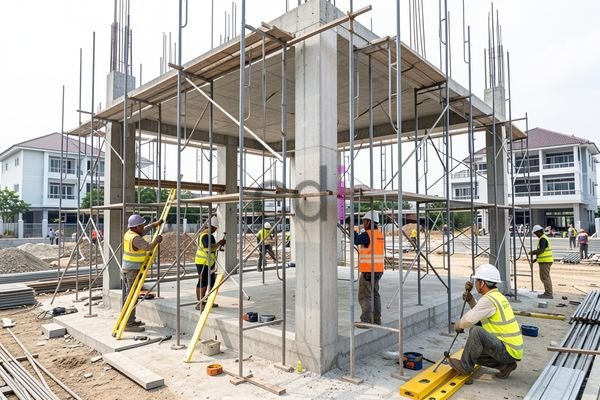

**Cara Pasang Scaffolding yang Aman dan Efisien: Panduan Lengkap 2026** - Hai Mitra CDI! Pernahkah Anda merasakan kesulitan saat proyek konstruksi memerlukan akses ke area tinggi? Atau mungkin Anda khawatir tentang keselamatan tim saat bekerja di ketinggian? Kami memahami betul hal ini. *Scaffolding*, atau perancah, adalah solusi yang tepat untuk meningkatkan efisiensi dan keamanan. Tetapi, pemasangan yang kurang tepat justru bisa jadi sumber bahaya. Oleh karena itu, mari kita pelajari bersama cara memasang *scaffolding* yang aman dan efektif di (not detected).

## Mengenal Berbagai Jenis Scaffolding untuk Kebutuhan Proyek Anda

Mitra, sebelum kita mulai membahas detail pemasangan, penting untuk memahami berbagai jenis *scaffolding* yang tersedia. Memilih jenis yang tepat sesuai kebutuhan akan mengoptimalkan kinerja dan meminimalkan risiko. Ada beberapa pilihan umum, di antaranya:

*   **Scaffolding Frame:** Pilihan paling populer karena mudah dipasang dan fleksibel. Terdiri dari rangka baja yang dihubungkan dengan *coupler*.
*   **Scaffolding System:** Cocok untuk proyek yang lebih kompleks dan memerlukan adaptasi terhadap area yang tidak beraturan.
*   **Scaffolding Suspended:** Ideal untuk pekerjaan di ketinggian bangunan tinggi, di mana pemasangan dari bawah tidak memungkinkan.

Pertimbangkan dengan cermat jenis pekerjaan, tinggi bangunan, dan kondisi lingkungan di (not detected) saat memilih *scaffolding*. Jangan lupakan juga kapasitas beban yang harus ditanggung.

## Panduan Langkah Demi Langkah Memasang Scaffolding yang Tepat

Mitra CDI, pemasangan *scaffolding* yang aman dan efisien membutuhkan perencanaan matang dan eksekusi yang presisi. Berikut adalah langkah-langkah yang perlu Anda ikuti:

1.  **Persiapan Awal:** Bersihkan area kerja dari segala hambatan dan pastikan semua komponen *scaffolding* lengkap. Periksa kondisi setiap bagian – pastikan tidak ada kerusakan atau korosi.
2.  **Pemasangan Base Plate:** Tempatkan *base plate* di permukaan yang rata dan stabil. Gunakan *adjustable base jack* jika permukaan tidak rata untuk menjaga keseimbangan.
3.  **Pemasangan Standar:** Pasang standar (tiang vertikal) di atas *base plate*. Pastikan posisinya tegak lurus dan terkunci dengan aman.
4.  **Pemasangan Ledger:** Hubungkan standar dengan *ledger* (balok horizontal) menggunakan *coupler*. Periksa kembali agar terpasang dengan kuat dan rata.
5.  **Pemasangan Bracing:** Tambahkan *bracing* (penyangga diagonal) untuk meningkatkan stabilitas *scaffolding*. Pastikan dipasang secara silang dan terkunci dengan sempurna.
6.  **Pemasangan Decking:** Letakkan *decking* (lantai kerja) di atas *ledger*. Pastikan terpasang rapat dan aman sebelum digunakan.

## Prioritaskan Keselamatan: Tips Penting Saat Pemasangan dan Penggunaan

Keselamatan adalah hal utama yang harus diperhatikan dalam setiap tahapan pemasangan dan pemakaian *scaffolding*. Mitra CDI, berikut adalah beberapa tips penting:

*   **Wajib Gunakan APD:** Pastikan setiap pekerja menggunakan helm, *safety harness*, dan sepatu *safety* tanpa terkecuali.
*   **Inspeksi Rutin:** Lakukan pemeriksaan berkala untuk memastikan semua komponen *scaffolding* dalam kondisi baik dan terpasang dengan benar.
*   **Perhatikan Batas Beban:** Jangan membebani *scaffolding* melebihi kapasitas maksimumnya. Biasanya informasi ini tertera pada label *scaffolding*.
*   **Pencahayaan yang Cukup:** Jika bekerja di malam hari atau area minim cahaya, pastikan pencahayaan memadai untuk mencegah kecelakaan.
*   **Pemasangan Railing & Toe Board:** Pasang *railing* dan *toe board* di sekeliling area kerja untuk mencegah pekerja terjatuh.

Sebagai referensi, harga sewa *scaffolding* di wilayah (not detected) dan sekitarnya pada tahun 2026 berkisar antara Rp 35.000 hingga Rp 75.000 per meter persegi per bulan, tergantung pada jenis dan lama sewa. Untuk informasi detail dan penawaran yang disesuaikan dengan proyek Anda, silakan lihat tabel harga di atas atau  hubungi Kami.

## Perawatan Scaffolding: Investasi untuk Keamanan dan Umur Pakai Jangka Panjang

Mitra CDI, jangan lupakan pentingnya perawatan setelah *scaffolding* digunakan. Lakukan pembersihan rutin untuk menghilangkan kotoran dan debu yang bisa memicu korosi. Simpan di tempat kering dan terlindung dari cuaca ekstrem. Jika ada kerusakan, segera perbaiki atau ganti bagian yang rusak. Dengan perawatan yang baik, *scaffolding* Anda akan lebih awet dan aman digunakan.

Kami siap menjadi mitra terpercaya Anda dalam menyediakan solusi *scaffolding* berkualitas di (not detected). Jangan ragu untuk menghubungi Kami melalui tombol **Telepon** atau **WhatsApp** di bawah ini — Kami siap membantu!  Jangan lewatkan juga artikel terkait lainnya seperti [Biaya Dak Rumah: Estimasi, Faktor Pengaruh, dan Tips Efisien 2026](/blog/biaya-dak-rumah/) untuk perencanaan anggaran yang lebih matang. [Berapa Luas Cakupan 1 Set Scaffolding? Ini Penjelasannya!](/blog/1-set-scaffolding-berapa-m2/) juga bisa menjadi panduan tambahan yang berguna.