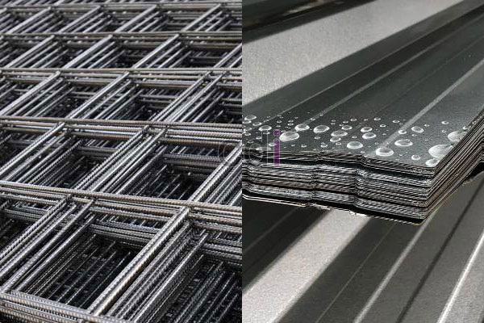

**Cara Pemasangan Bondek dan Wiremesh yang Benar: Panduan Lengkap 2026** - Halo Mitra CDI! Punya proyek konstruksi di (not detected) dan ingin memastikan kekuatan dak betonnya? Seringkali, kualitas hasil pengecoran sangat ditentukan oleh detail pemasangan, khususnya pada bagian bondek dan *wiremesh*. Kesalahan kecil bisa berakibat fatal, mulai dari retak hingga konstruksi yang kurang aman.

Nah, artikel ini hadir untuk memandu Anda, Mitra CDI, melalui seluruh proses pemasangan bondek dan *wiremesh* yang benar. Kami akan kupas tuntas langkah-langkahnya, mulai dari persiapan material hingga standar kualitas yang harus dipenuhi. Dengan panduan ini, kami yakin Anda bisa menciptakan fondasi dak beton yang kokoh dan tahan lama di (not detected).

## Memastikan Fondasi Kuat: Pemilihan Material & Perhitungan Akurat

Sebelum memulai pemasangan, kualitas material adalah kunci. Bondek yang tersedia di pasaran—biasanya terbuat dari baja galvanis atau galvalume—memiliki variasi ketebalan dan lebar. Pilih yang sesuai dengan beban yang akan ditanggung bangunan Anda. Biasanya, ketebalan bondek berkisar antara 0.75 mm hingga 1.2 mm. Pertimbangkan juga lapisan pelindung anti-korosi yang memadai.

Selain itu, perhitungan kebutuhan *wiremesh* harus presisi. Ukuran yang umum digunakan memiliki diameter kawat 6 mm hingga 12 mm, dengan jarak antar kawat 150 mm x 150 mm atau 200 mm x 200 mm. Jangan ragu berkonsultasi dengan ahli sipil untuk perhitungan struktur yang akurat, ya. Kesalahan perhitungan bisa berdampak besar pada kekuatan bangunan.

## Proses Pemasangan Bondek: Langkah Demi Langkah

Langkah pertama, pastikan permukaan beton bawah bersih dari debu, kotoran, dan minyak. Bondek kemudian dipasang secara merata, dengan overlap antar lembaran minimal 50 mm—ini penting untuk mencegah pergeseran.

Agar bondek terpasang dengan aman, gunakan *screw* atau baut khusus bondek. Alat ini berfungsi mengamankan posisi bondek pada struktur bawah. Pasang *screw* dengan jarak yang sesuai dan kencangkan dengan baik. [Untuk tips persiapan lebih detail, Anda bisa menyimak artikel kami tentang [Atap Bondek Cor: Panduan Lengkap Kekuatan, Pemasangan, dan Estimasi Biaya 2026](/blog/atap-bondek-cor/)] yang membahasnya secara mendalam.

## Pemasangan Wiremesh: Menjamin Tulangan Optimal

Setelah bondek terpasang stabil, saatnya memasang *wiremesh*. Letakkan *wiremesh* di atas bondek, pastikan seluruh permukaan bondek tertutup oleh tulangan. Gunakan *spacer* atau ganjal setinggi 20-30 mm untuk menjaga jarak antara *wiremesh* dan bondek. Jarak ini memungkinkan beton mengalir dan menutupi *wiremesh* secara sempurna, sekaligus melindunginya dari korosi.

Untuk menyambung lembaran *wiremesh*, gunakan kawat bendrat atau *overlap* minimal 20-30 kali diameter kawat. Pastikan sambungan kokoh dan aman. Hindari pengelasan, karena dapat mengurangi kekuatan *wiremesh*.

## Mengikuti Standar SNI dan Perkiraan Biaya Pemasangan

Pemasangan bondek dan *wiremesh* harus sesuai standar SNI 03-3976-2005 tentang Baja Tulangan Beton. Standar ini mengatur mutu material, dimensi, dan cara pemasangan yang benar. Kami sangat menyarankan penggunaan material bersertifikasi SNI untuk kualitas dan keamanan terjamin.

Estimasi biaya pemasangan bondek dan *wiremesh* bervariasi tergantung luas area, ketebalan bondek, ukuran *wiremesh*, dan lokasi proyek di (not detected). Secara umum, harga per meter persegi berkisar antara Rp 150.000 hingga Rp 300.000. Harga ini hanyalah perkiraan, jadi untuk penawaran yang paling akurat, segera hubungi Kami untuk informasi lebih lanjut. 

Sebagai perbandingan, berikut rincian material pelindung bondek yang perlu Anda pertimbangkan:

<table class="table">
  <caption>Perbandingan Material Pelindung Bondek</caption>
  <thead>
    <tr><th>Material</th><th>Kelebihan</th><th>Kekurangan</th><th>Estimasi Harga (per m2)</th></tr>
  </thead>
  <tbody>
    <tr><td>Galvanis</td><td>Tahan korosi cukup baik</td><td>Kurang tahan terhadap lingkungan asam</td><td>Rp 120.000 - Rp 180.000</td></tr>
    <tr><td>Galvalume</td><td>Tahan korosi sangat baik</td><td>Harga lebih mahal</td><td>Rp 150.000 - Rp 250.000</td></tr>
  </tbody>
</table>

Dengan mengikuti panduan ini dan mengutamakan material berkualitas, Anda bisa meningkatkan kualitas dan kekuatan dak beton di (not detected) secara signifikan. Ingin tahu lebih banyak tentang memilih *wiremesh* yang tepat? [Pelajari lebih lanjut tentang memilih wiremesh yang tepat di artikel kami: Cara Memilih Wiremesh Yang Benar & Berkualitas] akan sangat membantu!

Butuh bantuan profesional untuk memastikan pekerjaan Anda optimal? Tim Kami siap membantu mewujudkan proyek Anda. Hubungi Kami melalui tombol **Telepon** atau **WhatsApp** yang tersedia di bawah. Jangan tunda lagi, ya!