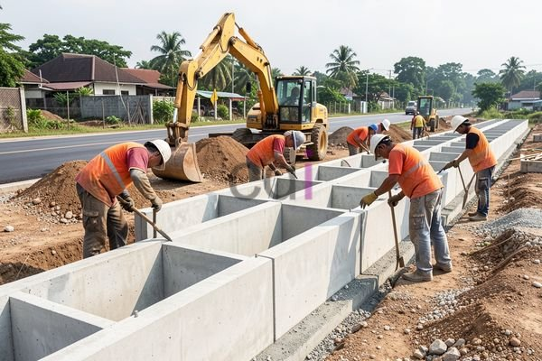

**Cara Pemasangan Saluran U Ditch: Panduan Lengkap dan Biaya 2026** - Halo Mitra CDI! Bingung bagaimana mengatasi masalah genangan air yang sering melanda area kita? Mungkin sistem drainase yang ada perlu ditingkatkan. Nah, saluran U ditch bisa jadi solusi efektif untuk mengalirkan air hujan dan limbah dengan baik. Artikel ini akan membahas tuntas cara pemasangan saluran U ditch yang benar, dari perencanaan hingga estimasi biayanya. Yuk, simak panduan lengkapnya!

### Apa Itu Saluran U Ditch dan Mengapa Penting?

Saluran U ditch adalah sistem drainase terbuka berbentuk huruf U, umumnya terbuat dari beton. Bentuknya yang sederhana namun efektif menjadikannya pilihan populer untuk mengelola aliran air di berbagai lingkungan – mulai dari perumahan, perkantoran, hingga fasilitas publik di (not detected). Fungsi utamanya adalah mengalirkan air hujan atau limbah cair menuju tempat pembuangan yang aman.

Ada beberapa tipe saluran U ditch yang tersedia. Kita bisa memilih saluran beton pracetak dengan ukuran beragam, atau opsi dicor di lokasi yang memberi fleksibilitas desain lebih besar. Ada pula varian yang dilengkapi penutup untuk meningkatkan keamanan dan mencegah sampah masuk ke dalam saluran.

### Panduan Langkah Demi Langkah Pemasangan Saluran U Ditch

Pemasangan saluran U ditch yang optimal memerlukan perencanaan mendetail dan eksekusi yang cermat. Simak panduan berikut:

1.  **Perencanaan Awal dan Desain:** Tentukan tata letak saluran yang ideal. Perhatikan kontur tanah, perkiraan volume air, dan lokasi pembuangan akhir. Desain harus memenuhi standar drainase yang berlaku dan mempertimbangkan dampak lingkungan.
2.  **Proses Penggalian:** Setelah desain final, lakukan penggalian sesuai dimensi saluran. Pastikan dimensi penggalian sesuai spesifikasi yang sudah dibuat.
3.  **Pembuatan Lapisan Dasar:** Siapkan lantai dasar saluran dengan lapisan pasir urug yang dipadatkan. Pastikan ketebalan pasir urug minimal 10 cm dan dipadatkan menggunakan alat pemadat tanah. Ini penting untuk fondasi saluran yang stabil.
4.  **Penempatan Unit Saluran:** Letakkan unit saluran U ditch di atas lapisan dasar yang sudah dipersiapkan. Pastikan setiap unit terpasang rapat dan sejajar. Gunakan peralatan pengangkat yang sesuai untuk menghindari kerusakan.
5.  **Proses Penyambungan:** Sambungkan setiap unit saluran U ditch menggunakan mortar beton atau perekat khusus yang berkualitas. Pastikan sambungan tertutup rapat dan kuat untuk mencegah resiko kebocoran. Beberapa jenis saluran dilengkapi sistem penguncian yang perlu diperhatikan.
6.  **Pemasangan Penutup (Jika Diperlukan):** Jika dibutuhkan, pasang penutup saluran U ditch. Penutup bisa berupa beton bertulang, besi cor, atau material lain yang sesuai kebutuhan. Pastikan pemasangan penutup aman dan kokoh.
7.  **Pengurugan dan Pemadatan Kembali:** Urug kembali tanah di sekitar saluran U ditch dengan material yang sesuai. Lakukan pemadatan bertahap untuk menjaga stabilitas struktur dan mencegah pergeseran.

### Memilih Material Berkualitas dan Estimasi Biaya

Kualitas material sangat memengaruhi performa dan usia pakai saluran U ditch. Untuk material beton pracetak, pastikan mutu beton minimal K-300 dan sudah bersertifikasi SNI. Pemilihan material yang tepat akan mengurangi potensi kerusakan dan biaya perawatan di masa depan.

Berikut perkiraan biaya pemasangan saluran U ditch per meter (harga ini hanya estimasi, untuk penawaran harga yang akurat sesuai kebutuhan proyek Anda di (not detected), silakan hubungi tim Kami):

| Ukuran Saluran U Ditch | Harga Material (Rp/unit) | Biaya Pemasangan (Rp/meter) | Estimasi Total (Rp/meter) |
|---|---|---|---|
| 30 cm x 30 cm | Rp 150.000 | Rp 80.000 | Rp 230.000 |
| 40 cm x 40 cm | Rp 200.000 | Rp 100.000 | Rp 300.000 |
| 50 cm x 50 cm | Rp 250.000 | Rp 120.000 | Rp 370.000 |

Angka di atas belum termasuk biaya penggalian, pengurugan, dan pemasangan penutup saluran. Biaya tambahan bisa saja muncul tergantung kondisi lokasi dan tingkat kesulitan pekerjaan.

### Tips Sukses Memasang Saluran U Ditch

Agar pemasangan saluran U ditch berjalan lancar dan hasilnya memuaskan, perhatikan tips berikut ini:

*   **Perhatikan Kemiringan yang Tepat:**  Kemiringan saluran sangat berpengaruh pada aliran air. Idealnya, kemiringan sekitar 0,5% - 1%.
*   **Pilih Material Berkualitas SNI:** Gunakan material yang kuat, tahan lama, dan sudah teruji sesuai standar SNI.
*   **Pastikan Sambungan Tertutup Sempurna:** Sambungan yang rapat mencegah kebocoran dan memastikan efisiensi sistem drainase.
*   **Konsultasi dengan Profesional:** Jika ragu, jangan sungkan berkonsultasi dengan ahli konstruksi atau spesialis drainase.
*   **Lakukan Perawatan Rutin:** Bersihkan saluran secara berkala dari kotoran dan sedimentasi agar aliran air tetap lancar.

Butuh bantuan untuk proyek Anda? Tim Kami dengan senang hati siap membantu. Hubungi Kami melalui tombol **Telepon** atau **WhatsApp** di bawah ini untuk konsultasi dan penawaran terbaik. Jangan tunda lagi, atasi masalah genangan air dengan saluran U ditch yang tepat! [Apa Itu Dak Dalam Bangunan? Fungsi, Jenis, dan Biaya Pemasangan 2026](/blog/apa-itu-dak-dalam-bangunan/) — Mungkin Anda juga tertarik dengan informasi mengenai dak bangunan, khususnya untuk area (not detected).