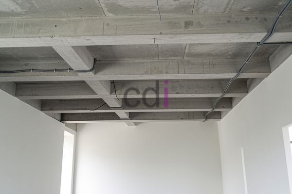

**Cara Pembesian Balok Gantung: Panduan Lengkap & Praktis 2026** - Hai Mitra CDI! Ingin menciptakan kesan modern dan lapang pada bangunan Anda? Balok gantung bisa menjadi jawabannya! Struktur ini menawarkan kebebasan desain yang menarik, namun kekuatan dan keamanannya sangat bergantung pada pembesian yang tepat. Yuk, simak panduan lengkap ini untuk memastikan balok gantung Anda kokoh dan tahan lama.

### Mengapa Balok Gantung Jadi Pilihan? Keunggulan dan Aplikasinya

Balok gantung adalah elemen beton bertulang yang unik, menonjol keluar tanpa penyangga vertikal di bawahnya. Konsep ini menghadirkan sejumlah keuntungan: ruang terbuka yang luas, desain yang fleksibel, dan tampilan arsitektur yang kontemporer. Umumnya, kita melihatnya diaplikasikan pada balkon, kanopi, atau bahkan atap garasi. Meskipun begitu, keberhasilan konstruksi ini sangat bergantung pada perencanaan dan pelaksanaan yang teliti, terutama di tahap pembesian. Pembesian yang presisi memastikan balok mampu menahan beban lentur dan gaya tarik, menjamin keamanan dan ketahanan bangunan Anda.

### Memahami Dasar-Dasar Pembesian Balok Gantung

Pembesian balok gantung memiliki perbedaan signifikan dibandingkan balok konvensional. Fokus utama terletak pada area pertemuan balok dengan tumpuan, di mana momen lentur maksimum terjadi. Akibatnya, konsentrasi tulangan utama (baja longitudinal) perlu ditingkatkan di area ini. Selain itu, penggunaan tulangan geser (sengkang) yang memadai sangat krusial untuk mencegah retak geser akibat beban yang bekerja. Rujuk standar SNI 03-2891-2002 untuk panduan detail tentang persyaratan beton bertulang, termasuk ketentuan diameter, jarak, dan mutu tulangan.

### Panduan Praktis: Langkah Demi Langkah Pembesian Balok Gantung

Proses pembesian balok gantung memerlukan ketelitian dan pemahaman mendalam tentang rencana struktur. Berikut adalah langkah-langkah yang perlu Anda perhatikan dengan seksama:

1.  **Persiapan Material:** Pastikan semua material yang dibutuhkan sudah tersedia, termasuk besi beton (rebar) dengan diameter dan mutu sesuai perhitungan struktur. Besi polos umumnya digunakan untuk tulangan lentur, sementara besi ulir lebih cocok untuk tulangan geser. Jangan lupa sediakan kawat pengikat dan alat bantu lainnya.
2.  **Pemasangan Tulangan Utama:** Pasang tulangan utama (longitudinal) di sepanjang bentang balok, mengikuti gambar rencana dengan akurat. Di area tumpuan, konsentrasikan tulangan utama dengan menambahkan beberapa baris besi tambahan untuk memperkuat struktur.
3.  **Pemasangan Tulangan Geser (Sengkang):** Pasang tulangan geser (sengkang) secara memutar di sepanjang bentang balok. Jarak antar sengkang biasanya berkisar antara 150-200 mm, namun selalu sesuaikan dengan perhitungan struktur. Sengkang berperan penting dalam menahan gaya geser dan mencegah retakan pada beton.
4.  **Pemasangan Tulangan Tambahan (Jika Diperlukan):** Jika terdapat tulangan tambahan seperti sengkang tertutup atau tulangan pengikat, pasang sesuai dengan detail pada gambar rencana.
5.  **Pengikatan Tulangan:** Ikat seluruh tulangan dengan kawat pengikat secara kuat dan rapi. Pastikan setiap tulangan terikat dengan kokoh dan tidak mudah bergeser, menciptakan kerangka yang stabil.
6.  **Pemasangan Selimut Beton:** Pasang selimut beton (spacer) untuk menjaga jarak yang tepat antara tulangan dan bekisting. Jarak ini penting agar beton dapat menutupi seluruh tulangan dengan sempurna, memberikan perlindungan terhadap korosi.

### Contoh Perhitungan Pembesian Balok Gantung: Studi Kasus

Mari kita ilustrasikan dengan contoh sederhana: balok gantung dengan bentang 4 meter dan beban terpusat 10 kN. Dengan asumsi mutu beton K-25 dan mutu baja fy 400 MPa, perhitungan detail akan melibatkan analisis momen lentur dan gaya geser. Namun, sebagai gambaran umum:

*   **Luas Tulangan Lentur (As):** Berdasarkan perhitungan momen lentur, misalnya dibutuhkan 2.5 cm².
*   **Diameter Tulangan Utama:** Jika menggunakan tulangan D13 (diameter 13 mm) dengan luas penampang 1.33 cm², maka dibutuhkan sekitar 2 batang tulangan D13.
*   **Jarak Tulangan Geser (Sengkang):** Berdasarkan perhitungan gaya geser, misalnya dibutuhkan jarak 200 mm.
*   **Diameter Tulangan Geser (Sengkang):** Umumnya digunakan D10 (diameter 10 mm).

Perlu diingat, perhitungan ini hanyalah ilustrasi. Untuk mendapatkan hasil yang akurat dan aman, selalu konsultasikan dengan ahli struktur.

### Perkiraan Biaya Pembesian Balok Gantung

Estimasi biaya pembesian balok gantung akan bervariasi tergantung pada beberapa faktor, termasuk harga besi beton, kompleksitas desain, dan upah tenaga kerja. Sebagai acuan kasar, biaya material (besi beton dan kawat pengikat) untuk balok gantung sederhana sepanjang 4 meter diperkirakan berkisar antara Rp 1.500.000 hingga Rp 3.000.000.  Harga ini adalah estimasi dan fluktuatif — untuk informasi harga terkini dan penawaran yang disesuaikan dengan proyek Anda, silakan hubungi Kami. Biaya tenaga kerja biasanya berkisar antara 10-20% dari biaya material.

### Tips Sukses: Pembesian Balok Gantung yang Optimal

*   **Libatkan Tenaga Ahli:** Pembesian balok gantung memerlukan keahlian khusus. Sangat disarankan untuk menggunakan jasa tukang besi profesional atau kontraktor berpengalaman.
*   **Validasi Gambar Rencana:** Pastikan Anda memahami dengan seksama gambar rencana struktur dan spesifikasi material. Jangan ragu untuk bertanya jika ada keraguan.
*   **Lakukan Pengawasan Intensif:** Awasi seluruh proses pembesian dengan cermat untuk memastikan semua pekerjaan dilakukan sesuai standar yang berlaku.
*   **Perhatikan Detail:** Perhatikan dengan seksama detail-detail kecil, seperti jarak tulangan, posisi pengikatan, dan pemasangan selimut beton. Ketelitian adalah kunci keberhasilan.

Jika Anda membutuhkan bantuan lebih lanjut atau ingin berkonsultasi mengenai proyek Anda di (not detected), jangan ragu untuk menghubungi Kami. Klik tombol **WhatsApp** atau **Telepon** di bawah ini untuk terhubung dengan tim ahli Kami. [Balok Gantung Rumah: Solusi Desain Modern dan Pemasangan yang Tepat](/blog/balok-gantung-rumah/) — bisa juga jadi referensi tambahan sebelum memulai proyek! [1 m3 beton berapa m2 bekisting: Panduan Praktis Menghitung dan Mengoptimalkan](/blog/1-m3-beton-berapa-m2-bekisting/) bisa membantu Anda memperkirakan kebutuhan material.