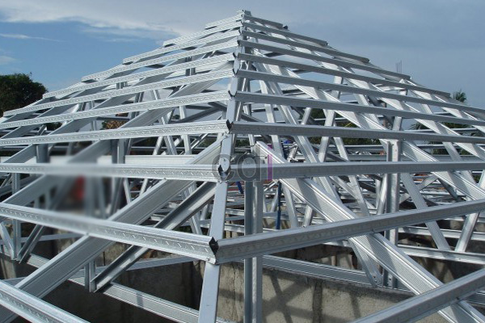

**Cara Simpel Menghitung Kebutuhan Baja Ringan** - Hai Mitra CDI! Pernahkah Anda bertanya-tanya, gimana sih cara menghitung kebutuhan baja ringan untuk proyek Anda di (not detected)? Baja ringan ini memang lagi populer banget, ya kan? Kuat, ringan, tahan rayap, dan pemasangannya cepat. Bahkan di desa-desa pun sekarang banyak yang pakai! Nah, kami dari CDI ingin bantu mempermudah proses perhitungan kebutuhan baja ringan Anda. Jadi, Anda bisa lebih akurat dalam memesan material dari kami.

## Mengenal Ukuran Baja Ringan: Dasar Perhitungan Anda

Sebelum kita masuk ke rumusnya, yuk, simak dulu berbagai macam ukuran baja ringan yang umum digunakan beserta peruntukannya. Dengan memahami ini, nanti perhitungannya jadi lebih tepat sasaran.

<table style="text-align: center; height: 168px;" border="1" width="100%" cellspacing="0" cellpadding="3"><tbody><tr><td>
No
</td><td>
JENIS KASO
</td><td>
PERUNTUKAN
</td><td>
UKURAN
</td></tr><tr><td>1</td><td>Truss C75.60 SNI</td><td>Untuk tiang canopy, pagar, kuda kuda /siku atap dll (sebagai penopang utama)</td><td>T 75 mm x P 6 m</td></tr><tr><td>2</td><td>Truss C75.70 SNI</td><td></td><td></td></tr><tr><td>3</td><td>Truss C75.75 SNI</td><td></td><td></td></tr><tr><td>4</td><td>Truss C75.100 SNI</td><td></td><td></td></tr><tr><td>
No
</td><td>
JENIS RENG
</td><td>
PERUNTUKAN
</td><td>
UKURAN
</td></tr><tr><td>1</td><td>Reng 30.45 SNI</td><td>Untuk reng pada atap /penahan genteng, canopy dan pagar.</td><td>T 30 mm x P 6 m</td></tr><tr><td>2</td><td>Reng 28.45 SNI</td><td></td><td>T 28 mm x P 6 m</td></tr></tbody></table>

**Keterangan:** _Ukuran tebal lempengan baja untuk jenis Truss (kaso) antara 0.60, 0.65, 0.75, 0.80 dan 0.100 mm dan untuk tebal jenis reng 0,45 mm._
> Ingin tahu harga terbaru baja ringan? Cek **[DAFTAR HARGA BAJA RINGAN TERBARU](/blog/daftar-harga-terbaru-atap-baja-ringan)**!

## Rumus Praktis Menghitung Kebutuhan Baja Ringan

Nah, sekarang kita masuk ke inti pembahasan. Penghitungan kebutuhan baja ringan sebenarnya akan bervariasi tergantung desain bangunan Anda. Desain yang rumit tentu membutuhkan lebih banyak material. Tapi, kami akan memberikan contoh perhitungan untuk desain atap baja ringan yang umum digunakan. Untuk mempermudah, kita akan membagi perhitungannya menjadi dua bagian: kebutuhan kaso dan kebutuhan reng. Perhatikan gambar di bawah ini untuk memahami bagian kaso dan reng.

Berdasarkan pengalaman kami, kebutuhan kaso baja ringan untuk desain kuda-kuda seperti contoh gambar di atas biasanya sekitar 2,5 sampai 3 batang kaso per kuda-kuda (satu batang berukuran 6 m). Sementara itu, kebutuhan rengnya akan sangat bergantung pada kerapatan susunan dan luas bangunan Anda. 

> _Rumus hitung KASO_: **2,5 batang** X **Jumlah kuda-kuda**

> 
> _Rumus hitung RENG_: **Panjang Bangunan** : **6** X **Jumlah susun reng pada kuda-kuda**

**Keterangan.**

_\*jarak antara kuda-kuda tergantung desain, namun yg paling umum 2m -3m, ukuran kuda-kuda juga tidak baku tergantung bentuk atau desain bangunannya, namun yang paling umum adalah ukuran pada rumus diatas._
_\*jarak susunan reng diatas kuda-kuda ditentukan sesuai kebutuhan ukuran genteng yang akan digunakan, umumnya berjarak antara 25 -30 cm, kalau pake asbes jaraknya bisa 1 m._

Semoga tips dari kami tentang Cara Simpel Menghitung Kebutuhan Baja Ringan ini bermanfaat dan membantu Anda dalam menghitung kebutuhan baja ringan secara mandiri. Jika Anda butuh bantuan lebih lanjut atau ingin konsultasi gratis, jangan ragu untuk menghubungi tim CDI di (not detected) ya! Kami siap membantu Anda mewujudkan proyek impian Anda. [Cara Menghitung Kebutuhan Batu Pondasi](/blog/cara-menghitung-kebutuhan-batu-pondasi/) bisa jadi referensi tambahan untuk perencanaan bangunan Anda!