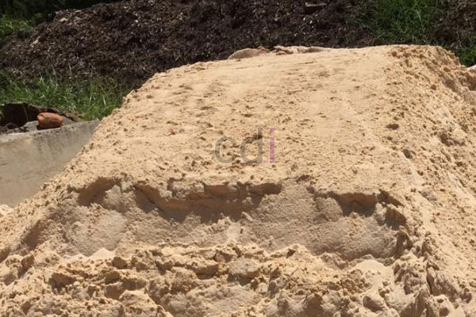

**Cara Mudah Memilih Pasir Yang Bagus** - Hai Mitra CDI! Pernahkah Anda bertanya-tanya, gimana caranya memastikan pasir yang digunakan untuk bangunan itu benar-benar berkualitas? Pasir itu kan fondasi penting banget, lho, dalam setiap proyek konstruksi – mulai dari rumah, kantor, sampai gedung tinggi. Memilih pasir yang tepat itu kunci utama supaya bangunan kokoh dan tahan lama. Nah, di artikel ini, kami akan berbagi tips praktis memilih pasir yang bagus, khusus buat Anda!

## Panduan Memilih Pasir Berkualitas untuk Proyek Anda

Memilih pasir yang pas memang butuh sedikit perhatian. Jangan sampai salah pilih yang malah bikin repot di kemudian hari. Yuk, simak beberapa tips berikut ini agar Anda bisa mendapatkan pasir terbaik untuk kebutuhan bangunan di (not detected).

### 1. Kenali Jenis Pasir yang Anda Butuhkan

Sebelum membeli, penting banget untuk tahu jenis pasir apa yang sesuai dengan proyek Anda. Setiap jenis pasir punya karakteristik dan kegunaan yang berbeda. Beberapa jenis pasir yang umum digunakan antara lain:

- **Pasir Pasang:** Ideal untuk pemasangan batako, batu bata, dan pembuatan pondasi dasar bangunan. Pasir ini berfungsi sebagai perekat yang kuat antar material.

- **Pasir Cor:** Pasir ini wajib hukumnya untuk pekerjaan cor beton seperti sloof, plat lantai, kolom, dan balok. Kekuatan pasir cor akan menentukan kekuatan struktur beton Anda.

- **Pasir Plester:** Butiran pasirnya halus dan sudah diayak, jadi bebas dari bebatuan. Cocok banget untuk plester dinding atau memasang marmer dan granit.

- **Pasir Urug:** Umumnya digunakan untuk menguruk lahan agar rata sebelum dibangun atau untuk meninggikan lantai bangunan. Kandungan lumpur atau tanah di pasir urug biasanya lebih banyak.

> _Pastikan Anda memilih jenis pasir yang paling sesuai dengan keperluan proyek Anda. Dengan begitu, Anda gak perlu khawatir hasilnya kurang maksimal._

### 2. Uji Kualitas Pasir dengan Cara Sederhana

Setelah tahu jenis pasir yang dibutuhkan, sekarang saatnya menguji kualitasnya. Pasir berkualitas baik seharusnya bebas dari campuran material lain seperti lumpur, debu, atau kerikil. Nah, gimana caranya mengetesnya? Gampang kok!

- Siapkan wadah berisi air bersih (gayung atau ember).
- Ambil segenggam pasir dengan tangan.
- Masukkan pasir ke dalam wadah berisi air.
- Perhatikan apa yang terjadi.

Kalau pasir cepat terurai dan air menjadi keruh, berarti pasir tersebut banyak mengandung campuran lumpur atau ampas. Tapi, kalau pasir tidak cepat terurai dan airnya tetap cukup jernih, berarti kualitas pasir tersebut bagus. Itulah cara mudah dan akurat untuk mengecek kualitas pasir sebelum dibeli.

> _Jangan ragu untuk melakukan pengujian ini sebelum membeli pasir dalam jumlah besar. Sedikit waktu yang Anda luangkan akan menyelamatkan Anda dari masalah di kemudian hari._

Butuh suplai pasir berkualitas tinggi di (not detected)? Kami siap membantu! Kami menyediakan berbagai jenis pasir dengan kualitas terjamin, dan yang terbaik, pengiriman ke (not detected) dan sekitarnya GRATIS! Kami juga menawarkan kemudahan pembayaran di tempat (COD) setelah barang sampai, jadi Anda bisa cek kualitasnya dulu baru bayar. Yuk, hubungi kami sekarang juga untuk mendapatkan penawaran terbaik! [Hubungi kami disini](URL) — dan dapatkan penawaran eksklusif untuk kebutuhan pasir Anda.