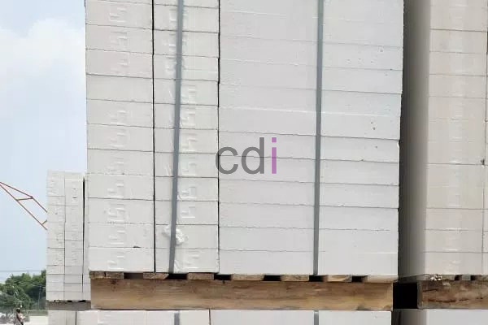

**Cara Tepat Menghitung Kebutuhan Hebel** - Hai Mitra CDI! Sedang merencanakan pembangunan atau renovasi rumah di (not detected)? Hebel, atau bata ringan, adalah pilihan material yang semakin populer karena ringan, kuat, dan efisien. Nah, penting banget nih untuk menghitung kebutuhan hebel dengan tepat agar tidak ada sisa atau kekurangan material. Artikel ini akan memandu Anda langkah demi langkah, serta memberikan tips praktis untuk memastikan perhitungan yang akurat. Yuk, simak bersama!

*cara hitung kebutuhan hebel*

Fluktuasi harga hebel (bata ringan) memang bisa jadi perhatian, tapi kami di CDI berkomitmen untuk tetap menyediakan material berkualitas dengan pelayanan terbaik bagi Anda. Kami percaya, kebutuhan konsumen adalah prioritas utama. Keuntungan pasti ada jika kita semua berusaha memberikan yang terbaik.

## Rumus Menghitung RAB Kebutuhan Hebel

Langsung saja ke inti pembahasan, yaitu Cara Tepat Menghitung Kebutuhan Hebel. Kami yakin ini yang paling Anda tunggu. Cara menghitungnya sebenarnya tidak rumit, kok. Hampir sama dengan perhitungan kebutuhan [bata merah](/product/bata-merah-oven) atau [batako](/product/batako-hitam-press). Kuncinya adalah mengetahui berapa banyak hebel yang dibutuhkan per meter persegi, lalu mengalikannya dengan luas dinding yang akan dipasang hebel. Berikut rincian perhitungannya:

_\*Hebel ukuran **7,5 x 20 x 60** dalam satu meter persginya (m²) membutuhkan **± 8 buah**, cara hitungnya **1 m : (0,20 x 0,60 = 0,12) = 8 buah**._
> _Rumus_: **Luas Total dinding** X **8 buah hebel** (_contoh_ 1**00 m²** X **8 buah** = **800 buah**)

Untuk menghitung ukuran hebel dengan _tebal 10 cm, lebar 20 cm, panjang 60 cm_ rumusnya juga sama seperti di atas. Yang terpenting dalam Cara Tepat Menghitung Kebutuhan Hebel ini adalah mengetahui ukuran lebar dan panjang hebel saja. Ukuran tebal (7,5 cm & 10 cm) biasanya tidak terlalu berpengaruh dalam perhitungan. Jika Anda ingin mengkonversinya ke volume m³, cara mudahnya adalah dengan membagi hasil perhitungan di atas dengan 83 atau 111 (tergantung ukuran hebelnya).

## Menghitung Kebutuhan Semen Perekat Hebel

Selain hebel, Anda juga perlu mengetahui cara menghitung kebutuhan semen perekat hebel. Karena sudah pasti, untuk memasang hebel Anda memerlukan semen perekat khusus. Berikut adalah cara penghitungannya:

Contoh yang akan kami jelaskan adalah untuk Hebel (Bata ringan) ukuran **10 x 20 x 60**. Berdasarkan pengalaman kami di lapangan, 1 m² dinding yang dipasangi hebel ukuran tersebut menghabiskan sekitar 4 kg semen mortar dan 1 liter air. Satu zak semen mortar biasanya memiliki berat 40 kg, yang berarti satu zak dapat digunakan untuk 10 m² luas dinding.

> _Rumus_: **Luas Total Dinding** X **4 kg** : **40** (_contoh_ **100 m²** X **4kg** : **40** = **10 zak semen mortar**)

## Menentukan Harga Hebel /Bata Ringan per Buah

Apakah Anda berencana membeli bata ringan dalam jumlah kecil, misalnya per buah?  Berikut adalah rumus untuk menentukan harga hebel per buahnya.

_\*jumlah hebel dalam 1 m³ untuk ukuran 7,5 x 20 x 60 adalah 111 buah dan untuk ukuran 10 x 20 x 60 adalah 83 buah._
> _Rumus_: **Harga Hebel 1 m³** : **Jumlah Hebel per m³** (_contoh_ **622.500** : **83** = **7500 per buah**)

Itulah tips dari kami tentang Cara Tepat Menghitung Kebutuhan Hebel (bata ringan) untuk proyek Anda di (not detected). Semoga setelah membaca artikel ini, Anda tidak lagi bingung dalam menghitung kebutuhan bata ringan atau memperkirakan dana yang dibutuhkan. Apabila ada pertanyaan lebih lanjut, jangan ragu untuk menghubungi kami. Dapatkan penawaran terbaik dan konsultasi gratis untuk kebutuhan material bangunan Anda di (not detected) melalui tombol Telepon/WhatsApp yang tersedia di halaman ini!  Jangan tunda lagi, segera wujudkan bangunan impian Anda bersama CDI! [Cara Menghitung Kebutuhan Semen](/blog/cara-akurat-menghitung-kebutuhan-semen/)