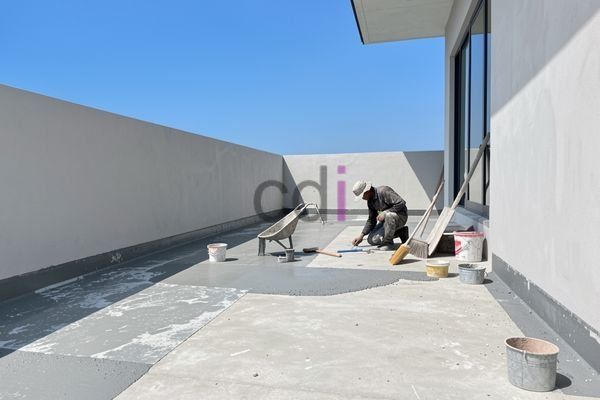

**Cara Waterproofing yang Benar: Panduan Lengkap untuk Perlindungan Bangunan Optimal** - Hai Mitra CDI! Pernahkah Anda menghadapi masalah rembesan yang bikin pusing? Atau khawatir bangunan Anda tidak terlindungi dari kelembapan? Nah, di artikel ini kita akan membahas tuntas tentang waterproofing, solusi jitu untuk menjaga bangunan Anda tetap kokoh dan nyaman. Mari simak panduan lengkapnya!

Waterproofing itu apa sih? Sederhananya, waterproofing adalah proses membuat permukaan bangunan menjadi kedap air. Proses ini penting banget, lho! Tanpa waterproofing yang baik, air bisa meresap ke dalam struktur bangunan, menyebabkan kerusakan seperti korosi, pertumbuhan jamur, bahkan kerusakan fondasi. Bayangkan kerugiannya! Artikel ini akan mengupas tuntas cara melakukan waterproofing yang benar, jenis material yang tersedia, dan tips aplikasinya.

## Jenis-Jenis Waterproofing: Mana yang Paling Cocok untuk Anda?

Ada banyak pilihan jenis waterproofing yang bisa Anda temukan. Masing-masing punya kelebihan dan kekurangan, dan yang terbaik untuk Anda tergantung pada beberapa faktor seperti lokasi aplikasi, seberapa besar paparan airnya, dan tentu saja, anggaran yang tersedia. Yuk, kita kenalan dengan beberapa jenis yang paling umum:

*   **Waterproofing Membrane:** Bentuknya lembaran kedap air yang diaplikasikan langsung ke permukaan. Biasanya dipakai untuk atap, balkon, atau kamar mandi. Ada beberapa jenis membran, seperti PVC, TPO, dan EPDM.
*   **Waterproofing Cair (Coating):** Bahan ini berupa cairan yang diaplikasikan pakai kuas atau sprayer. Cocok untuk permukaan yang bentuknya tidak beraturan, atau area yang sulit dijangkau. Biasanya berbahan dasar polimer, misalnya akrilik, poliuretan, atau epoksi.
*   **Waterproofing Semen:** Campuran semen khusus dengan aditif yang membuatnya tahan air. Aplikasi cukup mudah dan sering digunakan untuk area basah seperti kamar mandi dan dapur.
*   **Waterproofing Bitumen:** Berupa aspal yang dipanaskan lalu diaplikasikan ke permukaan. Paling sering dipakai untuk atap datar atau pondasi bangunan.

## Langkah Demi Langkah: Cara Aplikasi Waterproofing yang Tepat

Aplikasi waterproofing yang benar itu kunci keberhasilannya. Jangan sampai salah langkah, ya! Berikut adalah langkah-langkah umum yang perlu Anda ikuti:

1.  **Persiapan Permukaan:** Ini penting banget! Pastikan permukaan benar-benar bersih, kering, dan bebas dari debu, minyak, atau kotoran lainnya. Kalau ada retakan atau kerusakan, wajib diperbaiki dulu sebelum lanjut.
2.  **Pemberian Primer:** Aplikasikan primer ke permukaan untuk membantu waterproofing menempel lebih kuat. Primer ini seperti 'perekat' tambahan yang bikin waterproofing lebih efektif.
3.  **Aplikasi Waterproofing:** Aplikasikan waterproofing secara merata sesuai petunjuk produk. Untuk jenis cair, biasanya perlu beberapa lapisan supaya ketebalannya pas dan hasilnya maksimal.
4.  **Proses Penyembuhan:** Biarkan waterproofing mengering dan mengeras sesuai waktu yang direkomendasikan pabrikan. Jangan terburu-buru, ya!

Ingat, setiap jenis waterproof punya cara aplikasi yang sedikit beda. Jadi, selalu baca dan ikuti petunjuk pengunaan produk dengan teliti.

## Memilih Material Waterproofing: Tips Penting yang Wajib Diketahui

Memilih material waterproofing yang tepat itu seperti memilih fondasi yang kuat. Salah pilih, hasilnya bisa mengecewakan. Berikut beberapa tips yang bisa Anda pertimbangkan:

*   **Perhatikan Area Penggunaan:** Pilih material yang sesuai dengan area yang akan di-waterproofing. Misalnya, untuk atap yang sering terpapar matahari, pilih yang tahan UV.
*   **Tingkat Paparan Air:** Kalau areanya sering terendam air atau lembap, pilih material yang daya tahannya tinggi terhadap air dan tekanan hidrostatik.
*   **Reputasi Merek:** Pilih merek yang sudah dikenal dan terpercaya di pasaran. Kualitas produk beda-beda, lho.
*   **Konsultasikan dengan Ahli:** Bingung mau pilih yang mana? Jangan ragu konsultasikan dengan ahli waterproofing terpercaya. Mereka bisa memberikan saran berdasarkan kondisi bangunan Anda.

Sebagai gambaran, berikut adalah perbandingan beberapa material waterproofing yang umum digunakan:

<table class="table">
  <caption>Perbandingan Material Waterproofing</caption>
  <thead>
    <tr><th>Material</th><th>Kelebihan</th><th>Kekurangan</th><th>Estimasi Biaya per m²</th></tr>
  </thead>
  <tbody>
    <tr><td>Waterproofing Membrane (PVC)</td><td>Tahan lama, fleksibel, mudah diaplikasikan</td><td>Kurang ramah lingkungan, cukup rentan terhadap kerusakan mekanis</td><td>Rp 30.000 - Rp 80.000</td></tr>
    <tr><td>Waterproofing Cair (Poliuretan)</td><td>Sangat elastis, tahan terhadap UV, daya rekat kuat</td><td>Membutuhkan tenaga ahli untuk aplikasi, harganya relatif mahal</td><td>Rp 50.000 - Rp 150.000</td></tr>
    <tr><td>Waterproofing Semen</td><td>Mudah diaplikasikan, harga terjangkau</td><td>Kurang fleksibel, daya tahan terbatas</td><td>Rp 20.000 - Rp 50.000</td></tr>
    <tr><td>Waterproofing Bitumen</td><td>Tahan lama, sangat efektif untuk atap datar</td><td>Membutuhkan pemanasan, menghasilkan bau yang kurang sedap</td><td>Rp 40.000 - Rp 100.000</td></tr>
  </tbody>
</table>

Perlu diingat bahwa harga di atas hanyalah estimasi dan bisa berubah sewaktu-waktu — untuk informasi harga terbaru dan penawaran khusus yang disesuaikan dengan proyek Anda di (not detected), hubungi Kami sekarang juga! 

## Jangan Lupakan Perawatan: Kunci Waterproofing yang Awet

Setelah diaplikasikan, waterproofing juga perlu dirawat secara berkala. Lakukan pemeriksaan visual rutin untuk mendeteksi kerusakan atau retakan. Bersihkan permukaan dari kotoran dan debu secara teratur. Jika ada kerusakan, segera diperbaiki agar tidak berdampak lebih parah.

Butuh bantuan untuk memastikan waterproofing bangunan Anda optimal? Jangan sungkan menghubungi Kami! Tim ahli CDI siap membantu Anda. Untuk konsultasi atau penawaran harga, silakan klik tombol **WhatsApp** atau **Telepon** di halaman ini. Jangan tunda lagi, lindungi bangunan Anda sekarang!  Tentu saja, Anda juga bisa menjelajahi koleksi [Besi Buat Cor](https://cdi.co.id/blog/besi-buat-cor/) Kami untuk memilih material berkualitas.