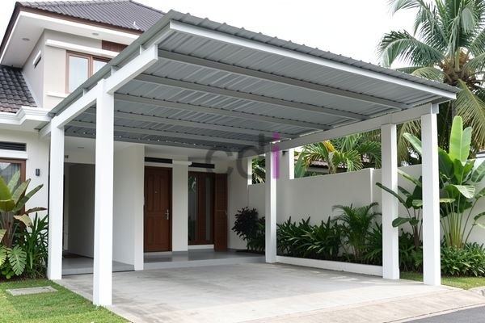

**Carport Plat Dak: Solusi Modern, Kuat, dan Tahan Lama untuk Kendaraan Anda** - Halo Mitra CDI! Apakah Anda sedang merencanakan pembangunan carport baru atau ingin meningkatkan kualitas carport yang sudah ada di (not detected)? Banyak terjadi kesalahan dalam pemilihan material dan cara membangun yang berujung pada carport kurang kokoh, rentan bocor, atau bahkan tidak sesuai dengan gaya rumah. Yuk, simak bagaimana carport plat dak bisa jadi solusi tepat untuk permasalahan tersebut!

## Mengapa Carport Plat Dak Jadi Pilihan Unggul Dibanding Material Lain?

Saat memikirkan carport, banyak pilihan tersedia di luar sana. Mulai dari material yang ringan seperti asbes, sampai yang lebih berat seperti beton bertulang. Tapi, kenapa carport plat dak seringkali jadi favorit banyak orang? Keunggulan utamanya terletak pada kombinasi kekuatan dan daya tahan yang luar biasa. Plat dak, yang umumnya menggunakan beton bertulang berkualitas, mampu menopang beban berat – termasuk tekanan dari angin kencang dan hujan deras – yang sering kita temui di (not detected). Ini jauh berbeda dengan material ringan yang lebih rentan rusak saat cuaca buruk.

Tidak hanya kuat, carport plat dak juga menawarkan kebebasan berkreasi dalam desain. Anda bisa menyesuaikan ukuran dan bentuknya sesuai kebutuhan, bahkan menambahkan sentuhan dekoratif agar selaras dengan desain rumah Anda. Bayangkan carport yang bukan hanya melindungi kendaraan, tapi juga mempercantik tampilan rumah! Ditambah lagi, perawatannya pun tergolong mudah. Berbeda dengan kayu yang butuh pengecatan rutin, carport plat dak hanya perlu dibersihkan secara berkala.

## Aspek Teknis Penting Saat Membangun Carport Plat Dak

Membuat carport plat dak yang awet dan aman bukan sekadar menuang beton. Perencanaan dan perhitungan yang cermat sangat diperlukan. Ketebalan ideal plat dak biasanya berkisar antara 120 mm hingga 150 mm, tergantung luas area carport dan beban yang akan ditanggung. Penggunaan beton dengan mutu minimal K-250, sesuai standar SNI, sangat dianjurkan demi memastikan kekuatan optimal. Jangan lupa, penggunaan tulangan baja yang tepat juga krusial.

Sistem drainase yang baik juga tak boleh diabaikan. Genangan air di permukaan carport dapat merusak konstruksi dalam jangka panjang. Pastikan desain carport memiliki kemiringan yang cukup untuk mengalirkan air hujan dengan lancar. Tambahan lapisan anti bocor (waterproofing) akan memberikan perlindungan ekstra terhadap rembesan air ke area bawah carport.

## Kisaran Biaya dan Faktor Penentu Harga

Berapa biaya yang dibutuhkan untuk membangun carport plat dak? Jawabannya tidak tunggal, karena ada beberapa faktor yang memengaruhi, seperti luas area, kompleksitas desain, dan harga material di (not detected). Untuk gambaran, biaya pembangunan carport plat dak di wilayah Jabodetabek pada tahun 2026 berkisar antara Rp 3.000.000 hingga Rp 6.000.000 per meter persegi. Harga ini bersifat perkiraan dan bisa berubah sewaktu-waktu. Untuk mendapatkan penawaran yang paling akurat, silakan hubungi Kami untuk berdiskusi lebih lanjut sesuai kebutuhan proyek Mitra CDI.

Faktor lain yang memengaruhi biaya termasuk biaya persiapan lahan, bekisting, tenaga kerja, dan finishing seperti pengecatan atau pelapisan anti bocor. Semakin rumit desain dan semakin tinggi kualitas material yang dipilih, tentu biayanya akan meningkat.

## Adu Keunggulan: Carport Plat Dak vs. Opsi Lainnya

Agar Anda semakin mantap dalam memilih, berikut perbandingan carport plat dak dengan beberapa alternatif lain:

<table class="table">
  <caption>Perbandingan Opsi Carport</caption>
  <thead>
    <tr><th>Fitur</th><th>Carport Plat Dak</th><th>Carport Polycarbonate</th><th>Carport Metal Hollow</th></tr>
  </thead>
  <tbody>
    <tr><td>Kekuatan</td><td>Sangat Kuat</td><td>Cukup Kuat</td><td>Kuat</td></tr>
    <tr><td>Daya Tahan</td><td>Sangat Tahan Lama</td><td>Cukup Tahan Lama</td><td>Tahan Lama</td></tr>
    <tr><td>Perawatan</td><td>Minim</td><td>Cukup Sering</td><td>Sering</td></tr>
    <tr><td>Biaya (Estimasi/m²)</td><td>Rp 3.000.000 - Rp 6.000.000</td><td>Rp 500.000 - Rp 1.500.000</td><td>Rp 700.000 - Rp 2.000.000</td></tr>
    <tr><td>Estetika</td><td>Modern &amp; Fleksibel</td><td>Minimalis</td><td>Sederhana</td></tr>
  </tbody>
</table>

Walaupun carport polycarbonate dan metal hollow menawarkan harga yang lebih ekonomis, carport plat dak tetap menjadi pilihan terbaik jika Anda mengutamakan kekuatan, umur panjang, dan kebebasan dalam berkreasi desain. Ingin tahu lebih banyak tentang bagaimana kami bisa mewujudkan carport impian Anda di (not detected)?

Butuh konsultasi gratis mengenai proyek Anda? Jangan ragu untuk menghubungi Kami melalui tombol **WhatsApp** atau **Telepon** yang tersedia di bawah ini. Kami siap membantu! [Balok Gantung Rumah: Solusi Desain Modern dan Pemasangan yang Tepat](/blog/balok-gantung-rumah/) — mungkin juga menarik bagi Anda yang sedang merenovasi rumah!