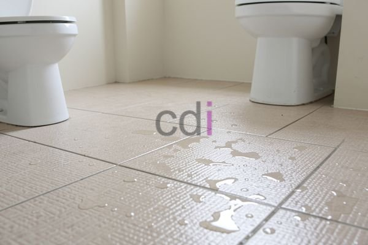

**Tersedia Cat Keramik Anti Licin: Pilihan Aman untuk Keluarga Anda** - Hai Mitra CDI! Pernahkah Anda membayangkan betapa nyamannya sebuah rumah dengan lantai yang indah dan, yang terpenting, aman? Data menunjukkan bahwa setiap tahun, ratusan ribu insiden kecelakaan rumah tangga di Indonesia disebabkan oleh lantai licin. Bayangkan ketenangan pikiran yang bisa Anda dapatkan dengan memastikan keluarga Anda terlindungi. Kami dari Creative Design Interior (CDI) mengerti betul kebutuhan Anda akan lantai yang tidak hanya mempercantik ruangan, tetapi juga menjamin keamanan seluruh anggota keluarga.

## Lantai Keramik: Indah Tapi Bisa Jadi Berbahaya – Solusinya?

Lantai keramik memang menjadi favorit banyak orang, mudah dirawat, dan punya daya tahan yang baik. Tapi, pernahkah Anda perhatikan bagaimana licinnya keramik saat terkena air? Kondisi ini menciptakan potensi bahaya yang serius, terutama untuk anak-anak kecil atau orang tua yang keseimbangannya mulai berkurang. Nah, di sinilah cat keramik anti licin hadir sebagai jawaban atas kekhawatiran Anda.

Cat ini bekerja dengan menciptakan lapisan bertekstur di permukaan keramik, meningkatkan gesekan sehingga risiko tergelincir berkurang drastis. Selain itu, cat keramik anti licin juga memberikan sentuhan personal pada ruangan Anda. Tersedia dalam beragam warna dan tekstur, Anda bisa menyesuaikannya agar harmonis dengan gaya desain interior yang Anda inginkan. Investasi kecil ini memberikan perlindungan keamanan yang besar dan tahan lama untuk hunian Anda di (not detected).

## Mengenal Lebih Dekat Berbagai Jenis Cat Keramik Anti Licin

Di pasaran, ada beberapa jenis cat keramik anti licin yang bisa Anda temukan. Masing-masing memiliki keunggulan dan karakteristik yang berbeda-beda. Pemilihan jenis yang tepat akan bergantung pada kebutuhan dan anggaran Anda. Secara umum, pilihan utama jatuh pada cat berbasis epoksi, poliuretan, dan akrilik.

Mari kita lihat perbandingan singkatnya dalam tabel berikut:

<table class="table">
  <caption>Perbandingan Jenis Cat Keramik Anti Licin</caption>
  <thead>
    <tr><th>Jenis Cat</th><th>Kekuatan</th><th>Ketahanan Abrasi</th><th>Ketahanan Kimia</th><th>Harga (Estimasi/Liter)</th></tr>
  </thead>
  <tbody>
    <tr><td>Epoksi</td><td>Sangat Kuat</td><td>Tinggi</td><td>Tinggi</td><td>Rp 250.000 - Rp 400.000</td></tr>
    <tr><td>Poliuretan</td><td>Kuat</td><td>Sedang</td><td>Sedang</td><td>Rp 200.000 - Rp 300.000</td></tr>
    <tr><td>Akrilik</td><td>Cukup Kuat</td><td>Rendah</td><td>Rendah</td><td>Rp 100.000 - Rp 200.000</td></tr>
  </tbody>
</table>

Sebagai catatan, harga di atas hanyalah estimasi dan bisa berubah sewaktu-waktu. Untuk mendapatkan penawaran harga yang paling akurat dan sesuai dengan kebutuhan proyek Anda di (not detected), silakan hubungi Kami.

## Creative Design Interior: Mitra Andal untuk Lantai Anti Licin Anda

Kami di Creative Design Interior (CDI) bukan hanya menyediakan cat keramik anti licin berkualitas tinggi. Kami adalah solusi lengkap untuk kebutuhan lantai Anda! Kami hanya bekerja sama dengan produsen terpercaya yang menjamin kualitas dan daya tahan produknya. Tim ahli kami siap membantu Anda memilih jenis cat yang paling tepat untuk kondisi lantai dan kebutuhan anggaran Anda.

Lebih dari itu, Kami menawarkan jasa aplikasi profesional. Dengan tenaga terampil dan peralatan modern, Kami memastikan lapisan anti licin terpasang dengan sempurna, memberikan perlindungan maksimal dan estetika yang memukau. Selain itu, CDI juga melayani jasa desain interior, termasuk pembuatan *kitchen set* custom, jasa pengecoran, dan pengadaan material bangunan seperti pasir, split, dan semen. Kami bangga menjadi solusi *one-stop shopping* untuk proyek konstruksi Anda di (not detected) dan sekitarnya. Pelanggan Kami dapat menikmati kemudahan skema harga *all in one* yang sudah termasuk material, biaya pengiriman, dan ongkos bongkar muat.

## Proses Pemesanan yang Mudah dan Pilihan Pembayaran Fleksibel

Ingin segera merasakan aman dan nyaman di rumah Anda? Proses pemesanan di CDI sangatlah mudah! Cukup hubungi Kami melalui tombol **Telepon** atau **WhatsApp** yang tertera di halaman ini. Tim Kami akan segera merespons dan siap membantu Anda memilih produk yang tepat dan memberikan konsultasi gratis.

Kami memahami bahwa setiap pelanggan memiliki preferensi pembayaran yang berbeda. Itulah mengapa Kami menawarkan berbagai opsi pembayaran yang fleksibel: COD, transfer bank, DP 50%, transfer setelah barang dikirim, bayar secara bertahap, hingga transfer setelah pekerjaan selesai. Kami juga memberikan jaminan penggantian produk jika ada ketidaksesuaian dengan spesifikasi, selama produk belum digunakan dan masih dalam kondisi utuh, serta diajukan dalam waktu maksimal 1 hari. Jangan tunda lagi, hubungi Kami sekarang juga untuk mendapatkan penawaran terbaik dan wujudkan lantai impian Anda di (not detected)! [Cat Lantai Anti Slip: Solusi Aman dan Nyaman untuk Keluarga](/blog/cat-lantai-anti-slip/)