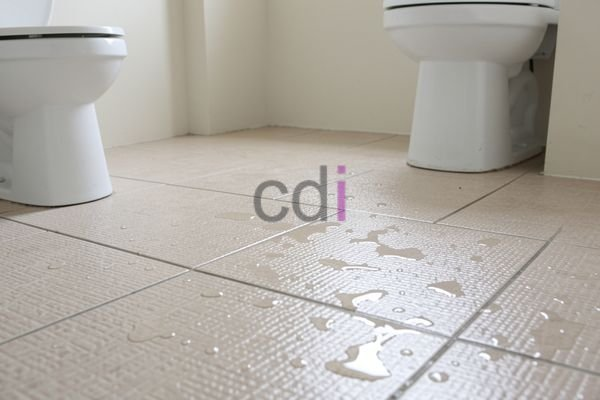

**Cat Lantai Seperti Keramik: Harga & Cara Aplikasi Terbaik 2026** - Hai Mitra CDI! Ingin memberikan sentuhan baru pada lantai tanpa repot renovasi besar? Kami punya solusinya! Cat lantai dengan efek visual keramik adalah cara cerdas dan ekonomis untuk menyegarkan tampilan rumah Anda. Artikel ini akan mengupas tuntas pilihan material, teknik aplikasi, dan perkiraan biaya yang perlu Anda siapkan. Yuk, simak selengkapnya!

## Mengapa Pilih Cat Lantai Efek Keramik?

Banyak yang bertanya, kenapa harus cat lantai daripada mengganti keramik? Jawabannya sederhana: lebih praktis dan hemat biaya! Proses pengecatan jauh lebih cepat, bersih, dan tidak membuat rumah berantakan seperti saat membongkar dan memasang keramik. Cukup bayangkan, Anda bisa langsung menikmati lantai baru dalam waktu singkat tanpa harus pindah barang-barang besar. 

Selain itu, cat lantai memberikan kebebasan berkreasi yang tak terbatas. Dengan beragam pilihan warna dan motif, Anda bisa mewujudkan desain lantai impian yang benar-benar personal. Kami menyediakan berbagai opsi yang bisa disesuaikan dengan gaya interior Anda. 

Perawatan cat lantai yang tepat juga sangat mudah lho. Permukaan yang dilapisi cat berkualitas akan lebih tahan terhadap noda dan goresan, sehingga lantai tetap cantik dan bersih lebih lama. Ini ideal untuk area-area yang sering digunakan seperti ruang tamu, dapur, atau koridor. Kami menyediakan solusi cat lantai berkualitas tinggi yang tahan lama dan mudah dibersihkan.

## Mengenal Berbagai Jenis Cat Lantai dengan Efek Keramik

Ada beberapa jenis cat lantai yang populer digunakan untuk menciptakan tampilan seperti keramik. Masing-masing punya karakteristik unik yang perlu Anda pertimbangkan.

*   **Cat Epoksi:** Dikenal dengan kekuatan dan daya tahannya yang luar biasa. Cocok untuk area yang membutuhkan perlindungan ekstra seperti garasi, gudang, atau lantai industri. Namun, aplikasinya memerlukan keahlian khusus dan waktu pengeringan yang relatif lama.
*   **Cat Poliuretan:** Pilihan yang tepat untuk area dengan tingkat aktivitas tinggi karena fleksibel dan tahan terhadap abrasi. Cat ini juga memiliki ketahanan yang baik terhadap bahan kimia dan mudah dibersihkan.
*   **Cat Akrilik:** Opsi yang paling ekonomis dan mudah diaplikasikan. Ideal untuk penggunaan di area perumahan dengan lalu lintas sedang. Meskipun tidak sekuat epoksi atau poliuretan, cat akrilik tetap bisa memberikan tampilan yang menarik dan tahan lama.

Agar hasilnya maksimal, pilihlah cat yang memang dirancang khusus untuk lantai. Pastikan cat tersebut memiliki daya rekat yang baik, tahan goresan, dan mudah dibersihkan. Kami merekomendasikan penggunaan cat lantai epoksi yang diperkaya dengan *flake* atau *chip* untuk menciptakan tekstur visual yang menyerupai keramik asli.

## Perkiraan Biaya dan Jasa Aplikasi di (not detected)

Biaya yang dibutuhkan untuk mengecat lantai dengan efek keramik bervariasi. Ini dipengaruhi oleh jenis cat yang Anda pilih, luas area yang akan dicat, dan kompleksitas proses aplikasi. Sebagai gambaran, berikut adalah perkiraan biaya yang perlu Anda siapkan:

| Jenis Cat   | Harga per Liter (Estimasi) | Luas Area (m²) | Biaya Material (Estimasi) | Biaya Jasa Aplikasi (Estimasi) | Total Biaya (Estimasi) |
| :---------- | :------------------------- | :------------- | :----------------------- | :----------------------------- | :--------------------- |
| Akrilik     | Rp 150.000 - Rp 300.000    | 20             | Rp 600.000 - Rp 1.200.000 | Rp 400.000 - Rp 800.000        | Rp 1.000.000 - Rp 2.000.000 |
| Poliuretan  | Rp 300.000 - Rp 600.000    | 20             | Rp 1.200.000 - Rp 2.400.000 | Rp 800.000 - Rp 1.600.000        | Rp 2.000.000 - Rp 4.000.000 |
| Epoksi      | Rp 400.000 - Rp 800.000    | 20             | Rp 1.600.000 - Rp 3.200.000 | Rp 1.200.000 - Rp 2.400.000        | Rp 2.800.000 - Rp 5.600.000 |

Perlu diingat bahwa harga di atas hanyalah estimasi dan dapat berubah sewaktu-waktu. Untuk mendapatkan informasi harga terbaru dan penawaran khusus untuk proyek Anda di (not detected), silakan hubungi Kami.

Jika Anda belum berpengalaman dalam mengecat lantai, Kami sarankan untuk menggunakan jasa profesional. Tim ahli Kami telah berpengalaman lebih dari 10 tahun dalam aplikasi cat lantai dan furniture custom. Kami menggunakan peralatan yang lengkap dan memastikan hasil akhir yang rapi, tahan lama, dan sesuai dengan harapan Anda. Kami juga melayani jasa pengecoran dan menyediakan berbagai material bangunan berkualitas.

## Tips Aplikasi Cat Lantai Agar Hasilnya Tahan Lama dan Memukau

Untuk memastikan cat lantai efek keramik Anda awet dan terlihat menarik, ikuti tips berikut:

1.  **Persiapan Permukaan:** Langkah paling penting! Pastikan lantai benar-benar bersih dari debu, kotoran, minyak, dan sisa cat lama. Gunakan amplas untuk meratakan permukaan yang kasar atau tidak rata.
2.  **Lapisan Primer:** Aplikasikan satu lapis primer berkualitas tinggi. Ini akan meningkatkan daya rekat cat dan mencegahnya terserap ke dalam lantai.
3.  **Aplikasi Cat:** Aplikasikan cat lantai secara merata dalam dua atau tiga lapisan tipis. Biarkan setiap lapisan mengering sempurna sebelum mengaplikasikan lapisan berikutnya.
4.  **Lapisan Pelindung:** Setelah lapisan cat kering, aplikasikan lapisan *topcoat* (pelindung) untuk meningkatkan ketahanan terhadap goresan, noda, dan keausan.

Kami dengan senang hati memberikan konsultasi gratis untuk membantu Anda memilih jenis cat yang paling tepat dan memberikan panduan aplikasi yang jelas. Jangan ragu untuk menghubungi Kami! Selain cat lantai, Kami juga menyediakan berbagai bahan bangunan berkualitas seperti pasir, split, batu belah, bata merah, batako, hebel, sirtu, dan lainnya. Kami siap melayani kebutuhan proyek Anda di (not detected) dan sekitarnya.

Hubungi tim Kami sekarang juga melalui tombol **Telepon** atau **WhatsApp** yang ada di bawah ini untuk mendapatkan penawaran terbaik dan solusi lantai impian Anda! Jangan tunda lagi, percantik lantai Anda sekarang! Kami siap membantu Anda mewujudkan ruang yang lebih nyaman dan indah.  
<table class="table">
  <caption>Perbandingan Material Bangunan</caption>
  <thead>
    <tr><th>Material</th><th>Ukuran</th><th>Harga</th></tr>
  </thead>
  <tbody>
    <tr><td>Pasir</td><td>0-5 mm</td><td>Rp 80.000/m³</td></tr>
    <tr><td>Split</td><td>5-20 mm</td><td>Rp 120.000/m³</td></tr>
  </tbody>
</table>
