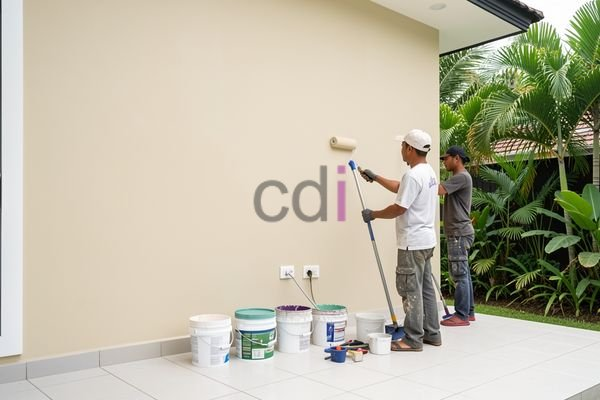

**Cat Tembok Teras Depan: Panduan Memilih Warna, Jenis, dan Estimasi Biaya 2026** - Hai Mitra CDI! Teras depan adalah wajah rumah Anda — kesan pertama yang tercipta bagi siapapun yang berkunjung. Pemilihan cat tembok teras depan yang tepat itu krusial, bukan cuma soal estetika, tapi juga perlindungan terhadap cuaca.

Nah, bagaimana caranya memilih cat yang ideal? Artikel ini akan membimbing Anda memilih warna, jenis cat yang kuat, dan memperkirakan biayanya. Kami akan membahasnya tuntas!

## Mengenal Lebih Dekat Jenis Cat Tembok Teras Depan

Teras depan berhadapan langsung dengan berbagai elemen cuaca: panas matahari, guyuran hujan, dan perubahan suhu yang signifikan. Jadi, memilih cat yang tepat itu wajib hukumnya, Mitra! Ada beberapa opsi yang bisa dipertimbangkan: cat akrilik, lateks, dan silikon.

Cat akrilik dikenal awet, fleksibel, dan tahan terhadap retakan. Cat lateks punya keunggulan elastisitas, serta efektif mencegah pertumbuhan jamur dan lumut. Sementara cat silikon unggul dalam menolak air dan kotoran, cocok untuk area yang polusinya tinggi.  Di wilayah (not detected), cat akrilik atau lateks sering jadi pilihan karena seimbang antara kualitas dan harga.

Selain itu, pertimbangkan juga *finishing*. Lapisan *matte* bagus untuk menyamarkan kekurangan dinding, sedangkan lapisan *glossy* memberi kesan mewah dan mudah dibersihkan. Kalau Mitra CDI ingin eksplorasi lebih jauh, Kelebihan Wallpaper Dinding Dibanding Cat Tembok bisa jadi ide menarik!

## Warna Cat Teras Depan: Menciptakan Kesan yang Tepat

Warna cat teras depan punya pengaruh besar pada kesan pertama. Sesuaikan pilihan warna dengan gaya rumah, lingkungan sekitar, dan tentu saja, selera Anda. 

Untuk rumah minimalis, warna netral seperti abu-abu, putih, atau krem memang jadi favorit. Kesan bersih, modern, dan elegan langsung terpancar.  Ingin sedikit berkreasi? Warna pastel seperti biru muda, hijau mint, atau *peach* bisa jadi pilihan yang menyegarkan.

Ingat ya, warna terang bisa membuat teras terkesan lebih luas, sementara warna gelap menciptakan suasana hangat dan akrab. Pertimbangkan juga bagaimana warna cat teras depan berpadu dengan elemen lain seperti pintu, jendela, dan pagar rumah.

## Perkiraan Biaya Pengecatan Teras Depan di (not detected) Tahun 2026

Biaya pengecatan teras depan bisa berbeda-beda, tergantung luas area, jenis cat yang dipilih, dan tingkat kerumitan pekerjaan. Ini perkiraan biayanya di wilayah (not detected) untuk tahun 2026:

| Item Biaya               | Estimasi Harga (Rp) |
|--------------------------|---------------------|
| Cat Tembok Eksterior (per galon) | 250.000 – 600.000  |
| Kuas, Roller, dan Peralatan  | 50.000 – 150.000   |
| Jasa Tukang Pengecat (per m²) | 100.000 – 200.000  |
| Biaya Persiapan (dempul, amplas) | 30.000 – 70.000   |

Misalnya, Anda punya teras depan seluas 20 m² dan memilih cat tembok eksterior seharga Rp 400.000 per galon. Jika Anda menggunakan jasa tukang dengan tarif Rp 150.000 per m², maka perkiraan biayanya adalah:

*   Biaya cat: 2 galon x Rp 400.000 = Rp 800.000
*   Biaya tukang: 20 m² x Rp 150.000 = Rp 3.000.000
*   Biaya peralatan & persiapan: Rp 200.000
*   **Total biaya: Rp 4.000.000**

Perlu diingat, ini hanya perkiraan. Untuk mendapatkan penawaran harga yang paling akurat sesuai proyek Anda, jangan ragu untuk menghubungi Kami!  Oh iya, selain pengecatan, Kami juga menyediakan layanan pengecoran seperti Biaya Membuat Jembatan Cor Depan Rumah untuk renovasi teras yang lebih menyeluruh.

## Tips Jitu Merawat Cat Teras Depan Agar Awet

Setelah pengecatan selesai, rawat cat teras depan Anda dengan benar agar tetap indah dan tahan lama. Ini dia tipsnya:

*   Bersihkan teras secara rutin dari debu dan kotoran — gunakan air bersih dan sabun lembut.
*   Hindari penggunaan bahan kimia keras atau sikat kawat yang bisa merusak lapisan cat.
*   Perbaiki segera retakan atau kerusakan kecil pada cat untuk mencegah masalah yang lebih besar.
*   Pertimbangkan aplikasi lapisan pelindung (waterproofing) untuk meningkatkan ketahanan cat terhadap air dan lumut.

Punya proyek di (not detected) dan butuh bantuan dari ahlinya? Jangan sungkan hubungi Kami! Klik tombol **WhatsApp** atau **Telepon** di bawah untuk konsultasi gratis. Kami siap membantu!