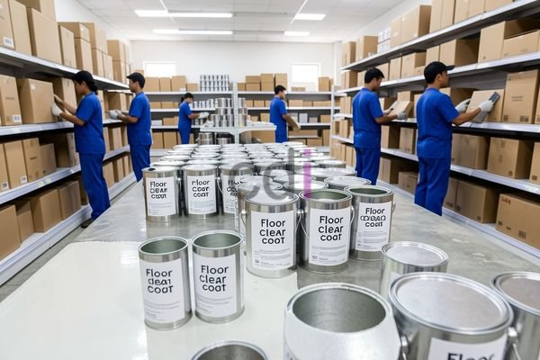

**Tersedia Cat untuk Lantai Outdoor Tahan Cuaca & Anti Licin** - Hai Mitra CDI! Mencari cara mempercantik sekaligus melindungi lantai luar ruangan di (not detected)? Memilih cat yang tepat itu penting banget, lho! Bukan cuma soal tampilan, tapi juga soal ketahanan terhadap cuaca ekstrem dan keamanan pengguna. Yuk, simak panduan lengkapnya di artikel ini!

### Pilihan Cat Lantai Outdoor: Apa Saja yang Tersedia?

Eits, sebelum mulai, penting banget tahu dulu ada apa aja jenis cat yang cocok buat lantai outdoor. Beda dengan cat interior, cat outdoor harus kuat menghadapi paparan matahari, hujan, perubahan suhu, bahkan tekanan dari aktivitas sehari-hari. Nah, beberapa opsi yang populer itu cat epoxy, polyurethane, dan acrylic.

Cat epoxy itu juara buat daya rekat dan tahan bahan kimia. Tapi, perlu diingat, dia agak kaku dan bisa pecah kalau lantainya bergerak. Cat polyurethane lebih fleksibel dan tahan gesekan, pas banget buat area ramai. Kalau cat acrylic, dia gampang dipakai dan harganya ramah di kantong, tapi soal daya tahan mungkin nggak sebagus dua yang lain. 

Oh iya, jangan lupa pertimbangkan cat anti slip! Lantai basah itu licin dan berbahaya. Untuk inspirasi, Anda bisa baca juga tentang [Cat Lantai Anti Slip: Solusi Aman dan Nyaman untuk Keluarga](/blog/cat-lantai-anti-slip/) sebagai tambahan informasi.

### Hal-Hal yang Perlu Dipertimbangkan Saat Memilih Cat

Jadi, gimana cara memilih cat yang pas buat lantai outdoor di (not detected)? Ada beberapa hal penting yang perlu Anda perhatikan. Pertama, jenis permukaan lantainya apa? Beton, keramik, kayu, atau material lain? Setiap material butuh perlakukan yang beda. Kedua, seberapa banyak orang yang lewat di area itu? Semakin ramai, semakin penting pilih cat yang tahan gesekan. Ketiga, gimana sih cuaca di (not detected)? Kalau sering hujan, pastikan catnya tahan air dan cepat kering.

Supaya lebih jelas, ini dia perbandingan beberapa jenis cat outdoor:

<table class="table">
  <caption>Perbandingan Jenis Cat untuk Lantai Outdoor</caption>
  <thead>
    <tr><th>Jenis Cat</th><th>Kelebihan</th><th>Kekurangan</th><th>Kisaran Harga (per liter)</th></tr>
  </thead>
  <tbody>
    <tr><td>Epoxy</td><td>Tahan kimia &amp; abrasi tinggi, daya rekat kuat</td><td>Kurang fleksibel, rentan retak</td><td>Rp 300.000 - Rp 600.000</td></tr>
    <tr><td>Polyurethane</td><td>Fleksibel, tahan abrasi &amp; UV</td><td>Harga relatif lebih mahal</td><td>Rp 400.000 - Rp 800.000</td></tr>
    <tr><td>Acrylic</td><td>Mudah diaplikasikan, harga terjangkau</td><td>Kurang tahan lama, kurang tahan kimia</td><td>Rp 150.000 - Rp 300.000</td></tr>
  </tbody>
</table>

Informasi harga di atas hanyalah perkiraan dan bisa berubah sewaktu-waktu. Untuk penawaran terbaik dan paling akurat, jangan sungkan menghubungi tim Kami, ya!

### Dapatkan Solusi Cat Lantai Outdoor Terbaik dari Kami

Di Creative Design Interior, Kami menyediakan beragam pilihan cat outdoor berkualitas tinggi. Tim Kami siap membantu Anda memilih cat yang paling cocok dengan kebutuhan dan budget Anda. Kami juga menawarkan jasa aplikasi cat lantai outdoor profesional, memastikan hasil yang awet dan estetik. Kami punya pengalaman lebih dari 10 tahun di bidang desain interior, furniture custom, dan pengadaan material bangunan.

Buat Anda yang lagi cari solusi cat lantai keramik untuk garasi, Kami juga punya solusinya. Anda bisa cek informasi awal di Cat Lantai Keramik Garasi Jabodetabek: Pilihan Terbaik & Harganya sebelum berkonsultasi dengan Kami.

Ada pertanyaan? Jangan ragu untuk menghubungi Kami melalui tombol **WhatsApp** atau **Telepon** yang ada di halaman ini. Kami siap membantu Anda mewujudkan lantai outdoor impian di (not detected)!