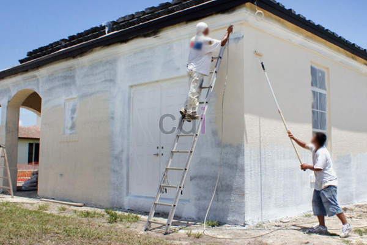

**Cat Untuk Lantai Rumah: Pertimbangkan Ini Sebelum Membeli** - Hai Mitra CDI! Mencari cat lantai yang pas untuk hunian memang tricky ya? Pemilihan cat yang tepat itu krusial banget lho, demi lantai yang awet, nyaman dipijak, sekaligus mempercantik tampilan rumah. Yuk, kita bahas tuntas supaya Mitra CDI nggak salah pilih!

Memikirkan jenis cat lantai yang ideal akan berdampak langsung pada ketahanan, kemudahan perawatan, dan hasil akhir lantai impian Mitra. Supaya nggak bingung, penting banget memahami opsi-opsi yang ada dan menyesuaikannya dengan kebutuhan sehari-hari.

## Mengenal Beragam Jenis Cat Lantai Rumah

Ada banyak pilihan cat lantai rumah yang tersedia di pasaran, masing-masing dengan kelebihan dan kekurangannya sendiri. Beberapa yang paling populer antara lain cat berbasis air (akrilik), cat berbasis minyak (epoxy dan poliuretan), serta cat khusus seperti anti-slip dan epoxy.

Cat akrilik punya keunggulan di sisi harga yang lebih bersahabat dan mudah diaplikasikan. Namun, soal daya tahan, ia cenderung kurang dibandingkan jenis cat lainnya. Sementara itu, cat epoxy dan poliuretan menawarkan kekuatan luar biasa dalam menahan gesekan, paparan bahan kimia, dan kelembapan tinggi. Karena itu, cat ini sangat cocok untuk area-area yang sering dilewati orang, contohnya garasi atau dapur.

Tambahan lagi nih, cat lantai anti-slip dirancang khusus untuk meningkatkan keamanan, terutama di lokasi yang sering basah seperti kamar mandi atau dapur. Partikel anti-slip yang terkandung di dalamnya memberikan tekstur yang mencegah tergelincir. Sedangkan cat epoxy, selain kuat, sering dipakai untuk menciptakan tampilan lantai yang mewah dan modern dengan pilihan warna serta efek visual yang beragam. [Cat Untuk Lantai Pabrik: Sebelum Memesan, Pastikan Ini!](/blog/cat-untuk-lantai-pabrik/) bisa jadi referensi tambahan untuk Mitra yang membutuhkan lantai tahan industri.

## Apa Saja yang Mempengaruhi Harga Cat Lantai?

Harga cat untuk lantai rumah bisa bervariasi, tergantung pada jenis, merek, dan luas area yang akan dicat. Cat akrilik umumnya yang paling ekonomis, dengan kisaran harga mulai dari Rp 30.000 hingga Rp 80.000 per liter. Sementara cat epoksi dan poliuretan biasanya lebih mahal, berkisar antara Rp 150.000 hingga Rp 500.000 per liter.

Harga-harga ini hanyalah perkiraan dan bisa saja berubah sewaktu-waktu. Untuk penawaran paling akurat dan sesuai dengan proyek Mitra CDI, jangan ragu untuk menghubungi Kami ya!

Selain harga cat itu sendiri, ada juga biaya lain yang perlu diperhitungkan, seperti primer, pelarut, peralatan aplikasi (kuas, rol, sprayer), dan biaya jasa tukang cat jika diperlukan. Untuk jasa tukang cat, tarifnya bervariasi antara Rp 80.000 hingga Rp 150.000 per meter persegi, tergantung tingkat kesulitan pekerjaan dan lokasi di (not detected).

## Creative Design Interior: Solusi Total untuk Kebutuhan Lantai Mitra CDI

Kami di Creative Design Interior menyediakan berbagai macam cat lantai rumah berkualitas tinggi dari merek-merek terpercaya. Selain itu, Kami juga menawarkan layanan pengecoran dan pengadaan material bangunan lengkap untuk mendukung proyek renovasi atau pembangunan rumah Mitra CDI.

Dengan pengalaman lebih dari 10 tahun di bidang jasa kitchen set, pembuatan furniture interior, dan penyediaan material bangunan, Kami siap memberikan yang terbaik. Tim Kami yang berpengalaman dan sistem kerja yang terjadwal memungkinkan Kami menyelesaikan pekerjaan tepat waktu dengan kualitas yang terjamin.

Jangan sungkan untuk berkonsultasi dengan tim Kami! Kami akan bantu Mitra CDI memilih cat lantai yang paling sesuai dengan kebutuhan dan anggaran. Selain itu, Kami juga siap memberikan solusi terbaik untuk menciptakan lantai yang indah, tahan lama, dan aman. Kami melayani pengiriman dan pemasangan di wilayah Jakarta, Bogor, Depok, Tangerang, Bekasi, Cikarang, Karawang, Bandung, Serang, Purwakarta, Cilegon, Cikampek, Subang, dan Rangkasbitung.

Informasi lengkap mengenai daftar harga dan promo terkini dapat dilihat di halaman Daftar Harga. Kami menawarkan skema harga *all in one* yang sudah termasuk material, pengiriman, dan bongkar muat. Tersedia pula gratis ongkir (dengan syarat dan ketentuan berlaku) serta pilihan pembayaran yang fleksibel: COD, transfer bank, DP 50%, transfer setelah barang terkirim, bayar bertahap, atau transfer setelah pekerjaan selesai.

Butuh informasi lebih lanjut? Jangan ragu! Tombol **Telepon** dan **WhatsApp** di bawah halaman ini siap melayani Mitra CDI. Kami juga siap membantu jika Mitra membutuhkan [Cara Tebaik Cat Ulang Dinding Luar Rumah](/blog/cara-terbaik-cat-ulang-dinding-luar-rumah/) sebagai langkah persiapan. Kami tunggu kabar baiknya!