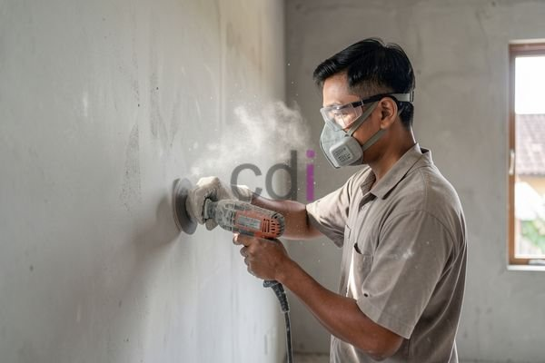

**Tersedia Cat Upox untuk Keramik: Pilihan Tahan Lama & Harga 2026** - Mitra CDI yang budiman, pernahkah Anda mengalami lantai keramik di rumah atau bisnis Anda yang mulai kusam, bernoda, dan tergores? Kondisi ini tidak hanya mengurangi estetika ruangan, tetapi juga berpotensi menimbulkan masalah kebersihan dan keamanan. Cat upox untuk keramik menawarkan solusi yang tahan lama, mudah dirawat, dan memperbarui tampilan lantai Anda secara signifikan.

## Mengapa Memilih Cat Upox untuk Keramik?

Cat upox, atau epoxy, adalah lapisan pelindung yang sangat kuat dan tahan terhadap berbagai kondisi ekstrem. Ketika diaplikasikan pada keramik, cat ini menciptakan permukaan yang sangat keras, tahan gores, tahan noda, dan tahan terhadap bahan kimia. Hal ini menjadikan cat upox pilihan ideal untuk area dengan lalu lintas tinggi seperti garasi, gudang, dapur komersial, atau bahkan kamar mandi. Selain daya tahan, cat upox juga memberikan tampilan yang mengkilap dan modern, meningkatkan nilai estetika ruangan Anda.

Salah satu keunggulan utama cat upox adalah kemudahannya dalam perawatan. Permukaan yang halus dan non-porous mencegah kotoran dan debu menempel, sehingga cukup dibersihkan dengan kain lembap secara berkala. Anda tidak perlu lagi menggunakan bahan pembersih keras atau menyikat lantai secara intensif. Selain itu, cat ini juga tahan terhadap jamur dan bakteri, sehingga menciptakan lingkungan yang lebih sehat dan higienis.

## Jenis-Jenis Cat Upox untuk Keramik dan Perbandingannya

Ada berbagai jenis cat upox yang tersedia di pasaran, masing-masing dengan karakteristik dan keunggulan tersendiri. Pemilihan jenis yang tepat tergantung pada kebutuhan spesifik Anda. Berikut adalah beberapa jenis cat upox yang umum digunakan untuk keramik:

<table class="table">
  <caption>Perbandingan Jenis Cat Upox untuk Keramik</caption>
  <thead>
    <tr><th>Jenis Cat Upox</th><th>Kelebihan</th><th>Kekurangan</th><th>Aplikasi Ideal</th></tr>
  </thead>
  <tbody>
    <tr><td>Epoxy Self-Leveling</td><td>Permukaan sangat halus dan rata, tampilan mengkilap tinggi</td><td>Harga relatif mahal, membutuhkan aplikasi oleh profesional</td><td>Garasi, pabrik, gudang, area komersial</td></tr>
    <tr><td>Epoxy 100% Solid</td><td>Sangat tahan terhadap bahan kimia dan abrasi, daya rekat tinggi</td><td>Membutuhkan persiapan permukaan yang sangat baik, waktu pengeringan lebih lama</td><td>Dapur industri, laboratorium, area dengan paparan bahan kimia tinggi</td></tr>
    <tr><td>Epoxy Water-Based</td><td>Ramah lingkungan, mudah diaplikasikan, bau tidak menyengat</td><td>Ketahanan terhadap abrasi dan bahan kimia lebih rendah dibandingkan epoxy solvent-based</td><td>Kamar mandi, dapur rumah tangga, area dengan lalu lintas rendah</td></tr>
  </tbody>
</table>

Penting untuk mempertimbangkan faktor-faktor seperti tingkat lalu lintas, paparan bahan kimia, dan anggaran Anda saat memilih jenis cat upox yang tepat. Kami di Creative Design Interior siap membantu Anda memilih produk yang paling sesuai dengan kebutuhan Anda.

## Proses Aplikasi Cat Upox untuk Keramik yang Tepat

Aplikasi cat upox membutuhkan persiapan permukaan yang matang agar hasilnya optimal. Langkah-langkahnya meliputi:

1.  **Pembersihan:** Bersihkan permukaan keramik dari kotoran, debu, minyak, dan lemak. Gunakan deterjen yang kuat dan bilas hingga bersih.
2.  **Perbaikan Kerusakan:** Perbaiki retakan atau lubang pada keramik dengan menggunakan compound perbaikan keramik.
3.  **Pengamplasan:** Amplas permukaan keramik untuk meningkatkan daya rekat cat upox.
4.  **Primer:** Aplikasikan primer epoxy untuk memastikan cat upox menempel dengan baik.
5.  **Pencampuran:** Campurkan resin dan hardener sesuai dengan petunjuk produsen.
6.  **Aplikasi:** Aplikasikan cat upox secara merata menggunakan roller atau kuas.
7.  **Pengeringan:** Biarkan cat mengering sepenuhnya sesuai dengan waktu yang ditentukan oleh produsen.

Untuk hasil terbaik, Kami sangat menyarankan Anda menggunakan jasa profesional. Tim Kami memiliki pengalaman dan keahlian untuk memastikan aplikasi cat upox yang sempurna. Kami juga menyediakan layanan persiapan permukaan, sehingga Anda tidak perlu khawatir tentang detail teknisnya.

Apakah Anda membutuhkan solusi lantai yang tahan lama dan mudah dirawat? Creative Design Interior menyediakan berbagai pilihan cat upox untuk keramik dengan kualitas terbaik. Kami juga menawarkan layanan aplikasi profesional untuk memastikan hasil yang memuaskan. Dapatkan penawaran harga terbaik untuk proyek Anda dengan menghubungi Kami. Harga ini bersifat estimasi dan dapat berubah sewaktu-waktu — hubungi Kami untuk penawaran terbaru dan paling akurat sesuai kebutuhan proyek Mitra CDI.

Untuk konsultasi lebih lanjut, tombol **Telepon** dan **WhatsApp** di bawah halaman ini dapat langsung digunakan untuk menghubungi Kami.
