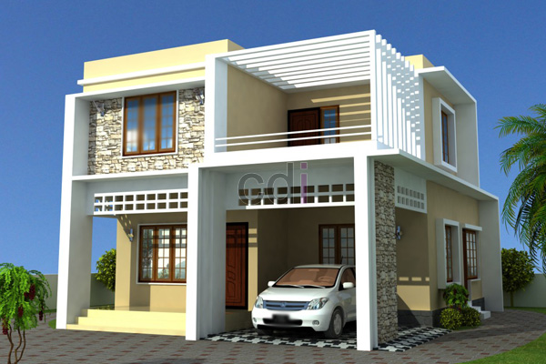

**Ciri Khas Desain Rumah Minimalis** - Hai Mitra CDI! Sedang memikirkan desain rumah impian? Nah, desain minimalis mungkin bisa jadi inspirasi yang menarik. Kalau dibilang, konsep ini berfokus pada kesederhanaan yang elegan—bukan berarti rumah jadi terkesan kosong, justru kualitas setiap elemen jadi lebih menonjol. Daripada memenuhi ruangan dengan banyak perabotan, desain minimalis lebih memilih sedikit benda berkualitas tinggi. Di (not detected), tren ini makin populer, lho!

*Mengenal Lebih Dekat Desain Rumah Minimalis*

## Kriteria Utama Rumah Minimalis

Lalu, apa saja ciri khas yang membedakan rumah minimalis dari yang lain? Secara umum, ada beberapa kriteria penting yang perlu diperhatikan:

- **Kualitas Diutamakan:** Fokus utama adalah kualitas, bukan kuantitas. Ini terlihat dari pemilihan dekorasi dan furnitur yang cermat.
- **Permukaan Bersih dan Sederhana:** Dinding tanpa banyak ornamen, dengan bidang permukaan yang jelas dan warna netral sering menjadi ciri khasnya.
- **Dekorasi yang Cermat:** Pemilihan elemen dekorasi dilakukan secara selektif, mengutamakan fungsi daripada sekadar hiasan.

## Mengapa Memilih Desain Rumah Minimalis?

Banyak yang menyukai desain minimalis karena gayanya yang elegan, simpel, dan rapi. Selain itu, ada beberapa kelebihan lain yang bisa Anda pertimbangkan:

- 1\. **Efisiensi Lahan:** Desain minimalis sangat cocok untuk lahan terbatas. Jika Anda memiliki bidang tanah yang tidak terlalu luas di (not detected), model ini bisa menjadi solusi yang tepat.
- 2\. **Tampilan Elegan dan Modern:** Walaupun simpel, rumah minimalis justru terlihat sangat elegan dan modern, dengan sentuhan unik yang membedakannya dari desain rumah konvensional.
- 3\. **Fokus pada Elemen Kunci:** Konsep dasar desain ini berpusat pada ornament, furnitur, dan dekorasi yang dipilih secara cermat. Ketiga elemen ini berperan penting dalam menciptakan tampilan yang harmonis.

Nah, itulah beberapa ciri khas desain rumah minimalis yang perlu Anda ketahui. Di (not detected) sendiri, semakin banyak orang yang memilih konsep ini untuk hunian mereka. Selain terlihat simpel dan elegan, proses pembangunannya juga relatif lebih cepat dibandingkan model desain lainnya. Jadi, sangat wajar jika desain rumah minimalis menjadi pilihan favorit bagi mereka yang mencari hunian yang hemat biaya, modern, dan tidak ketinggalan zaman. 
<table class="table">
  <caption>Perbandingan Ukuran Furnitur Minimalis</caption>
  <thead>
    <tr><th>Jenis Furnitur</th><th>Ukuran Standar</th><th>Ukuran Minimalis</th></tr>
  </thead>
  <tbody>
    <tr><td>Sofa</td><td>200x80x70 cm</td><td>150x70x60 cm</td></tr>
    <tr><td>Meja Makan</td><td>120x80 cm</td><td>90x60 cm</td></tr>
  </tbody>
</table>

Butuh bantuan untuk mewujudkan desain rumah minimalis impian Anda di (not detected)? Jangan ragu untuk menghubungi tim ahli kami! Konsultasikan kebutuhan Anda dan dapatkan solusi desain interior yang paling sesuai.