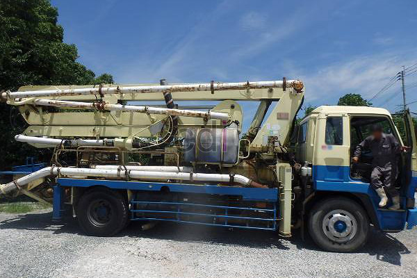

**Concrete Pump Jakarta: Solusi Efisien untuk Pengecoran Beton Skala Besar** - Hai Mitra CDI! Apakah Anda tengah bergulat dengan tantangan pengecoran beton di proyek-proyek Jakarta yang padat dan seringkali sulit dijangkau? Pengecoran yang efisien adalah kunci kelancaran proyek Anda, dan di sinilah concrete pump hadir sebagai solusi cerdas.

Pengecoran beton adalah jantung dari konstruksi. Namun, bayangkan kesulitan jika lokasi pengecoran terhalang aksesibilitas truk molen biasa. Di sinilah *concrete pump* atau pompa beton Jakarta menjadi andalan. Alat ini menawarkan efisiensi, kecepatan, dan penghematan biaya yang signifikan. Artikel ini akan mengupas tuntas concrete pump – apa saja manfaatnya, beragam jenis yang tersedia, dan bagaimana menimbang biaya yang diperlukan.

## Mengapa Concrete Pump Jakarta Jadi Pilihan Tepat untuk Proyek Anda?

Menggunakan *concrete pump* Jakarta menghadirkan banyak keunggulan dibandingkan cara konvensional. Pertama, hemat waktu! Proses pemompaan langsung menuju titik pengecoran mempercepat keseluruhan pekerjaan. Ini berdampak langsung pada ketepatan jadwal proyek Anda. Kedua, jangkauan yang tak terbatas. *Concrete pump* dapat memompa beton secara horizontal dan vertikal, bahkan ke lokasi yang tinggi atau terpencil. Ketiga, efisiensi biaya tenaga kerja. Pemompaan beton membutuhkan lebih sedikit pekerja dibandingkan metode manual, jadi pengeluaran operasional proyek bisa ditekan.

Selain efisiensi, *concrete pump* menjamin pengecoran yang lebih presisi dan merata. Distribusi beton yang homogen meminimalisir potensi munculnya rongga atau kerusakan struktur. Kualitas bangunan pun meningkat pesat. Terakhir, *concrete pump* turut meningkatkan keselamatan kerja, mengurangi risiko kecelakaan yang sering terjadi saat mengangkat dan memindahkan beban berat secara manual.

## Mengenal Beragam Jenis Concrete Pump di Jakarta

Di Jakarta, Anda bisa menemukan berbagai macam *concrete pump*, masing-masing dengan kelebihan dan kekurangannya. Klasifikasi umumnya didasarkan pada metode pemasangan: *concrete pump* stasioner, *concrete pump* mounted, dan *concrete pump* trailer.

*   **Concrete Pump Stasioner:** Ideal untuk proyek skala besar yang membutuhkan pengecoran berkelanjutan. Unit ini dipasang permanen dan menawarkan kapasitas tinggi serta biaya operasional rendah jangka panjang.
*   **Concrete Pump Mounted:** Terpasang pada truk, memberikan fleksibilitas tinggi karena mudah dipindahkan antar lokasi. Sangat cocok untuk proyek dengan mobilitas yang jadi prioritas.
*   **Concrete Pump Trailer:** Ditarik oleh kendaraan lain, memberikan fleksibilitas maksimal untuk proyek dengan akses terbatas.

Selain metode pemasangan, perbedaan juga terletak pada panjang *boom* (lengan pemompa). Semakin panjang *boom*, semakin jauh jangkauan pemompaan beton. Di Jakarta, *concrete pump long boom* dan *concrete pump super long boom* sangat direkomendasikan untuk menjangkau area pengecoran tinggi dan kompleks. Perhatikan tabel berikut untuk gambaran perbandingan:

<table class="table">
  <caption>Perbandingan Concrete Pump Berdasarkan Panjang Boom</caption>
  <thead>
    <tr><th>Jenis Concrete Pump</th><th>Panjang Boom (meter)</th><th>Kapasitas Pengecoran (m³/jam)</th><th>Aplikasi Umum</th></tr>
  </thead>
  <tbody>
    <tr><td>Concrete Pump Mini</td><td>21-26</td><td>30-60</td><td>Proyek perumahan skala kecil</td></tr>
    <tr><td>Concrete Pump Medium</td><td>28-36</td><td>60-90</td><td>Proyek komersial sedang</td></tr>
    <tr><td>Concrete Pump Long Boom</td><td>38-52</td><td>90-130</td><td>Gedung bertingkat, jembatan</td></tr>
    <tr><td>Concrete Pump Super Long Boom</td><td>56-62</td><td>120-180</td><td>Proyek infrastruktur skala besar</td></tr>
  </tbody>
</table>

## Mengulas Estimasi Biaya Sewa Concrete Pump di Jakarta

Harga sewa *concrete pump* di Jakarta bisa sangat bervariasi, dipengaruhi oleh jenis pompa, panjang *boom*, durasi sewa, dan lokasi proyek. Secara umum, kisaran harga sewa berkisar antara Rp 8.000.000 hingga Rp 30.000.000 per hari. Perlu diingat bahwa angka ini hanyalah estimasi dan bisa berubah sewaktu-waktu — untuk penawaran terkini dan paling sesuai dengan kebutuhan proyek Anda, silakan hubungi Kami.

Sebagai ilustrasi, jika Anda mengerjakan pengecoran lantai dasar bangunan komersial seluas 200 m² di daerah Jakarta Pusat, Anda mungkin membutuhkan *concrete pump* medium dengan *boom* 32 meter. Sewa unit ini selama satu hari bisa berkisar antara Rp 12.000.000 - Rp 18.000.000, belum termasuk biaya operator dan biaya transportasi.

## Apa yang Perlu Dipertimbangkan Sebelum Menyewa Concrete Pump?

Sebelum mengambil keputusan, ada beberapa aspek penting yang harus Anda pertimbangkan. Pertama, pilih penyedia jasa yang terpercaya dengan reputasi mapan. Pastikan mereka memiliki peralatan yang terawat dan operator yang berpengalaman. Kedua, hitung kebutuhan beton secara teliti. Ini membantu memilih *concrete pump* dengan kapasitas yang tepat. Ketiga, perhatikan aksesibilitas lokasi proyek. Pastikan *concrete pump* dapat dipasang dan dioperasikan dengan lancar di area tersebut.

Nah, jika Anda memiliki pertanyaan lebih lanjut, jangan ragu untuk menghubungi Kami! Tombol **Telepon** dan **WhatsApp** yang tertera di bawah ini siap melayani Anda. [Concrete Pump Kodok: Solusi Pengecoran Efisien untuk Proyek Jabodetabek](/blog/concrete-pump-kodok/) bisa jadi referensi tambahan mengenai solusi pengecoran efisien.