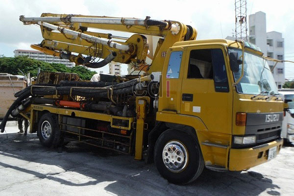

**Concrete Pump Kodok: Solusi Pengecoran Efisien untuk Proyek Jabodetabek** - Hai Mitra CDI! Pengecoran beton seringkali jadi tantangan tersendiri, ya? Apalagi kalau lokasi proyeknya sulit dijangkau. Nah, di sinilah concrete pump kodok hadir sebagai jawaban cerdas!

Pengecoran yang efisien dan tepat waktu itu krusial buat kelancaran setiap proyek konstruksi. Tapi, seringkali ada kendala karena lahan terbatas. Concrete pump kodok, atau pompa beton mini, hadir sebagai solusi praktis dan efektif untuk mengatasi masalah tersebut. Artikel ini akan membahas tuntas mengenai alat ini: mulai dari manfaatnya, hingga hal-hal penting yang perlu Anda pertimbangkan sebelum menyewanya.

## Mengenal Concrete Pump Kodok: Ukuran, Kapasitas, dan Kapan Digunakan?

Concrete pump kodok punya keunggulan utama: ukurannya yang ringkas. Dibandingkan pompa beton konvensional, concrete pump kodok jauh lebih kecil dan mudah dimanuver. Ini menjadikannya ideal untuk bekerja di ruang sempit seperti gang, halaman rumah, atau area konstruksi padat di (not detected). Kapasitas outputnya bervariasi antara 15 hingga 30 meter kubik per jam—sesuai model dan merek pompa.

Alat ini sangat cocok untuk proyek-proyek skala kecil hingga menengah. Misalnya, pembangunan rumah baru, renovasi, pengecoran lantai, atau pembuatan jalan lingkungan. Kemampuannya memompa beton secara vertikal dan horizontal dengan jangkauan lumayan jauh bikin concrete pump kodok jadi solusi serbaguna. 

Sebagai contoh, kalau Anda mengerjakan pengecoran lantai rumah tipe 45 (luas sekitar 72 meter persegi), kebutuhan betonnya rata-rata 8-10 meter kubik. Nah, concrete pump kodok dengan kapasitas 20 meter kubik per jam bisa menyelesaikan pekerjaan ini dalam waktu kurang dari satu jam. Jauh lebih cepat daripada cara manual, kan?

## Concrete Pump Kodok vs. Pompa Beton Konvensional: Mana yang Tepat?

Memilih antara concrete pump kodok dan pompa beton konvensional tergantung pada skala dan kompleksitas proyek Anda. Berikut perbandingan singkat yang bisa jadi panduan:

<table class="table">
  <caption>Perbandingan Concrete Pump Kodok vs. Konvensional</caption>
  <thead>
    <tr><th>Fitur</th><th>Concrete Pump Kodok</th><th>Pompa Beton Konvensional</th></tr>
  </thead>
  <tbody>
    <tr><td>Ukuran</td><td>Kompak, mudah manuver</td><td>Lebih besar, butuh ruang luas</td></tr>
    <tr><td>Kapasitas</td><td>15-30 m³/jam</td><td>30-100+ m³/jam</td></tr>
    <tr><td>Mobilitas</td><td>Sangat baik, ideal untuk area sempit</td><td>Terbatas, butuh akses jalan lebar</td></tr>
    <tr><td>Biaya Sewa</td><td>Relatif lebih terjangkau</td><td>Lebih mahal</td></tr>
    <tr><td>Aplikasi</td><td>Proyek kecil-menengah, renovasi rumah</td><td>Proyek besar, gedung bertingkat, infrastruktur</td></tr>
  </tbody>
</table>

Sebagai informasi, harga sewa concrete pump kodok bervariasi tergantung lokasi, durasi sewa, dan spesifikasi pompa. Anda dapat melihat estimasi harga di . Untuk informasi harga terkini dan penawaran terbaik sesuai kebutuhan proyek Anda di (not detected), langsung saja hubungi Kami. Atau, pertimbangkan juga rental pompa beton atau concrete pump untuk opsi lain.

## Tips Memilih Jasa Sewa Concrete Pump Kodok yang Terpercaya

Setelah yakin ingin menggunakan concrete pump kodok, selanjutnya adalah memilih penyedia jasa yang handal. Berikut beberapa hal yang perlu diperhatikan:

* **Reputasi Perusahaan:** Pilih penyedia jasa yang punya reputasi baik dan pengalaman memadai dalam menyediakan concrete pump kodok.
* **Kondisi Peralatan:** Pastikan pompa yang disewakan dalam kondisi prima, terawat, dan telah diperiksa secara berkala.
* **Ketersediaan Operator:** Akan lebih baik jika penyedia jasa juga menyediakan operator yang terlatih dan berpengalaman.
* **Layanan Purna Jual:** Cari penyedia jasa yang menawarkan layanan purna jual yang memuaskan, seperti dukungan teknis dan ketersediaan suku cadang.
* **Harga dan Ketentuan Sewa:** Bandingkan harga dari beberapa penyedia jasa dan pastikan Anda memahami ketentuan sewanya dengan jelas.

## Agar Pengecoran Lebih Optimal: Tips Menggunakan Concrete Pump Kodok

Yuk, simak beberapa tips ini untuk memaksimalkan hasil pengecoran menggunakan concrete pump kodok:

1. **Persiapan Lokasi:** Siapkan area pengecoran dengan baik—bersihkan dari segala penghalang dan pastikan ada jalur yang jelas untuk selang pompa.
2. **Rasio Campuran Beton:** Gunakan rasio campuran beton yang tepat sesuai kebutuhan proyek Anda. Konsultasikan dengan ahli beton untuk mendapatkan rekomendasi terbaik.
3. **Pengoperasian Pompa:** Ikuti petunjuk pengoperasian pompa dengan cermat dan jangan memaksakan pompa untuk memompa beton yang terlalu kental atau berisi material besar.
4. **Perawatan Rutin:** Setelah digunakan, bersihkan pompa secara menyeluruh dan lakukan perawatan berkala sesuai panduan produsen.

Butuh informasi lebih lanjut? Jangan sungkan untuk menghubungi Kami melalui tombol **WhatsApp** atau **Telepon** yang tersedia di halaman ini. Tim Kami siap membantu Anda dalam proyek konstruksi di (not detected)! 