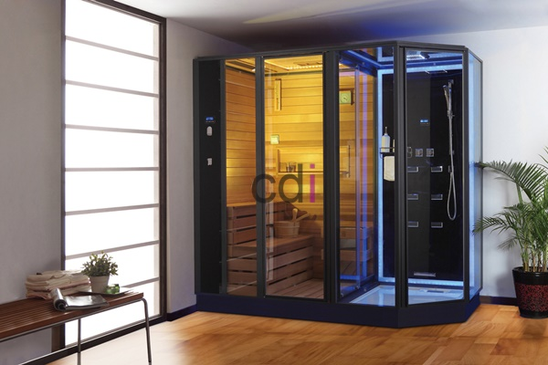

**Contoh Lemari Buku Kaca: Desain Modern dan Hemat Ruang** - Hai Mitra CDI! Pernah merasa koleksi buku dan pajangan kesayangan menumpuk, membuat ruangan terasa penuh? Atau sedang mencari cara menampilkan buku-buku dengan gaya yang lebih elegan dan memukau? Nah, lemari buku kaca bisa jadi jawaban yang tepat untuk mewujudkan ruangan impian Anda!

Lemari buku kaca bukan sekadar tempat menyimpan buku, tapi juga elemen dekoratif yang mempercantik ruangan. Desain yang tepat mampu menciptakan ilusi ruang lebih luas, bersih, dan tentunya modern. Artikel ini akan menginspirasi Anda dengan beragam contoh desain lemari buku kaca, sekaligus memberikan panduan memilih dan merawatnya.

## Inspirasi Desain Lemari Buku Kaca yang Sedang Tren

Beragam pilihan desain lemari buku kaca tersedia, tentu saja menyesuaikan dengan gaya dan kebutuhan ruangan Anda. Salah satu yang paling digemari adalah lemari buku kaca minimalis. Desain ini mengutamakan kesederhanaan bentuk dan fungsi, dengan material kaca jernih dan rangka yang ramping. Cocok banget buat ruangan bergaya modern atau Skandinavia, lho!

Selain minimalis, gaya industrial juga sedang naik daun. Lemari buku kaca industrial memadukan kaca, besi, dan kayu. Rangka besi yang kokoh memberikan kesan kuat, sementara kaca menambahkan sentuhan modern dan elegan. Ideal untuk ruangan bergaya loft atau urban.

Buat ruangan bernuansa klasik, lemari buku kaca desain antik atau vintage bisa jadi pilihan. Biasanya dihiasi ukiran indah dan detail rumit. Kaca patri atau bertekstur akan semakin mempercantik dan memberikan kesan mewah.

## Memilih Material Kaca yang Tepat untuk Lemari Buku Anda

Memilih material kaca yang tepat itu krusial untuk keamanan, daya tahan, dan tampilan lemari buku kaca Anda. Ada dua jenis kaca yang paling umum digunakan, yaitu kaca bening dan kaca tempered.

Kaca bening memberikan tampilan jernih dan transparan, memudahkan Anda melihat isi lemari. Cocok untuk ruangan yang butuh pencahayaan alami maksimal. Perlu diingat, kaca bening cenderung lebih mudah pecah dibandingkan kaca tempered.

Kaca tempered adalah kaca yang diproses khusus agar lebih kuat. Lebih tahan terhadap benturan dan tekanan, sehingga lebih aman untuk lemari buku. Kalaupun pecah, kaca tempered akan hancur menjadi butiran-butiran kecil yang tidak tajam, meminimalkan risiko cedera. Biasanya harganya sedikit lebih mahal dari kaca bening.

Ingin tampilan yang unik? Kaca frosted atau bertekstur bisa jadi pilihan menarik. Kaca frosted memberikan efek buram, menyembunyikan isi lemari. Sementara kaca bertekstur menawarkan efek visual yang menawan.

## Wujudkan Lemari Buku Kaca Impian Anda Bersama CDI di (not detected)

Creative Design Interior (CDI) siap mewujudkan lemari buku kaca custom sesuai keinginan dan kebutuhan Anda! Kami sudah lebih dari 10 tahun berpengalaman dalam pembuatan furniture interior, termasuk lemari buku kaca dengan berbagai desain dan ukuran. Konsultasi desain gratis tersedia untuk membantu Anda menentukan desain yang paling pas untuk ruangan Anda di (not detected).

Kami hanya menggunakan material berkualitas tinggi dan proses pengerjaan yang teliti, memastikan lemari buku kaca buatan Kami kokoh, tahan lama, dan tampil elegan. Skema harga Kami *all-in-one*, mencakup material, pengiriman, dan bongkar muat. Ada juga promo gratis ongkir untuk area tertentu di sekitar (not detected). Kami menawarkan fleksibilitas pembayaran, mulai dari COD, transfer bank, DP 50%, transfer setelah barang terkirim, bayar bertahap, hingga transfer setelah pekerjaan selesai.

Kami melayani pemesanan lemari buku kaca custom untuk wilayah Jakarta, Bogor, Depok, Tangerang, Bekasi, Cikarang, Karawang, Bandung, Serang, Purwakarta, Cilegon, Cikampek, Subang, dan Rangkasbitung. Untuk informasi lebih lanjut tentang layanan dan harga lemari buku kaca custom, silakan kunjungi [Daftar Harga](URL) Kami atau langsung hubungi Kami melalui tombol **Telepon** atau **WhatsApp** di bawah ini.

Yuk, wujudkan proyek interior impian Anda! Hubungi tim Kami melalui tombol **Telepon** atau **WhatsApp** yang tersedia di bawah ini. Jangan ragu untuk berkonsultasi dengan tim ahli Kami!