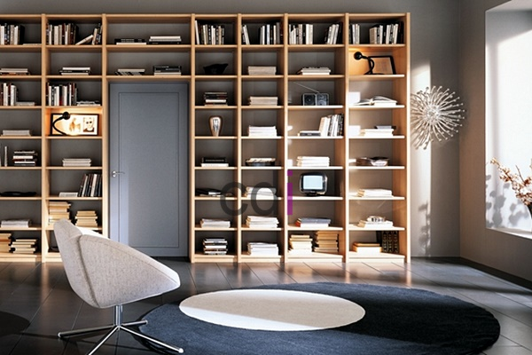

**Contoh Lemari Buku Kayu: Ragam Desain untuk Ruang Belajar Nyaman** - Hai Mitra CDI! Mencari cara agar ruang belajar terasa lebih tertata dan menginspirasi? Punya tumpukan buku yang bikin ruangan terasa sempit? Nah, lemari buku kayu bisa jadi solusi tepat yang menggabungkan fungsionalitas dan keindahan.

Ruang belajar yang nyaman dan terorganisir itu penting banget, lho, untuk meningkatkan fokus dan produktivitas. Apalagi kalau koleksi bukunya sudah banyak. Mitra CDI tentu ingin punya tempat penyimpanan yang tidak hanya praktis, tapi juga estetis dan bikin ruang belajar semakin menyenangkan. Artikel ini akan membahas berbagai ide desain lemari buku kayu yang bisa jadi inspirasi untuk menciptakan ruang belajar impian Anda.

## Pilih Kayu yang Sesuai: Kualitas dan Tampilan Lemari Buku

Memilih jenis kayu yang tepat adalah kunci utama dalam menentukan kualitas dan keawetan lemari buku. Ada banyak pilihan kayu yang tersedia, masing-masing dengan karakteristik uniknya. Kayu solid seperti jati, mahoni, dan oak menawarkan kekuatan dan keindahan alami yang tahan lama. Kayu jati, misalnya, dikenal sangat tahan terhadap cuaca ekstrem dan hama, menjadikannya pilihan ideal untuk iklim tropis seperti di (not detected).

Untuk opsi yang lebih ekonomis, kayu lapis atau MDF (Medium Density Fiberboard) bisa jadi alternatif yang baik. Meski tidak sekuat kayu solid, MDF memiliki permukaan yang halus dan mudah diproses, sehingga cocok untuk dicat atau dilapisi veneer dengan berbagai motif kayu. Ketebalan material juga penting diperhatikan; untuk lemari buku yang akan menampung banyak buku, MDF minimal 18mm sangat disarankan untuk memastikan kekokohannya.

## Inspirasi Desain: Sesuaikan dengan Gaya Interior Anda

Gaya interior ruang belajar akan sangat menentukan desain lemari buku yang paling tepat. Mitra, bagi Anda yang menyukai gaya minimalis, lemari buku dengan desain simpel, garis bersih, dan warna netral seperti putih, abu-abu, atau cokelat muda akan terlihat sangat serasi. Pilihan seperti lemari buku gantung atau rak buku terbuka bisa menciptakan ilusi ruang yang lebih luas dan modern. Bagaimana, sudah kebayang belum?

Kalau Anda lebih menyukai gaya klasik atau tradisional, lemari buku kayu dengan ukiran detail, warna gelap seperti cokelat tua atau merah mahoni, serta sentuhan kaca patri akan menghadirkan suasana elegan dan mewah. Lemari buku dengan pintu kaca juga bisa menjadi pilihan menarik untuk menampilkan koleksi buku sekaligus melindunginya dari debu. Percayakan pada keahlian kami di Creative Design Interior untuk mewujudkan desain sesuai keinginan Anda.

## Lemari Buku Custom: Solusi Penyimpanan yang Tepat Guna

Setiap ruangan punya bentuk dan kebutuhan yang berbeda-beda. Mitra CDI, lemari buku custom menawarkan solusi penyimpanan yang benar-benar dipersonalisasi dan pas dengan ruang Anda. Kami bisa menyesuaikan ukuran, bentuk, warna, hingga fitur lemari buku sesuai dengan ketersediaan ruang dan jumlah koleksi buku.

Bayangkan, jika Anda memiliki ruang yang terbatas, kami bisa merancang lemari buku tinggi dan ramping dengan rak yang bisa diatur ketinggiannya. Atau, apabila Anda punya koleksi buku yang sangat banyak, kami dapat membuat lemari buku yang membentang sepanjang dinding, lengkap dengan kombinasi rak terbuka, rak tertutup, dan laci.  Harga lemari buku custom akan bergantung pada jenis kayu, ukuran, dan tingkat kerumitan desain – detail selengkapnya bisa dilihat di . Kami telah berpengalaman lebih dari 10 tahun dalam pembuatan furniture custom, termasuk lemari buku kayu. Tim terlatih kami menggunakan material berkualitas tinggi untuk hasil yang optimal. Pelayanan pengiriman dan pemasangan gratis tersedia untuk wilayah (not detected) dan sekitarnya. Hubungi kami melalui tombol **WhatsApp** atau **Telepon** pada halaman ini untuk konsultasi gratis dan pemesanan lemari buku custom impian Anda. [Lemari Kayu 2 Pintu: Pilihan Tepat untuk Ruang Tidur Minimalis Modern](/blog/lemari-kayu-2-pintu/) juga bisa jadi inspirasi terkait furniture custom lainnya.

Kami berkomitmen untuk memberikan yang terbaik bagi Mitra. Jika masih ada pertanyaan, jangan sungkan untuk menghubungi Kami melalui tombol **WhatsApp** atau **Telepon** yang tersedia di halaman ini.

<table class="table">
  <caption>Perbandingan Jenis Kayu untuk Lemari Buku</caption>
  <thead>
    <tr><th>Jenis Kayu</th><th>Kekuatan</th><th>Ketahanan</th><th>Harga (Estimasi)</th></tr>
  </thead>
  <tbody>
    <tr><td>Jati</td><td>Sangat Kuat</td><td>Sangat Tahan Lama</td><td>Mahal</td></tr>
    <tr><td>Mahoni</td><td>Kuat</td><td>Tahan Lama</td><td>Menengah</td></tr>
    <tr><td>Oak</td><td>Kuat</td><td>Tahan Lama</td><td>Mahal</td></tr>
    <tr><td>MDF</td><td>Sedang</td><td>Cukup Tahan Lama</td><td>Ekonomis</td></tr>
  </tbody>
</table>
