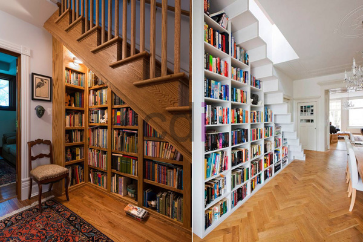

**Contoh Lemari Rak Buku: Pilih Desain & Ukuran Ideal Bersama CDI** - Hai Mitra CDI! Lagi cari cara pintar untuk menata buku-buku kesayangan sekaligus bikin ruangan makin oke? Memilih lemari rak buku yang pas itu penting banget. Bukan cuma soal tampilan, tapi juga soal fungsi dan seberapa efisien ruang yang kita punya. Nah, di sini, Kami siap bantu Mitra menemukan solusi yang paling cocok!

### Memikirkan Lemari Rak Buku yang Pas: Apa Saja yang Perlu Dipertimbangkan?

Saat memilih lemari rak buku, ada beberapa hal penting yang perlu diperhatikan, Mitra CDI. Pertama, ukuran ruangan tentu jadi penentu utama. Lemari yang terlalu besar bisa bikin ruangan terasa penuh, sementara yang terlalu kecil ya kurang memadai untuk semua koleksi buku Mitra. Jadi, sebaiknya ukur dulu area yang akan ditempati lemari, lalu sesuaikan dengan ukuran lemari yang tersedia. Selain itu, perhatikan juga gaya interior ruangan. Lemari rak buku hadir dalam berbagai desain, mulai dari yang minimalis modern sampai klasik elegan. Pastikan lemari yang dipilih cocok dengan tema dekorasi rumah Mitra. Terakhir, yuk, pertimbangkan juga materialnya! Kayu solid, MDF, atau *particle board* punya kelebihan dan kekurangannya masing-masing. Kayu solid memang kuat dan terlihat alami, tapi harganya lumayan. Sementara MDF dan *particle board* lebih terjangkau, tapi kualitasnya juga perlu dicek biar awet.

### Desain Lemari Rak Buku Custom: Bebas Berkreasi dengan CDI

Kami di Creative Design Interior (CDI) punya solusi keren: desain lemari rak buku custom! Dengan layanan ini, Mitra bisa menentukan sendiri ukuran, bentuk, warna, dan material yang diinginkan. Pas banget buat ruangan yang ukurannya unik atau kalau Mitra punya desain khusus yang pengen diwujudkan. Ini daftar pilihan material yang tersedia:

<table class="table">
  <caption>Perbandingan Material Lemari Rak Buku</caption>
  <thead>
    <tr><th>Material</th><th>Kelebihan</th><th>Kekurangan</th><th>Estimasi Harga (per meter)</th></tr>
  </thead>
  <tbody>
    <tr><td>Kayu Solid (Mahoni, Jati)</td><td>Kuat, tahan lama, tampilan alami, bisa diperbaiki</td><td>Harga mahal, rentan terhadap rayap (perlu perawatan)</td><td>Rp 2.500.000 - Rp 5.000.000</td></tr>
    <tr><td>MDF (Medium Density Fiberboard)</td><td>Permukaan halus, mudah dicat, harga terjangkau</td><td>Kurang kuat, mudah rusak jika terkena air</td><td>Rp 800.000 - Rp 1.800.000</td></tr>
    <tr><td>Particle Board</td><td>Paling terjangkau</td><td>Kurang kuat, mudah mengembang jika terkena air, kurang tahan lama</td><td>Rp 500.000 - Rp 1.200.000</td></tr>
  </tbody>
</table>

Ingat, harga di atas hanya perkiraan dan bisa berubah sewaktu-waktu. Untuk penawaran paling akurat, yuk hubungi Kami langsung! Dengan layanan custom dari CDI, Mitra bebas berkreasi tanpa kompromi soal desain atau kualitas.

### Lebih dari Sekadar Furniture: Jasa Pengecoran & Material Bangunan

CDI bukan cuma jago bikin lemari rak buku custom, lho. Kami juga menyediakan jasa pengecoran untuk fondasi atau struktur penunjang lemari, terutama yang ukurannya besar atau berat. Misalnya, kalau Mitra menginginkan lemari tinggi menjulang yang menempel di dinding, Kami bisa bantu mengecor fondasi yang kuat dan aman. Selain itu, Kami juga suplai berbagai material bangunan berkualitas dengan harga yang bersaing. Dengan CDI, semua kebutuhan proyek interior Mitra bisa terpenuhi dalam satu tempat! Pengalaman Kami lebih dari 10 tahun di bidang furniture dan material bangunan, jadi Mitra bisa tenang mempercayakan proyek ini pada ahlinya. Ditambah lagi, Kami menawarkan fleksibilitas pembayaran.

### CDI Hadir di (not detected) dan Sekitarnya

Mitra CDI, Kami melayani wilayah (not detected), Jakarta, Bogor, Depok, Tangerang, Bekasi, Cikarang, Karawang, Bandung, Serang, Purwakarta, Cilegon, Cikampek, Subang, dan Rangkasbitung. Jangan ragu untuk menghubungi Kami melalui tombol **Telepon** atau **WhatsApp** di bawah ini. Tim Kami siap mewujudkan lemari rak buku impian Mitra! [Beli Rak Buku Dinding: Tampilan Rapi, Ruang Lebih Luas](/blog/beli-rak-buku-dinding/) — Temukan inspirasi rak buku dinding untuk memaksimalkan ruang.