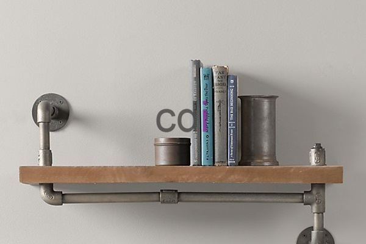

**Contoh Rak Buku Gantung: Hemat Ruang, Desain Modern untuk Rumah Anda** - Halo Mitra CDI! Sering merasa kesulitan mengatur buku-buku kesayangan di rumah? Ruangan jadi terasa penuh dan kurang nyaman? Jangan khawatir, kami punya solusinya! Rak buku gantung bisa jadi jawaban tepat. Selain memaksimalkan ruang vertikal yang sering terlewatkan, rak ini juga memberikan sentuhan desain modern yang bikin rumah makin estetik. Yuk, simak ulasan lengkapnya!

## Kenapa Rak Buku Gantung Jadi Pilihan Cerdas? Keuntungan dan Kelebihannya

Banyak yang memilih rak buku gantung, dan alasannya cukup jelas. Keuntungan utamanya tentu saja menghemat ruang. Dengan dipasang di dinding, Anda bisa mengoptimalkan area lantai, terutama untuk ruangan yang tidak terlalu luas. Ini solusi yang pas banget buat apartemen, studio, atau rumah minimalis di (not detected).

Selain hemat ruang, rak buku gantung juga fleksibel dalam penataan. Anda bebas mengatur ketinggian dan jarak antar rak sesuai selera. Jadi, koleksi buku, pajangan, atau barang-barang kesayangan bisa ditampilkan secara kreatif dan personal. 

Ditambah lagi, rak buku gantung bisa jadi pusat perhatian di ruangan. Dengan desain yang tepat, tampilan visualnya jadi unik dan kekinian. Pemasangannya pun relatif mudah dan bisa disesuaikan dengan kebutuhan Anda.

## Pilih Material yang Tepat: Panduan Material Rak Buku Gantung

Ada beberapa pilihan material untuk membuat rak buku gantung, masing-masing punya kelebihan dan kekurangannya. Pilihan umumnya ada kayu solid, MDF (Medium-Density Fiberboard), dan metal—atau kombinasinya.

Kalau ingin tampilan klasik dan elegan, kayu solid seperti jati, mahoni, atau pinus adalah opsi terbaik. Kuat, awet, dan memberikan kesan hangat alami. Tapi ingat, material ini biasanya lebih mahal dan butuh perawatan ekstra.

MDF bisa jadi alternatif yang lebih ekonomis dan mudah diolah. Permukaannya halus dan rata, cocok untuk dicat atau dilapisi veneer. Bobotnya juga lebih ringan dari kayu solid, jadi lebih mudah dipasang. Kekurangannya? Kurang tahan terhadap kelembaban dan beban berat.

Rak buku gantung berbahan metal menawarkan kesan modern dan industrial. Kuat, tahan lama, dan gampang dibersihkan. Tapi, metal bisa terasa kurang ramah dan nyaman secara visual. 

<table class="table">
  <caption>Perbandingan Material Rak Buku Gantung</caption>
  <thead>
    <tr><th>Material</th><th>Kelebihan</th><th>Kekurangan</th><th>Estimasi Harga/Meter</th></tr>
  </thead>
  <tbody>
    <tr><td>Kayu Solid</td><td>Kuat, tahan lama, tampilan klasik</td><td>Mahal, butuh perawatan</td><td>Rp 300.000 - Rp 800.000</td></tr>
    <tr><td>MDF</td><td>Ekonomis, mudah dikerjakan</td><td>Kurang tahan lembab dan beban berat</td><td>Rp 150.000 - Rp 400.000</td></tr>
    <tr><td>Metal</td><td>Kuat, tahan lama, tampilan modern</td><td>Terasa dingin</td><td>Rp 200.000 - Rp 500.000</td></tr>
  </tbody>
</table>

Perlu diingat, harga di atas hanyalah estimasi dan bisa berubah sewaktu-waktu. Untuk penawaran paling akurat sesuai proyek Anda, jangan ragu untuk menghubungi Kami. Kami menyediakan berbagai pilihan material berkualitas untuk rak buku gantung, disesuaikan dengan budget dan gaya interior Anda.

## Inspirasi Desain Rak Buku Gantung untuk Berbagai Gaya Rumah

Ada banyak sekali ide desain rak buku gantung yang bisa Anda terapkan! Untuk gaya minimalis, pilih desain simpel dan warna netral seperti putih, abu-abu, atau hitam. Bentuk geometris atau asimetris juga bisa jadi pilihan menarik.

Suka gaya industrial? Pilih rak berbahan metal dengan tampilan kasar dan minimalis. Kombinasi kayu dan metal bisa menciptakan tampilan unik dan artistik.

Kalau lebih suka gaya klasik, pilih rak berbahan kayu solid dengan ukiran atau detail dekoratif. Warna-warna hangat seperti cokelat atau krem bisa menciptakan suasana nyaman dan elegan. 

Supaya lebih menarik, tambahkan pencahayaan pada rak buku gantung Anda. Lampu sorot atau strip LED bisa menyoroti koleksi buku atau pajangan, menciptakan efek visual yang memukau. Nah, untuk inspirasi lebih lanjut, Anda bisa cek juga artikel [Beli Rak Buku Dinding: Tampilan Rapi, Ruang Lebih Luas](/blog/beli-rak-buku-dinding/) di situs kami.

## Rak Buku Gantung Custom: Realisasikan Impian Desain Anda Bersama CDI

Mencari contoh rak buku gantung yang benar-benar sesuai dengan impian Anda di (not detected)? Kami di Creative Design Interior siap membantu! Dengan pengalaman lebih dari 10 tahun dalam pembuatan furniture custom, Kami menawarkan layanan desain dan produksi rak buku gantung sesuai kebutuhan dan anggaran Anda.

Kami menyediakan berbagai pilihan material, ukuran, dan desain yang bisa Anda kustomisasi sesuai gaya interior rumah Anda. Selain itu, kami juga menyediakan layanan konsultasi gratis untuk membantu Anda memilih desain dan material terbaik.

Tim Kami terdiri dari tenaga kerja berpengalaman dan terampil dalam membuat furniture custom berkualitas tinggi. Kami hanya menggunakan material pilihan dan teknologi terkini untuk memastikan rak buku gantung Anda awet dan tahan lama. Kami juga menawarkan skema harga *all-in* yang transparan, jadi Anda tidak perlu khawatir ada biaya tersembunyi.

Kami melayani wilayah Jakarta, Bogor, Depok, Tangerang, Bekasi, Cikarang, Karawang, Bandung, Serang, Purwakarta, Cilegon, Cikampek, Subang, dan Rangkasbitung. Bahkan, ada garansi tukar produk jika tidak sesuai spesifikasi (selama belum dipakai atau dibongkar dan maksimal 1 hari). Untuk informasi lebih lengkap dan daftar harga, silakan kunjungi halaman Daftar Harga.

Jangan tunda lagi! Tim Kami siap mewujudkan proyek desain interior impian Anda. Hubungi Kami sekarang juga melalui tombol **Telepon** atau **WhatsApp** di bawah ini. Kami tunggu kabar baiknya dari Anda!