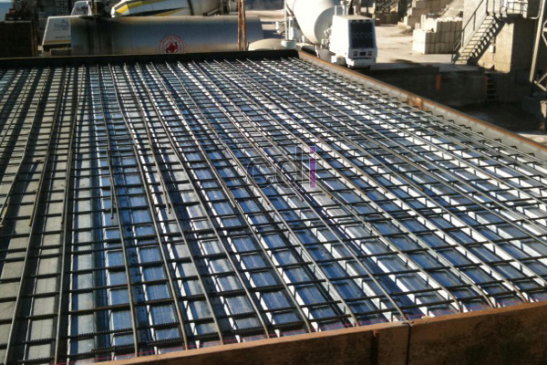

**Cor Dak Bondek Vs Konvensional: Pilih yang Tepat untuk Hunian Anda** - Hai Mitra CDI! Sedang merencanakan pembangunan atau renovasi di (not detected)? Nah, seringkali muncul pertanyaan: cor dak bondek atau yang konvensional, ya? Banyak yang bingung menentukan pilihan terbaik. 

Keputusan antara cor dak bondek dan konvensional ini bukan sekadar soal harga, tapi lebih kepada menimbang keuntungan dan kerugian masing-masing. Pilihannya idealnya disesuaikan dengan karakter proyek Anda, mulai dari desain, target waktu pengerjaan, hingga rencana jangka panjang bangunan.

Seringkali keputusan diambil terburu-buru hanya karena mendengar rekomendasi dari tukang atau terpaku pada harga termurah. Padahal, pertimbangan mendalam harus jadi prioritas utama.

## Apa Itu Cor Dak Bondek?

Bondek itu sebenarnya adalah pelat baja ringan yang dilapisi galvanis atau zincalume. Fungsinya seperti cetakan sekaligus pengganti bekisting kayu. Ukurannya standar, jadi pemasangannya relatif cepat karena langsung dipasang di atas balok. Keunggulan lainnya? Bentuk bergelombangnya memberikan kekuatan tambahan pada beton, seolah-olah bertindak sebagai tulangan ekstra.

## Apa Itu Cor Dak Konvensional?

Ini adalah metode yang lebih tradisional, menggunakan papan kayu atau tripleks sebagai bekisting sementara. Bekisting ini kemudian ditopang oleh balok kayu sampai beton benar-benar mengering. Metode ini sudah sangat umum dan masih banyak digunakan, terutama untuk bangunan dengan anggaran terbatas atau desain khusus.

## Mari Kita Bandingkan!

| Aspek | Bondek | Konvensional |
|---|---|---|
| Kecepatan pemasangan | Jauh lebih cepat | Membutuhkan waktu lebih lama |
| Biaya material awal | Relatif lebih tinggi | Lebih ekonomis |
| Ketahanan terhadap karat | Sangat baik | Bergantung pada kualitas kayu |
| Fleksibilitas desain | Terbatas pada bentuk standar | Lebih mudah dikustomisasi |
| Jumlah limbah konstruksi | Minim | Menghasilkan limbah lebih banyak (bekisting kayu) |
| Keterampilan tenaga kerja | Membutuhkan tenaga yang terlatih | Umumnya dikuasai oleh tukang bangunan |

## Kapan Sebaiknya Memilih Bondek?

Bondek sangat cocok untuk proyek-proyek besar atau bangunan bertingkat yang mengutamakan efisiensi waktu. Pemasangannya yang cepat, minim tenaga tambahan, dan hasil akhir yang rapi membuatnya jadi solusi praktis. Selain itu, bondek ideal untuk area dengan akses terbatas karena tidak memerlukan penumpukan material kayu yang banyak.

## Kapan Cor Dak Konvensional Masih Menjadi Pilihan?

Metode konvensional masih relevan untuk proyek dengan desain unik yang tidak standar, misalnya dak dengan bentuk melengkung atau sudut-sudut yang rumit. Kalau anggaran Anda terbatas dan kayu mudah didapatkan di lokasi proyek, metode ini bisa jadi pertimbangan yang tepat. Keunggulan lain adalah fleksibilitasnya: perubahan desain di lapangan bisa dilakukan dengan relatif mudah karena bekisting kayu bisa dimodifikasi langsung.

## Bagaimana Dampaknya pada Bangunan dalam Jangka Panjang?

Selain biaya awal, pikirkan juga tentang perawatan di masa depan. Bondek yang tahan karat cenderung lebih minim perawatan selama bertahun-tahun. Sementara itu, kualitas dak konvensional akan sangat bergantung pada keahlian tukang yang mengerjakannya, termasuk kerapatan pemasangan bekisting saat pengecoran.

## Faktor Penting yang Harus Dipertimbangkan

Jadi, apa yang perlu Anda pertimbangkan sebelum mengambil keputusan? Tiga hal utama: anggaran yang tersedia, kompleksitas desain dak yang Anda inginkan, dan seberapa penting kecepatan pengerjaan bagi keseluruhan jadwal proyek. Setiap pilihan punya kelebihan dan kekurangannya masing-masing.

## Perkiraan Biaya: Bondek vs Konvensional

Sebagai gambaran, biaya cor dak bondek biasanya berkisar antara Rp450.000 - Rp650.000 per meter persegi (termasuk material bondek dan pengecoran). Sementara itu, biaya cor dak konvensional berkisar antara Rp350.000 - Rp500.000 per meter persegi, tetapi belum termasuk biaya tambahan untuk pembongkaran bekisting dan pembuangan limbah kayu. Perbedaan ini perlu diperhitungkan bersamaan dengan waktu pengerjaan yang akan memengaruhi biaya tenaga kerja. 

## Jadi, Bisa Kah Kedua Metode Ini Digabungkan?

Tentu saja bisa! Beberapa proyek mengkombinasikan keduanya. Misalnya, menggunakan bondek untuk area dak yang luas dan rata, kemudian bekisting konvensional untuk bagian tepi atau sudut yang bentuknya tidak standar. Pendekatan ini bisa jadi solusi cerdas untuk memaksimalkan efisiensi dan fleksibilitas.

## Kesimpulan: Pilihan Terbaik untuk Anda

Cor dak bondek menawarkan kecepatan dan ketahanan jangka panjang, sementara cor dak konvensional memberikan fleksibilitas dan harga yang lebih terjangkau di awal. Pilihan terbaik sepenuhnya bergantung pada prioritas dan kondisi proyek Anda.

Masih bingung mau pilih yang mana? Jangan ragu untuk berkonsultasi dengan tim Creative Design Interior! Hubungi kami melalui tombol **Telepon** atau **WhatsApp** yang ada di bawah tampilan halaman ini. Kami siap membantu Anda menemukan solusi terbaik untuk hunian impian Anda di (not detected)! [Kelebihan Dak Bondek Vs Konvensional](/blog/kelebihan-dak-bondek-vs-konvensional/) — agar Anda bisa tahu lebih detail perbandingan keduanya. [Atap Bondek Cor: Panduan Lengkap Kekuatan, Pemasangan, dan Estimasi Biaya 2026](/blog/atap-bondek-cor/) — informasi penting untuk memperkirakan anggaran Anda.