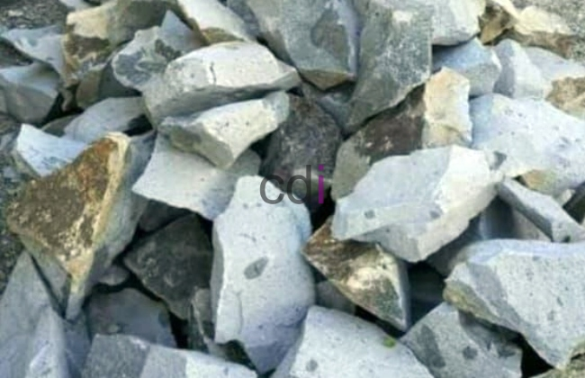

**Cor Pondasi** - Hai Mitra CDI! Pernahkah terbersit pikiran, pondasi itu seperti apa, ya? Ibaratnya, ini adalah 'jantung' dari sebuah bangunan. Pondasi yang kuat menjamin rumah berdiri tegak dan awet bertahun-tahun. Tapi, membuat pondasi itu nggak bisa sembarangan, lho! Ada banyak detail penting yang perlu diperhatikan demi hasil yang optimal. Nah, di artikel ini, kami akan membagikan tips dan panduan lengkap tentang cor pondasi untuk rumah impian Mitra CDI. Yuk, kita mulai!

## Mengapa Pondasi Kokoh Itu Krusial?
Pondasi adalah elemen struktur bangunan yang terletak paling bawah, bertugas menanggung seluruh beban di atasnya. Bayangkan jika pondasinya rapuh – konsekuensinya bisa sangat serius. Mulai dari dinding retak hingga potensi bangunan roboh. Ngeri, kan?

Ketika melakukan pengecoran pondasi, kualitas material dan ketepatan proses pengerjaan jadi kunci utama. Pondasi yang kokoh bukan cuma soal keamanan, tapi juga investasi jangka panjang. Bangunan dengan fondasi yang baik cenderung lebih tahan lama dan minim perawatan.

Lebih dari itu, pondasi yang andal juga meningkatkan nilai jual properti Mitra CDI. Rumah dengan konstruksi yang solid pasti lebih menarik bagi calon pembeli, dan harganya pun lebih tinggi.

## Material Esensial untuk Cor Pondasi
Mitra CDI, sebelum memulai pengecoran, pastikan semua bahan yang dibutuhkan sudah lengkap dan memenuhi standar kualitas. Berikut adalah daftar material utama:

1.  **Semen**
    Pilih semen berkualitas tinggi yang terbukti memiliki kekuatan optimal. Semen ini adalah bahan dasar utama dalam campuran beton.

2.  **Pasir**
    Gunakan pasir bersih, bebas dari lumpur, tanah liat, atau kotoran organik. Pasir kotor dapat mengurangi daya rekat beton, jadi hati-hati ya!

3.  **Kerikil atau Agregat Kasar**
    Kerikil berfungsi sebagai agregat kasar yang memperkuat struktur beton. Pastikan ukurannya seragam – jangan terlalu kecil, jangan juga terlalu besar.

4.  **Air Bersih**
    Air yang digunakan harus bersih dan bebas dari kontaminan seperti minyak, lumpur, atau zat kimia. Air kotor dapat merusak kualitas beton.

5.  **Besi Tulangan**
    Besi tulangan memberikan kekuatan tarik pada pondasi, menjadikannya lebih mampu menahan beban berat. Pilih besi dengan diameter dan spesifikasi yang sesuai dengan kebutuhan bangunan Mitra CDI.

## Langkah-Langkah Pengecoran Pondasi yang Benar
Supaya hasil cor pondasi maksimal dan awet, ikuti langkah-langkah penting berikut ini:

1.  **Persiapan Area Kerja**
    Pastikan area cor pondasi siap digunakan. Bersihkan dari sampah, batu besar, akar pohon, dan segala hal yang bisa mengganggu proses pengecoran.

2.  **Pemasangan Bekisting**
    Bekisting adalah cetakan sementara untuk membentuk pondasi. Pasang bekisting dengan kokoh dan presisi, sehingga dimensi pondasi sesuai dengan rencana desain.

3.  **Pencampuran Bahan**
    Campurkan material dengan perbandingan yang tepat. Umumnya, rasio yang digunakan adalah 1:2:3 (1 bagian semen, 2 bagian pasir, dan 3 bagian kerikil). Tambahkan air secara bertahap hingga campuran mencapai konsistensi yang ideal.

4.  **Proses Pengecoran Bertahap**
    Tuangkan campuran beton ke dalam bekisting secara merata dan bertahap. Gunakan alat vibrator untuk memadatkan beton dan menghilangkan gelembung udara yang terperangkap.

5.  **Perawatan (Curing) Beton**
    Setelah beton mengeras, lakukan perawatan dengan menyiram air secara teratur selama beberapa hari. Hal ini mencegah retak akibat penguapan air yang terlalu cepat dan membantu beton mencapai kekuatan maksimal.

## Hindari Kesalahan Umum Saat Cor Pondasi
Mitra CDI, ada beberapa kesalahan yang sering terjadi saat pengecoran pondasi. Mari hindari hal-hal berikut ini:

*   **Kualitas Material yang Diabaikan**
    Jangan tergoda harga murah dengan mengorbankan kualitas material. Material berkualitas rendah bisa mengancam kekuatan pondasi.

*   **Campuran Bahan yang Tidak Tepat**
    Pastikan perbandingan campuran bahan sesuai dengan rekomendasi. Campuran yang tidak tepat dapat membuat beton menjadi rapuh atau tidak kuat.

*   **Perawatan Beton yang Terlupakan**
    Jangan lupakan proses curing setelah beton mengeras. Perawatan yang baik akan mencegah retak dan memastikan beton mencapai kekuatan optimal.

## Biarkan Ahlinya yang Menangani!
Mitra CDI, meskipun terlihat sederhana, pengecoran pondasi memerlukan keahlian dan pengalaman khusus. Jika tidak dilakukan dengan benar, hasilnya bisa mengecewakan, bahkan membahayakan keselamatan bangunan. Risiko kegagalan cukup besar kalau dikerjakan tanpa ilmu yang benar.

Jadi, daripada mencoba-coba sendiri, serahkan urusan ini kepada ahlinya! Tim Creative Design Interior (CDI) siap membantu membangun pondasi yang kokoh dan tahan lama untuk hunian Mitra CDI. Dengan pengalaman bertahun-tahun di bidang konstruksi, desain interior, dan penyediaan material bangunan di (not detected), kami memberikan jaminan kualitas dan ketenangan pikiran.

Semoga panduan ini bermanfaat, ya. Untuk konsultasi gratis, penawaran harga terbaik, atau sekadar diskusi, jangan sungkan untuk menghubungi kami. Silakan klik tombol **Telepon** atau **WhatsApp** yang ada di bawah ini untuk terhubung dengan tim ahli kami! Siap membantu mewujudkan bangunan impian Anda di (not detected).