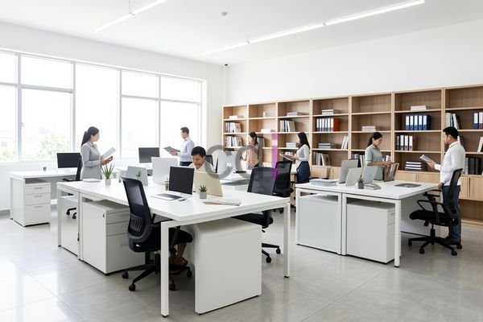

**Daftar Harga Furniture Kantor: Solusi Lengkap untuk Ruang Kerja Anda** - Mitra CDI yang budiman, pemilihan furniture kantor yang tepat merupakan investasi penting bagi produktivitas dan kenyamanan karyawan. Dengan beragam pilihan yang tersedia, menemukan furniture yang sesuai dengan anggaran dan kebutuhan Anda bisa menjadi tantangan tersendiri. 

Memilih furniture kantor yang tepat tidak hanya soal estetika, tetapi juga ergonomi, durabilitas, dan tentu saja, harga. Anda pasti ingin mendapatkan kualitas terbaik dengan harga yang sesuai. Kami dari Creative Design Interior hadir untuk membantu Anda menemukan solusi furniture kantor yang ideal.

## Memahami Rentang Harga Furniture Kantor di Tahun 2026

Rentang harga furniture kantor bervariasi signifikan, bergantung pada material, ukuran, desain, dan merek. Secara umum, Anda dapat menemukan pilihan dengan harga yang berbeda-beda, mulai dari produk massal hingga custom-made. Untuk meja kantor, misalnya, harga mulai dari sekitar Rp 500.000 untuk model sederhana berbahan particle board hingga lebih dari Rp 5.000.000 untuk meja eksekutif berbahan kayu solid atau dengan fitur elektrik yang dapat diatur ketinggiannya.

Kursi kantor juga memiliki rentang harga yang luas. Kursi standar dengan sandaran rendah dapat ditemukan mulai dari Rp 300.000, sementara kursi ergonomis dengan fitur lumbar support dan headrest dapat mencapai Rp 2.000.000 atau lebih.  Harga ini bersifat estimasi dan dapat berubah sewaktu-waktu — hubungi Kami untuk penawaran terbaru dan paling akurat sesuai kebutuhan proyek Anda.

## Solusi Furniture Kantor All-in-One dari Creative Design Interior

Kami di Creative Design Interior menawarkan solusi furniture kantor *all-in-one* yang praktis dan efisien. Kami menyediakan berbagai macam furniture kantor, termasuk:

*   **Meja Kantor:** Tersedia dalam berbagai ukuran, bentuk, dan material, mulai dari meja staf standar hingga meja meeting dan meja resepsionis. Kami juga menyediakan layanan custom untuk menyesuaikan meja dengan kebutuhan spesifik Anda.
*   **Kursi Kantor:** Pilihan kursi ergonomis yang mendukung postur tubuh yang baik dan mengurangi risiko kelelahan. Kami menawarkan berbagai model, termasuk kursi staf, kursi manajer, dan kursi direktur.
*   **Lemari Kantor:** Lemari arsip, lemari pakaian, dan lemari serbaguna untuk penyimpanan dokumen dan barang-barang kantor lainnya.
*   **Rak Buku:** Tersedia dalam berbagai ukuran dan desain untuk menampung koleksi buku dan referensi Anda.

Kami memahami bahwa setiap bisnis memiliki kebutuhan yang unik. Oleh karena itu, kami menyediakan layanan konsultasi gratis untuk membantu Anda memilih furniture yang paling sesuai dengan anggaran dan kebutuhan Anda.  Dengan memilih Kami, Anda tidak perlu repot mencari material dan pemasang terpisah, karena harga yang Kami tawarkan sudah termasuk material, pengiriman, dan bongkar muat.

## Kemudahan Pemesanan dan Pembayaran Furniture Kantor di Jabodetabek

Kami melayani pemesanan furniture kantor di seluruh wilayah Jabodetabek, termasuk Jakarta, Bogor, Depok, Tangerang, dan Bekasi. Anda dapat melihat [daftar harga](/daftar-harga/) lengkap furniture kantor Kami di situs web Kami. Kami menawarkan berbagai pilihan pembayaran yang fleksibel, termasuk COD, transfer bank, DP 50%, transfer setelah barang terkirim, bayar bertahap, atau transfer setelah pekerjaan selesai.

Untuk kenyamanan Anda, Kami juga menyediakan layanan pengiriman gratis dengan ketentuan tertentu. Tim Kami berpengalaman dalam menangani pengiriman furniture kantor ke berbagai lokasi di Jabodetabek.  Jangan ragu untuk berkonsultasi dengan Kami, karena produk dapat ditukar jika tidak sesuai spesifikasi, selama belum dipakai atau dibongkar dan maksimal 1 hari.

Kami memiliki tim kerja yang berpengalaman dengan sistem kerja terjadwal agar pengerjaan tepat waktu dan kualitas terjaga.  Kami siap membantu Anda menciptakan ruang kerja yang produktif dan nyaman.

Tim Kami siap membantu mewujudkan proyek Anda — silakan hubungi melalui tombol **Telepon** atau **WhatsApp** yang tersedia di bawah.
