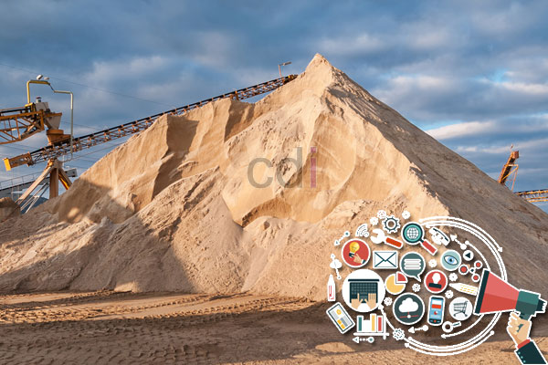

**Daftar Harga Material Pasir dan Batu Terlengkap |** Hai Mitra CDI! Mencari informasi harga material pasir dan batu yang akurat untuk proyek Anda? Kami mengerti betul pentingnya mendapatkan data yang valid dan terpercaya. Artikel ini hadir untuk membantu Anda menemukan referensi harga termurah, khususnya untuk pasir dan batu, agar pembangunan proyek Anda berjalan lancar.

*Daftar Harga Material Pasir dan Batu Terlengkap*

Dengan banyaknya pilihan harga dan tingginya permintaan pasar, tak jarang para perencana konstruksi merasa kesulitan menentukan harga standar untuk material pasir dan batu. Sebagai Agen Supplier Pasir dan Batu terpercaya, kami ingin berbagi informasi Daftar Harga Material Pasir dan Batu Terlengkap yang kami tawarkan saat ini.

> _Penting! Dapatkan penawaran terbaik untuk pasir dan batu dengan menghubungi kami melalui telepon **0857 7678 6091 - 0813 8050 0660**. Bandingkan harga kami dengan penjual lain – kami berani menjamin kualitas dan kuantitas yang lebih baik! Apalagi, harga yang kami berikan sudah termasuk biaya pengiriman (free ongkir), dengan volume muat per truk yang lebih banyak, dan sistem pembayaran yang fleksibel: Cash On Delivery (COD) alias bayar setelah barang sampai._

## Berikut adalah **Daftar Harga Material Pasir dan Batu Terlengkap** yang kami sediakan.

**Harga Pasir Terbaru – Update Terbaru!**

<table style="text-align: center; height: 168px;" border="1" width="100%" cellspacing="0" cellpadding="3"><tbody><tr><td>
No
</td><td>
Jenis Pasir
</td><td>
Vol /truk
</td><td>
Harga /truk
</td></tr><tr><td>1</td><td><a rel="noopener noreferrer">Pasir Putih Lampung</a></td><td>8,5 m³</td><td>Rp 2.600.000,- <strong>(nego)</strong></td></tr><tr><td>2</td><td><a rel="noopener noreferrer">Pasir Hitam Cor /Extra Beton</a></td><td>7 m³</td><td>Rp 2.200.000,- <strong>(nego)</strong></td></tr><tr><td>3</td><td><a rel="noopener noreferrer">Pasir Rangkas</a></td><td>7 m³</td><td>Rp 2.000.000,- <strong>(nego)</strong></td></tr><tr><td>4</td><td><a rel="noopener noreferrer">Pasir Putih Bangka Super</a></td><td>7,5 m³</td><td>Rp 2.500.000,- <strong>(nego)</strong></td></tr><tr><td>5</td><td><a rel="noopener noreferrer">Pasir Mundu</a></td><td>8,36 m³</td><td>Rp 2.600.000,- <strong>(nego)</strong></td></tr><tr><td>6</td><td><a rel="noopener noreferrer">Pasir Pasang Cilegon</a></td><td>9,5 m³</td><td>Rp 1.900.000,- <strong>(nego)</strong></td></tr><tr><td>7</td><td>Pasir Cuci Cilegon</td><td>9,5 m³</td><td>Rp 2.450.000,- <strong>(nego)</strong></td></tr><tr><td>8</td><td><a rel="noopener noreferrer">Pasir Cimangkok</a></td><td>8,36 m³</td><td>Rp 2.600.000,- <strong>(nego)</strong></td></tr><tr><td>9</td><td>Pasir Coklat Belitung</td><td>7,5 m³</td><td>Rp 2.450.000,- <strong>(nego)</strong></td></tr><tr><td>10</td><td>Pasir Bangka Putih Kasar</td><td>8,36 m³</td><td>Rp 2.900.000,- <strong>(nego)</strong></td></tr><tr><td>11</td><td><a rel="noopener noreferrer">Pasir Hitam bebas lumpur</a></td><td>8,36 m³</td><td>Rp 2.600.000,- <strong>(nego)</strong></td></tr><tr><td>12</td><td><a rel="noopener noreferrer">Pasir Jebrod /Jebrot</a></td><td>8,36 m³</td><td>Rp 2.600.000,- <strong>(nego)</strong></td></tr><tr><td>13</td><td><a rel="noopener noreferrer">Pasir Hitam Subang /Cimalaka</a></td><td>8,36 m³</td><td>Rp 2.600.000,- <strong>(nego)</strong></td></tr><tr><td>14</td><td>Pasir Ayak Hitam</td><td>9,5 m³</td><td>Rp 2.400.000,- <strong>(nego)</strong></td></tr><tr><td>15</td><td>Pasir Urug</td><td>7 m³</td><td>Rp 1.550.000,- <strong>(nego)</strong></td></tr><tr><td>16</td><td>Pasir Cor Serang</td><td>22 m³</td><td>Rp 5.550.000,- <strong>(nego)</strong></td></tr><tr><td>17</td><td>Pasir Laut Hitam</td><td>8 m³</td><td>Rp 2.150.000,- <strong>(nego)</strong></td></tr><tr><td>18</td><td>Pasir Bohlam Sukabumi</td><td>8 m³</td><td>Rp 2.350.000,- <strong>(nego)</strong></td></tr><tr><td>19</td><td>Pasir Abu /Abu Batu</td><td>8,36 m³</td><td>Rp 1.950.000,- <strong>(nego)</strong></td></tr></tbody></table>

**Daftar Harga Material Batu – Harga Terbaik di Pasaran!**

<table style="text-align: center; height: 168px;" border="1" width="100%" cellspacing="0" cellpadding="3"><tbody><tr><td>
No
</td><td>
Jenis Batu
</td><td>
Harga /truk vol 8,36 m³
</td><td>
Harga /m³
</td></tr><tr><td>1</td><td><a rel="noopener noreferrer">Lime Stone</a> (batu kapur)</td><td>1.550.000,- <strong>(nego)</strong></td><td>Rp 185.000,- <strong>(nego)</strong></td></tr><tr><td>2</td><td><a rel="noopener noreferrer">Batu Belah</a></td><td>1.900.000,- <strong>(nego)</strong></td><td>Rp 250.000,- <strong>(nego)</strong></td></tr><tr><td>3</td><td><a rel="noopener noreferrer">Batu Splite 1-2, 2-3, 3-5</a></td><td>2.100.000,- <strong>(nego)</strong></td><td>Rp 255.000,- <strong>(nego)</strong></td></tr><tr><td>4</td><td><a rel="noopener noreferrer">Sirtu urug</a></td><td>1.600.000,- <strong>(nego)</strong></td><td>Rp 200.000,- <strong>(nego)</strong></td></tr><tr><td>5</td><td><a rel="noopener noreferrer">Sirdam urug</a></td><td>1.600.000,- <strong>(nego)</strong></td><td>Rp 200.000,- <strong>(nego)</strong></td></tr><tr><td>6</td><td><a rel="noopener noreferrer">Batu Base course</a></td><td>1.900.000,- <strong>(nego)</strong></td><td>Rp 230.000,- <strong>(nego)</strong></td></tr><tr><td>7</td><td><a rel="noopener noreferrer">Batu Makadam</a></td><td>1.800.000,- <strong>(nego)</strong></td><td>Rp 225.000,- <strong>(nego)</strong></td></tr></tbody></table>

**Daftar Harga Material Bata Merah, Batako & Hebel – Pilihan Lengkap!**

<table style="text-align: center; height: 168px;" border="1" width="100%" cellspacing="0" cellpadding="3"><tbody><tr><td>
No
</td><td>
Jenis Bata
</td><td>
Vol /truk
</td><td>
Harga
</td></tr><tr><td>1</td><td><a rel="noopener noreferrer">Batako Press </a>7 x 17 x 36</td><td>-</td><td>Rp 2.500,- /bh <strong>(nego)</strong></td></tr><tr><td>2</td><td><a rel="noopener noreferrer">Batako Press</a> 8 x 18 x 38</td><td>-</td><td>Rp 2.600,- /bh <strong>(nego)</strong></td></tr><tr><td>3</td><td>Bata Riangan (Hebel) uk. 7, 8, 10</td><td>12 m³</td><td>Rp 650.000,- /m³ <strong>(nego)</strong></td></tr><tr><td>4</td><td><a rel="noopener noreferrer">Bata merah standar&nbsp;</a></td><td>±10.000 bh</td><td>Rp 360,- /bh <strong>(nego)</strong></td></tr><tr><td>5</td><td><a rel="noopener noreferrer">Bata Merah Jumbo</a></td><td>±6.000 bh</td><td>Rp 710,- /bh <strong>(nego)</strong></td></tr></tbody></table>

**Informasi Tambahan**

- Untuk informasi harga dan negosiasi, silakan hubungi kami melalui telepon di **0857 7678 6091 (Bpk Maman)**.
- Minimal pemesanan adalah 7 meter kubik atau satu unit colt diesel.
- Harga dapat berubah sewaktu-waktu tanpa pemberitahuan. Untuk informasi terbaru, hubungi **0857 7678 6091**.
- Pemesanan dalam jumlah besar (tronton) atau untuk proyek lengkap berpotensi mendapatkan harga khusus.
- Kami melayani pengiriman gratis (free ongkir) untuk wilayah Jabodetabek, Cikarang, Karawang, Cikampek, dan Purwakarta.

- Sistem pembayaran kami fleksibel: Cash On Delivery (COD) setelah material tiba di lokasi Anda, atau pembayaran per Purchase Order (P.O) untuk pengiriman tronton.

- Kami juga menerima pembayaran tempo dengan syarat minimal 10 truk dan jangka waktu maksimal 1 minggu setelah pengiriman pertama.

- Untuk pemesanan per Delivery Order (D.O) atau per tongkang, segera hubungi kami untuk negosiasi harga melalui nomor telepon yang tertera.

Sebagai penutup, Mitra, daftar harga material pasir dan batu terlengkap ini adalah referensi untuk proyek Anda di wilayah Jabodetabek (Jakarta, Bogor, Depok, Tangerang, Bekasi), BSD, Tambun, Cikarang, Cibitung, Karawang, Cikampek, Purwakarta, serta kota-kota lain di Jawa Barat dan Banten. Jangan ragu untuk menghubungi kami di **0857 7678 6091** (Bpk Maman) untuk mendapatkan harga terbaik dan pasokan material yang handal.

Selain pasir dan batu, kami juga menyediakan layanan cor beton curah siap pakai (ready mix concrete) dan sewa pompa beton. Hubungi kami untuk informasi lebih lanjut. Terima kasih atas kunjungan Anda! [Jual Material Batu Pondasi di Ancol Jakarta Gratis Ongkir](/batu/jual-material-batu-pondasi-di-ancol-jakarta-gratis-ongkir/) — Kami juga melayani pengiriman hingga Ancol Jakarta.