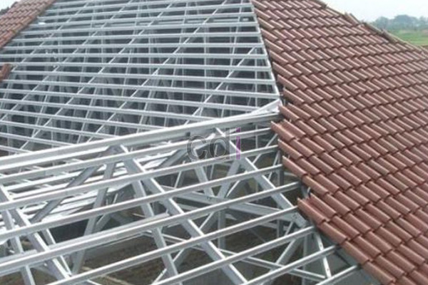

**Daftar Harga Terbaru Atap Baja Ringan |** Mitra CDI! Tertarik dengan atap yang kuat, ringan, dan terjangkau? Sekarang ini, konstruksi atap baja ringan semakin populer di setiap sudut (not detected), bahkan hingga ke desa-desa. Material ini unggul dalam hal kekuatan dan ketahanan, tanpa khawatir dimakan rayap atau lapuk oleh hujan. Masyarakat pun semakin sadar akan keunggulan baja ringan: tahan lama dan pemasangannya praktis. Ini yang membuat permintaannya terus meningkat di (not detected) dan sekitarnya.

Namun, seringkali harga atap baja ringan bervariasi antar toko, sehingga membingungkan konsumen yang mencari harga terbaik sesuai anggaran mereka. Nah, di sinilah peran kami sebagai penjual Baja Ringan. Kami hadir dengan artikel ini yang menyajikan Daftar Harga Terbaru Atap Baja Ringan yang valid dan kompetitif.

*Harga Atap Baja Ringan Terkini*

 ## Harga Terbaru Atap Baja Ringan SNI – Pilihan Terbaik untuk Proyek Anda

Bagi Anda yang membutuhkan pemasok Baja Ringan bersertifikasi SNI, Anda berada di tempat yang tepat! Kami menyediakan berbagai jenis baja ringan dari berbagai produsen terpercaya dengan harga yang bisa **dinegosiasikan** dan **gratis ongkir**.

> _Untuk informasi **PEMESANAN** atau ingin **NEGOSIASI** harga, hubungi kami via telepon di **0813 8050 0660** (Bpk Maman). Kami siap memberikan penawaran terbaik tanpa biaya tambahan._

Berikut adalah Daftar Harga Terbaru Atap Baja Ringan dari beberapa merek terkemuka di Indonesia. Harga berikut berlaku untuk wilayah Jabodetabek (jakarta, bogor, depok, tangerang, bekasi), Cikarang, Cibitung, Karawang, Cikampek, Purwakarta, Banten, dan Jawa Barat.

<table style="text-align: center; height: 168px;" border="1" width="100%" cellspacing="0" cellpadding="3"><tbody><tr><td>
No
</td><td>
JENIS /MERK
</td><td>
UKURAN
</td><td>
HARGA (Rp)
</td></tr><tr><td>1</td><td>BMT Truss C75.60 SNI</td><td>T 75 mm x P 6 m</td><td>Rp 61.000,- <strong>(nego)</strong></td></tr><tr><td>2</td><td>BMT Truss C75.70 SNI</td><td>T 75 mm x P 6 m</td><td>Rp 67.000,- <strong>(nego)</strong></td></tr><tr><td>3</td><td>BMT Truss C75.75 SNI</td><td>T 75 mm x P 6 m</td><td>Rp 70.000,- <strong>(nego)</strong></td></tr><tr><td>4</td><td>BMT Truss C75.100 SNI</td><td>T 75 mm x P 6 m</td><td>Rp 98.000,- <strong>(nego)</strong></td></tr><tr><td>5</td><td>PRIMA Truss C75.75 SNI</td><td>T 75 mm x P 6 m</td><td>Rp 70.000,- <strong>(nego)</strong></td></tr><tr><td>6</td><td>PRIMA Truss C75.65 SNI</td><td>T 75 mm x P 6 m</td><td>Rp 66.000,- <strong>(nego)</strong></td></tr><tr><td>7</td><td>PRIMA Truss C75.100 SNI</td><td>T 75 mm x P 6 m</td><td>Rp 98.000,- <strong>(nego)</strong></td></tr><tr><td>8</td><td>TASO Truss C75.75 SNI</td><td>T 75 mm x P 6 m</td><td>Rp 80.000,- <strong>(nego)</strong></td></tr><tr><td>9</td><td>TASO Truss C75.80 SNI</td><td>T 75 mm x P 6 m</td><td>Rp 90.000,- <strong>(nego)</strong></td></tr><tr><td>10</td><td>TASO Truss C75.100 SNI</td><td>T 75 mm x P 6 m</td><td>Rp 125.000,- <strong>(nego)</strong></td></tr><tr><td>11</td><td>CBM Truss C75.75 SNI</td><td>T 75 mm x P 6 m</td><td>Rp 76.000,- <strong>(nego)</strong></td></tr><tr><td>12</td><td>CBM Truss C75.100 SNI</td><td>T 75 mm x P 6 m</td><td>Rp 105.000,- <strong>(nego)</strong></td></tr><tr><td>13</td><td>YUME Truss C75.70 SNI</td><td>T 75 mm x P 6 m</td><td>Rp 67.000,- <strong>(nego)</strong></td></tr><tr><td>14</td><td>YUME Truss C75.75 SNI</td><td>T 75 mm x P 6 m</td><td>Rp 70.000,- <strong>(nego)</strong></td></tr></tbody><tbody><tr><td>
No
</td><td>
JENIS /MERK
</td><td>
UKURAN
</td><td>
HARGA (Rp)
</td></tr><tr><td>1</td><td>TASO Reng 32.45 SNI</td><td>T 32 mm x P 6 m</td><td>Rp 40.000,- <strong>(nego)</strong></td></tr><tr><td>2</td><td>&nbsp;PRIMA Reng 31.45 SNI</td><td>T 31 mm x P 6 m</td><td>Rp 33.000,- <strong>(nego)</strong></td></tr><tr><td>3</td><td>BMT Reng 30.45 SNI</td><td>T 30 mm x P 6 m</td><td>Rp 32.000,- <strong>(nego)</strong></td></tr><tr><td>4</td><td>BMT Reng 28.45 SNI</td><td>T 28 mm x P 6 m</td><td>Rp 29.000,- <strong>(nego)</strong></td></tr><tr><td>5</td><td>YUME Reng 30.45 SNI</td><td>T 30 mm x P 6 m</td><td>Rp 32.000,- <strong>(nego)</strong></td></tr></tbody></table>

**Catatan Penting:**

- Harga sudah termasuk biaya pengiriman untuk wilayah Jabodetabek dan sekitarnya.
- Untuk negosiasi harga, silakan hubungi kami di **0813 8050 0660**.
- Ketebalan baja ringan yang tersedia untuk truss (kaso) adalah 0.60, 0.65, 0.75, 0.80, dan 0.100 mm. Sementara untuk reng, ketebalannya adalah 0,45 mm.

Semoga daftar Harga Terbaru Atap Baja Ringan ini membantu Anda menemukan solusi terbaik untuk proyek konstruksi Anda di (not detected). Ingin mengetahui lebih lanjut tentang keunggulan dan kekurangan rangka atap baja ringan? Silakan baca artikel kami [Perbandingan Kelebihan dan Kekurangan Rangka Atap Baja Ringan](/blog/perbandingan-kelebihan-dan-kekurangan-rangka-atap-baja-ringan "Perbandingan Kelebihan dan Kekurangan Rangka Atap Baja Ringan").

Selain itu, kami juga menyediakan material bangunan lainnya seperti pasir, batu belah, bata merah, split, batako, bata hebel, sirtu, dan sirdam. Untuk informasi lebih lanjut mengenai [**DAFTAR HARGA MATERIAL PASIR DAN BATU TERLENGKAP**](/blog/daftar-harga-material-pasir-dan-batu-terlengkap), hubungi kami melalui telepon di **0857 7678 6091**. Selamat membangun dan semoga sukses!