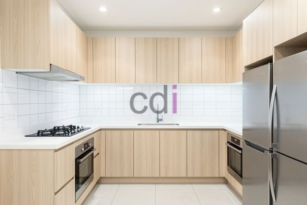

**Dapur dan Mini Bar: Desain Efisien untuk Ruang Terbatas?** - Hai Mitra CDI! Sedang memikirkan cara mempercantik dapur atau memaksimalkan ruang yang ada? Menggabungkan area dapur dengan mini bar bisa jadi ide brilian. Ruang yang nyaman untuk memasak, bersantai, dan menjamu tamu? Kenapa tidak!

Desain dapur yang efisien dan kehadiran mini bar yang menarik bukan sekadar mempercantik rumah, tapi juga meningkatkan fungsi ruangan. Nah, dalam artikel ini, Kami akan memandu Anda dalam merencanakan dapur dan mini bar impian, mulai dari penataan ruang hingga pemilihan material terbaik.

## Desain Dapur dan Mini Bar Terintegrasi: Solusi Cerdas untuk Ruang

Integrasi dapur dan mini bar adalah kunci utama menciptakan ruang yang efisien dan menyenangkan. Bayangkan mini bar sebagai perpanjangan alami dari *island kitchen* Anda, atau sebagai pemisah visual yang elegan antara area memasak dan ruang keluarga. Alur yang mulus dan interaksi yang mudah antar ruangan adalah keunggulannya.

Dapur berukuran kecil membutuhkan perencanaan tata letak yang matang. Bentuk L atau U seringkali paling ideal karena memaksimalkan setiap sudut. Pertimbangkan lemari gantung dan rak terbuka untuk ruang penyimpanan tambahan tanpa membuat dapur terasa penuh. Ingatlah prinsip segitiga kerja (kulkas, kompor, wastafel) agar aktivitas memasak terasa lebih lancar.

Ingin menghemat ruang lebih banyak? Peralatan dapur multifungsi bisa jadi pilihan tepat! Misalnya, kompor induksi yang bisa dilipat atau meja lipat serbaguna. Untuk inspirasi lebih lanjut soal optimasi ruang dapur, yuk simak juga artikel Kami tentang [Buat Lemari Gantung Dapur: Solusi Ruang Rapi & Estetis](/blog/buat-lemari-gantung-dapur/).

## Material yang Tepat: Estetika dan Ketahanan untuk Dapur & Mini Bar

Pemilihan material yang berkualitas akan menentukan tampilan dan daya tahan dapur dan mini bar Anda. Untuk permukaan meja dapur, *quartz*, granit, atau *solid surface* adalah pilihan populer karena tahan gores, tahan panas, dan mudah dibersihkan. Selain itu, variasi warna dan motifnya juga beragam, sehingga mudah dipadukan dengan gaya interior rumah Anda.

Area mini bar bisa menggunakan material berbeda untuk menciptakan kesan visual yang menarik. Kayu solid atau *marble* menawarkan kesan mewah dan elegan. Pastikan material yang Anda pilih tahan terhadap kelembapan dan mudah dibersihkan, terutama jika sering digunakan untuk menyajikan minuman.

Dengan pengalaman lebih dari 10 tahun di bidang material bangunan, Kami siap membantu Anda memilih material yang paling sesuai dengan kebutuhan dan anggaran Anda. Silakan hubungi Kami melalui tombol **Telepon** atau **WhatsApp** untuk informasi lengkap.

## Estimasi Biaya dan Layanan dari Creative Design Interior (CDI)

Biaya pembuatan dapur dan mini bar bergantung pada ukuran, desain, material yang digunakan, serta tingkat kesulitan proyek. Sebagai referensi, biaya pembuatan *kitchen set* minimalis ukuran 3x2 meter berkisar antara Rp 15.000.000 hingga Rp 30.000.000, sudah termasuk biaya material dan pemasangan. Perlu diingat, harga ini bersifat estimasi, dan dapat disesuaikan dengan kebutuhan spesifik proyek Anda. Untuk penawaran harga yang paling akurat, jangan ragu untuk menghubungi Kami!

Kami menawarkan solusi *all-in-one* yang mencakup desain, pembuatan, pengiriman, dan pemasangan. Kami juga menyediakan berbagai opsi pembayaran yang fleksibel agar sesuai dengan kebutuhan Anda: COD, transfer bank, DP 50%, transfer setelah barang diterima, bayar bertahap, atau transfer setelah pekerjaan selesai. 

Sebagai penyedia jasa desain interior, furniture custom, material bangunan, dan jasa pengecoran terpercaya di wilayah Jabodetabek, Kami berkomitmen memberikan yang terbaik. Kami melayani Jakarta, Bogor, Depok, Tangerang, Bekasi, Cikarang, Karawang, Bandung, Serang, Purwakarta, Cilegon, Cikampek, Subang, dan Rangkasbitung. Kami siap mewujudkan dapur dan mini bar impian Mitra CDI di lokasi (not detected).

Butuh informasi lebih lanjut atau ingin berkonsultasi? Jangan sungkan untuk menghubungi Kami melalui tombol **Telepon** atau **WhatsApp** yang tersedia di bawah ini. Kami siap menjawab semua pertanyaan Anda!