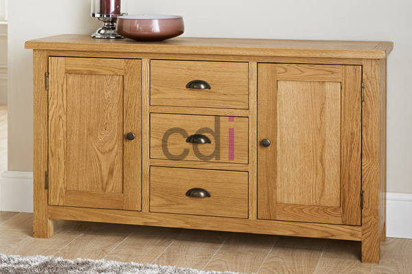

**Dapur Kayu Jati Minimalis: Harga & Desain Modern 2026** - Mitra CDI yang terhormat, banyak pemilik rumah yang menginginkan dapur yang cantik, fungsional, dan tahan lama. Seringkali, perencanaan yang kurang matang mengakibatkan pemilihan material yang kurang tepat, desain yang tidak ergonomis, atau biaya yang membengkak. Padahal, dengan perencanaan yang cermat, Anda dapat memiliki dapur impian yang sesuai dengan anggaran dan gaya hidup.

## Keunggulan Dapur Kayu Jati Minimalis untuk Hunian Modern Anda

Kayu jati adalah pilihan material yang sangat populer untuk pembuatan kitchen set, terutama untuk gaya minimalis. Ketahanannya terhadap cuaca ekstrem dan serangan hama menjadikannya investasi jangka panjang. Selain itu, serat alami kayu jati memberikan kesan hangat dan elegan pada ruang dapur. Desain minimalis sendiri menekankan pada kesederhanaan bentuk, pemanfaatan ruang yang efisien, dan minimnya ornamen yang berlebihan. Kombinasi keduanya menghasilkan dapur yang tidak hanya cantik secara visual, tetapi juga sangat praktis digunakan.

Anda mungkin bertanya-tanya mengapa memilih kayu jati dibandingkan material lain. Kayu jati memiliki tingkat kekerasan yang tinggi, sehingga tahan terhadap goresan dan benturan. Ini sangat penting untuk area dapur yang sering digunakan dan rentan terhadap aktivitas. Selain itu, kayu jati memiliki kandungan minyak alami yang menjadikannya tahan terhadap air dan kelembapan. Dengan perawatan yang tepat, dapur kayu jati Anda dapat bertahan selama bertahun-tahun tanpa mengalami kerusakan signifikan.

## Estimasi Biaya dan Faktor yang Mempengaruhi Harga Dapur Kayu Jati Minimalis

Biaya pembuatan dapur kayu jati minimalis bervariasi tergantung pada beberapa faktor, termasuk ukuran dapur, kompleksitas desain, kualitas kayu jati yang digunakan, dan finishing yang dipilih. Sebagai gambaran, harga per meter persegi untuk kitchen set kayu jati minimalis berkisar antara Rp 3.500.000 hingga Rp 7.000.000. Harga ini bersifat estimasi dan dapat berubah sewaktu-waktu — hubungi Kami untuk penawaran terbaru dan paling akurat sesuai kebutuhan proyek Mitra CDI.

Faktor-faktor yang berpengaruh pada harga antara lain:

*   **Jenis Kayu Jati:** Kayu jati memiliki beberapa grade, dengan grade yang lebih tinggi (misalnya kayu jati Perhutani) memiliki harga yang lebih mahal.
*   **Desain:** Desain yang rumit dengan banyak detail akan membutuhkan lebih banyak waktu dan tenaga kerja, sehingga meningkatkan biaya.
*   **Finishing:** Pilihan finishing seperti *clear coat*, *varnish*, atau cat duco akan memengaruhi harga.
*   **Aksesori:** Penggunaan aksesori seperti *soft closing* untuk engsel dan laci, *handle* berkualitas tinggi, dan lampu LED juga akan menambah biaya.

## Creative Design Interior: Mitra Terpercaya untuk Dapur Kayu Jati Minimalis Impian Anda

Kami di Creative Design Interior berpengalaman lebih dari 10 tahun dalam pembuatan kitchen set, furniture interior, dan pengadaan material bangunan. Kami memahami betul kebutuhan Anda akan dapur yang cantik, fungsional, dan tahan lama. Kami menawarkan layanan custom yang memungkinkan Anda untuk merancang dapur kayu jati minimalis sesuai dengan selera dan anggaran Anda. Kami menyediakan berbagai pilihan kayu jati dengan kualitas terbaik, serta berbagai pilihan finishing dan aksesori yang dapat Anda pilih.

Kami memberikan kemudahan dalam proses pemesanan dan pembayaran. Anda dapat memilih skema pembayaran yang sesuai dengan kemampuan Anda, termasuk COD, transfer bank, DP 50%, transfer setelah barang terkirim, bayar bertahap, atau transfer setelah pekerjaan selesai. Kami juga menyediakan gratis ongkir (ketentuan mengikuti wilayah layanan) untuk memudahkan Anda. Kami melayani wilayah Jakarta, Bogor, Depok, Tangerang, Bekasi, Cikarang, Karawang, Bandung, Serang, Purwakarta, Cilegon, Cikampek, Subang, dan Rangkasbitung.

## Konsultasikan Kebutuhan Dapur Minimalis Anda dengan Tim Kami Sekarang Juga!

Kami memahami bahwa memilih desain dapur yang tepat adalah keputusan penting. Itulah mengapa Kami menawarkan layanan konsultasi gratis untuk membantu Anda merencanakan dapur kayu jati minimalis impian Anda. Tim Kami yang berpengalaman akan memberikan saran dan rekomendasi terbaik sesuai dengan kebutuhan dan anggaran Anda. Jangan ragu untuk [mengeksplorasi daftar harga Kami di sini](/daftar-harga/) untuk mendapatkan gambaran biaya yang lebih jelas.

Membutuhkan bantuan langsung untuk kebutuhan proyek Anda? Silakan klik tombol **WhatsApp** atau **Telepon** di bawah untuk berkonsultasi dengan tim Kami.
