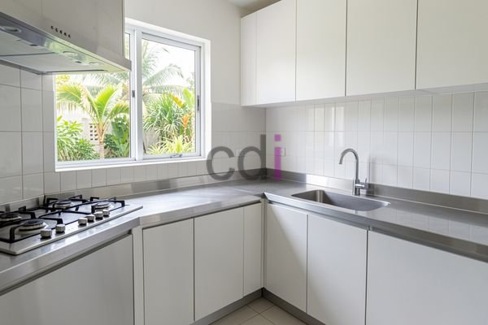

**Dapur Minimalis Stainless Steel: Estetika Modern & Perawatan Mudah** - Mitra CDI, apakah Anda sedang mempertimbangkan desain dapur minimalis yang modern dan tahan lama? Dapur minimalis *stainless steel* menjadi pilihan populer karena kemampuannya menghadirkan kesan bersih, elegan, dan mudah dirawat. Kami di Creative Design Interior siap membantu Anda mewujudkan dapur impian dengan material berkualitas dan desain yang sesuai dengan kebutuhan Anda.

## Mengapa Memilih Dapur Minimalis Stainless Steel?

*Stainless steel* menawarkan sejumlah keunggulan yang menjadikannya material ideal untuk dapur minimalis. Ketahanannya terhadap korosi dan panas menjamin umur panjang, bahkan dalam kondisi penggunaan sehari-hari yang intensif. Selain itu, permukaan *stainless steel* yang halus dan non-porous membuatnya sangat mudah dibersihkan, cukup dengan lap basah dan deterjen ringan. Ini sangat berbeda dengan material lain seperti kayu atau laminasi yang mungkin memerlukan perawatan khusus.

Selain kemudahan perawatan, *stainless steel* juga memberikan tampilan yang sangat modern dan elegan. Permukaannya yang reflektif dapat membuat dapur terasa lebih luas dan terang, terutama jika dipadukan dengan pencahayaan yang tepat. Desain minimalis yang bersih dari *stainless steel* juga menonjolkan kesan rapi dan teratur, sesuai dengan filosofi desain minimalis itu sendiri.

## Desain Dapur Minimalis Stainless Steel yang Populer

Ada banyak variasi desain dapur minimalis *stainless steel* yang dapat Anda pilih. Salah satu yang paling populer adalah penggunaan *kitchen set* dengan pintu dan laci *stainless steel*. Desain ini memberikan kesan monokrom yang kuat dan modern. Anda bisa memadukannya dengan *countertop* berwarna netral seperti putih, abu-abu, atau hitam untuk menciptakan keseimbangan visual.

Alternatif lain adalah menggabungkan *stainless steel* dengan material lain, seperti kayu atau kaca. Misalnya, Anda bisa menggunakan *kitchen set* dengan rangka *stainless steel* dan pintu kaca, atau *countertop* kayu yang dipadukan dengan *backsplash stainless steel*. Kombinasi ini dapat memberikan sentuhan hangat dan alami pada dapur Anda, tanpa mengurangi kesan modern dan minimalis.

## Layanan Custom Dapur Minimalis Stainless Steel dari Creative Design Interior

Kami di Creative Design Interior menawarkan layanan *custom* untuk dapur minimalis *stainless steel* yang sepenuhnya disesuaikan dengan kebutuhan dan preferensi Anda. Tim desain kami akan bekerja sama dengan Anda untuk merencanakan tata letak dapur yang optimal, memilih material yang tepat, dan menciptakan desain yang sesuai dengan gaya hidup Anda.

Kami menggunakan *stainless steel* berkualitas tinggi yang tahan lama dan mudah dirawat. Selain itu, kami juga menawarkan berbagai pilihan finishing, seperti *brushed stainless steel*, *polished stainless steel*, dan *fingerprint-resistant stainless steel*. Harga untuk *kitchen set stainless steel* custom bervariasi tergantung pada ukuran, desain, dan material yang digunakan. Sebagai estimasi, biaya pembuatan *kitchen set stainless steel* minimalis ukuran 3x2 meter dengan material standar dapat berkisar antara Rp 15.000.000 hingga Rp 30.000.000. Harga ini bersifat estimasi dan dapat berubah sewaktu-waktu — hubungi Kami untuk penawaran terbaru dan paling akurat sesuai kebutuhan proyek Anda. Kami juga menyediakan layanan pengiriman dan pemasangan untuk wilayah Jabodetabek dan sekitarnya.

## Perawatan Dapur Minimalis Stainless Steel Agar Awet

Perawatan dapur minimalis *stainless steel* relatif mudah, namun ada beberapa hal yang perlu diperhatikan. Hindari penggunaan pembersih abrasif atau sikat kawat, karena dapat merusak permukaan *stainless steel*. Gunakan lap microfiber yang lembut dan deterjen ringan untuk membersihkan secara teratur. Untuk noda yang membandel, Anda bisa menggunakan pembersih *stainless steel* khusus. Selain itu, rutin lap permukaan *stainless steel* dengan arah serat untuk menjaga kilau dan mencegah goresan.

Membutuhkan bantuan langsung untuk kebutuhan proyek Anda? Silakan klik tombol **WhatsApp** atau **Telepon** di bawah untuk berkonsultasi dengan tim Kami.
