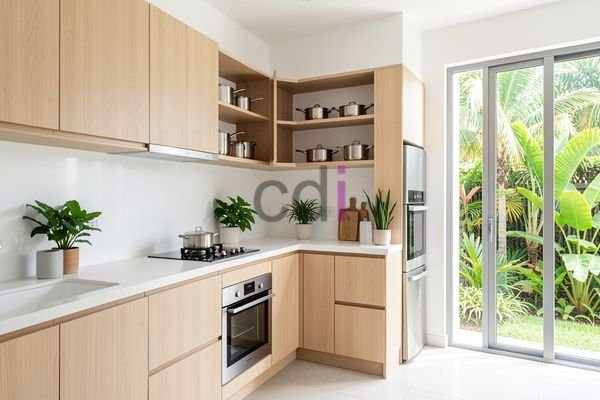

**Dapur Set Minimalis Modern Jabodetabek: Desain & Harga 2026** - Halo Mitra CDI! Membangun dapur impian itu penting, kan? Dapur bukan cuma tempat memasak, tapi juga pusat kegiatan keluarga. Nah, desain dapur modern minimalis sedang jadi favorit banyak orang di Jabodetabek. Kenapa? Karena selain terlihat cantik, desain ini juga pintar memaksimalkan ruang. Kami di Creative Design Interior siap membantu mewujudkan dapur minimalis modern impian Anda, dengan harga yang bersahabat dan kualitas terjamin.

## Dapur Minimalis Modern: Mengapa Semakin Populer di Jabodetabek?

Mungkin Anda bertanya-tanya, kenapa banyak yang memilih desain dapur minimalis modern? Simpel saja: desain ini menawarkan solusi cerdas untuk memaksimalkan ruang. Terutama di wilayah seperti Jabodetabek, di mana lahan seringkali terbatas, konsep minimalis sangat membantu menciptakan kesan luas dan rapi. Garis-garis bersih, warna netral, dan minim dekorasi adalah ciri khasnya. Yuk, ciptakan dapur yang fungsional sekaligus estetis!

Selain itu, desain minimalis modern juga perawatannya mudah! Bayangkan, permukaan dapur yang halus dan sederhana itu bikin debu dan kotoran nggak gampang menempel. Material seperti *stainless steel* atau *HPL* juga tahan noda dan gampang dibersihkan. Gimana, nggak praktis apa? Kami di Creative Design Interior siap mewujudkan dapur minimalis modern yang sesuai dengan gaya dan kebutuhan Anda.

## Pilihan Material dan Kisaran Biaya Dapur Set Minimalis

Ada banyak pilihan material untuk membuat dapur set minimalis modern. Masing-masing punya kelebihan dan kekurangannya sendiri. Berikut beberapa yang paling populer:

*   **Multipleks dengan Finishing HPL:** Pilihan yang paling ekonomis, dengan banyak pilihan warna dan motif.
*   **Multipleks dengan Finishing Melamin:** Lebih tahan gores daripada HPL, tapi pilihan warnanya terbatas.
*   **Kayu Solid (Jati, Merbau, Mahoni):** Memberikan kesan mewah dan alami, tapi perlu perawatan ekstra agar awet.
*   **Aluminium:** Ringan, kuat, dan tahan karat. Cocok untuk desain yang sangat minimalis dan modern.

<table class="table">
  <caption>Estimasi Biaya Dapur Set Minimalis Modern (per meter)</caption>
  <thead>
    <tr><th>Material</th><th>Harga (Rp)</th><th>Keterangan</th></tr>
  </thead>
  <tbody>
    <tr><td>Multipleks HPL</td><td>350.000 - 600.000</td><td>Pilihan paling ekonomis, variasi desain terbatas</td></tr>
    <tr><td>Multipleks Melamin</td><td>450.000 - 700.000</td><td>Lebih tahan gores, pilihan warna terbatas</td></tr>
    <tr><td>Kayu Solid</td><td>800.000 - 1.500.000</td><td>Tampilan mewah dan alami, perlu perawatan rutin</td></tr>
    <tr><td>Aluminium</td><td>600.000 - 1.000.000</td><td>Ringan, kuat, dan tahan karat, desain minimalis</td></tr>
  </tbody>
</table>

Ingat ya, harga di atas hanya estimasi. Untuk penawaran yang lebih akurat sesuai dengan proyek Anda, jangan ragu untuk menghubungi tim Kami. Kami selalu siap memberikan solusi terbaik! Sebagai penyedia jasa *furniture custom*, Kami bisa menyesuaikan desain dan material dengan anggaran yang Anda miliki.

## Creative Design Interior: Mitra Terbaik untuk Dapur Impian Anda

Mitra, Creative Design Interior sudah berkecimpung di dunia desain interior, pembuatan *furniture custom*, dan penyediaan material bangunan selama lebih dari 10 tahun di wilayah Jabodetabek. Kami menawarkan solusi lengkap, mulai dari desain, pembuatan, pengiriman, hingga pemasangan. Kami juga menyediakan berbagai material bangunan berkualitas, seperti pasir, split, batu belah, bata merah, batako, hebel, dan sirtu.

Kami mengerti betul kalau setiap rumah punya karakteristik yang unik. Itulah kenapa Kami menawarkan layanan desain *custom* yang disesuaikan dengan kebutuhan dan preferensi Anda. Tim desain Kami akan bekerja sama dengan Anda untuk menciptakan dapur minimalis modern yang fungsional, cantik, dan sesuai dengan anggaran. Selain itu, Kami juga menyediakan berbagai pilihan metode pembayaran yang fleksibel. 

Untuk memudahkan Anda dalam memilih model dan material, Anda bisa melihat daftar harga lengkap di situs web Kami. Atau, konsultasikan langsung kebutuhan Anda dengan tim ahli Kami secara gratis!

## Kami Hadir di Seluruh Jabodetabek

Mitra CDI, jangan khawatir soal lokasi! Kami melayani seluruh wilayah Jabodetabek, termasuk Jakarta, Bogor, Depok, Tangerang, Bekasi, Cikarang, Karawang, Bandung, Serang, Purwakarta, Cilegon, Cikampek, Subang, dan Rangkasbitung. Semua ini berkat tim kerja Kami yang berpengalaman dan sistem kerja yang terjadwal, demi memastikan pengerjaan tepat waktu dan kualitas terjaga. Kalau ada produk yang kurang sesuai, jangan ragu untuk menghubungi Kami. Kami menerima penukaran produk selama belum dipakai atau dibongkar dan maksimal 1 hari setelah diterima.

Butuh bantuan langsung? Klik tombol **WhatsApp** atau **Telepon** di bawah ini untuk berkonsultasi dengan tim Kami sekarang juga! [Dapur Kayu Jati Minimalis: Harga & Desain Modern 2026](/blog/dapur-kayu-jati-minimalis/) adalah salah satu artikel lain yang mungkin bisa jadi inspirasi desain dapur Anda!