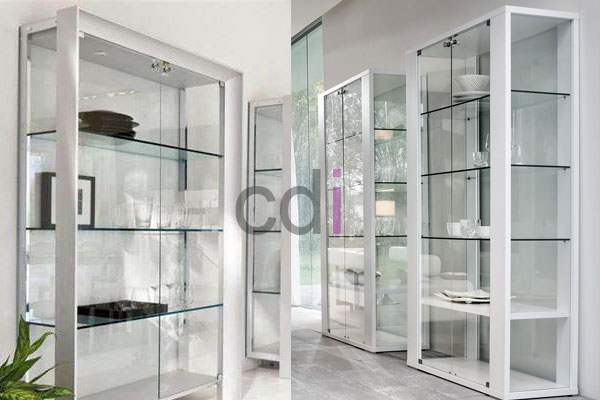

**Desain Lemari Kaca Minimalis Masa Kini** - Hai Mitra CDI! Sedang mencari lemari yang bisa membuat ruangan terasa lebih luas dan rapi? Atau mungkin ingin memajang koleksi kesayangan dengan tampilan yang elegan? Lemari kaca minimalis bisa jadi solusi tepatnya! Nah, kami dari CDI (not detected) hadir untuk membantu mewujudkan hunian impian Anda. Dengan desain yang modern dan material berkualitas, lemari kaca minimalis dari kami akan menjadi investasi yang memuaskan.

*Lemari kaca minimalis*

Lemari kaca bukan sekadar tempat penyimpanan, tapi juga elemen penting dalam dekorasi. Dengan desain yang tepat, lemari kaca bisa jadi fokus perhatian di ruangan mana pun. Memilih lemari kaca yang sesuai dengan kebutuhan dan selera memang penting. Yuk, kita bahas lebih lanjut apa saja yang perlu diperhatikan sebelum membeli lemari kaca minimalis.

## Kelebihan Lemari Kaca Minimalis

Lemari kaca hadir dalam berbagai material, mulai dari kayu, kaca, hingga besi. Pilihan material ini memberikan fleksibilitas sesuai selera dan anggaran Anda. Banyak yang masih mengunggulkan kayu karena kesan hangat dan klasik yang ditawarkannya. Tapi, lemari kaca juga semakin populer karena keunggulannya sendiri.

Salah satu kelebihan utama lemari kaca adalah kemudahan perawatannya. Kotoran atau debu yang menempel pada kaca sangat mudah dibersihkan, cukup dengan lap basah. Hal ini tentu berbeda dengan material lain yang mungkin membutuhkan perawatan lebih intensif. Namun, perlu diingat, lemari kaca memang memerlukan penanganan hati-hati agar tidak mudah pecah. Keunggulannya adalah daya tahan yang lebih lama jika dirawat dengan baik.

Sementara itu, lemari kayu rentan terhadap masalah seperti rayap atau kekeroposan. Rayap merupakan musuh utama kayu yang bisa merusak struktur lemari dari dalam. Jika Anda memilih lemari kayu, pastikan menggunakan jenis kayu berkualitas tinggi, seperti kayu jati, yang lebih tahan terhadap serangan rayap dan perubahan cuaca.

Secara keseluruhan, lemari kaca menawarkan keunggulan dalam hal perawatan dan daya tahan. Tentu saja, pilihan terbaik tergantung pada preferensi pribadi dan anggaran Anda. Kami di CDI (not detected) siap membantu Anda menemukan lemari kaca minimalis yang paling sesuai! [Lemari Kaca 3 Pintu: Hindari 5 Kesalahan Umum Saat Memilih](/blog/lemari-kaca-3-pintu/) bisa menjadi referensi tambahan sebelum Anda memutuskan.

## Harga Lemari Kaca Minimalis

Harga lemari kaca minimalis bervariasi tergantung ukuran, model, dan material yang digunakan. Semakin kompleks desain dan semakin berkualitas materialnya, tentu saja harganya akan menyesuaikan. Namun, jangan khawatir! Kami di CDI (not detected) menawarkan berbagai pilihan lemari kaca minimalis dengan harga yang kompetitif.

Tertarik untuk memiliki lemari kaca minimalis impian Anda? Jangan ragu untuk mengunjungi toko kami atau melakukan pemesanan secara *online* melalui situs web ini. Kami menjamin kualitas produk yang kami tawarkan. Soal harga, tim kami akan dengan senang hati membantu Anda menemukan solusi terbaik yang sesuai dengan *budget* yang Anda miliki. Pelanggan setia CDI (not detected) akan mendapatkan penawaran khusus dan potongan harga menarik. Dijamin, Anda tidak akan menyesal memilih CDI (not detected) sebagai mitra desain interior Anda. Tunggu apa lagi? Segera hubungi kami sekarang juga untuk informasi lebih lanjut dan penawaran terbaik! 
<table class="table">
  <caption>Contoh Ukuran Lemari Kaca Minimalis</caption>
  <thead>
    <tr><th>Ukuran (PxLxT)</th><th>Harga (Estimasi)</th></tr>
  </thead>
  <tbody>
    <tr><td>80x40x180 cm</td><td>Silakan lihat</td></tr>
    <tr><td>120x45x200 cm</td><td>Silakan lihat</td></tr>
    <tr><td>160x50x220 cm</td><td>Silakan lihat</td></tr>
  </tbody>
</table>
 Untuk detail harga terkini, silakan lihat tabel di atas atau hubungi tim kami.