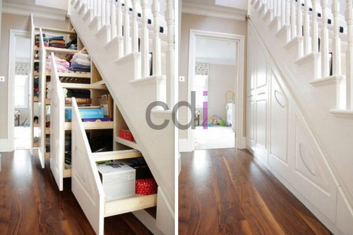
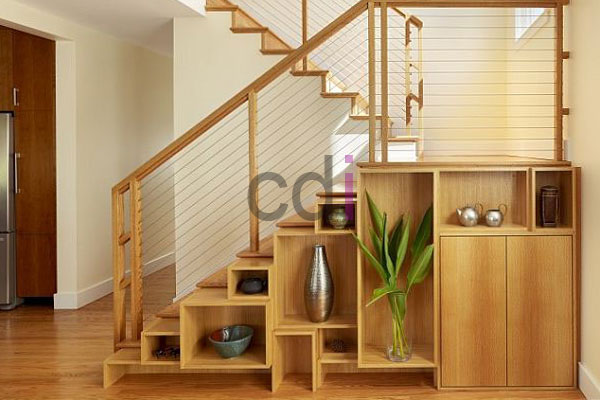
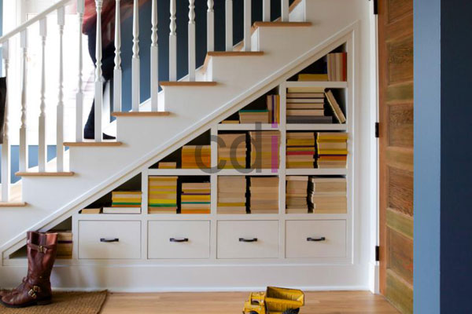
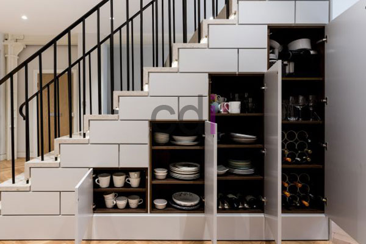
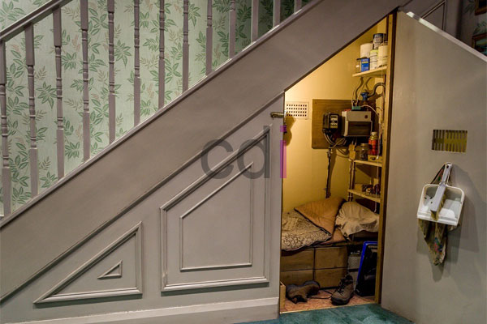

**Desain Terbaru Lemari Bawah Tangga** - Hai Mitra CDI! Punya ruang kosong di bawah tangga? Jangan biarkan terbuang percuma! Lemari adalah solusi cerdas untuk memaksimalkan setiap sudut rumah Anda. Furniture satu ini penting banget, kan? Untuk menyimpan barang-barang berharga, pakaian, atau sekadar membuat tampilan rumah lebih rapi. Nah, di artikel ini, kami akan berbagi inspirasi desain lemari bawah tangga yang lagi hits di (not detected). Yuk, simak!

Ada banyak pilihan desain lemari yang bisa Anda sesuaikan dengan gaya rumah dan kebutuhan. Mulai dari lemari khusus dapur (kitchen set) dengan bentuk unik, lemari TV yang elegan untuk ruang tamu, hingga lemari bawah tangga yang sedang jadi perbincangan. Setiap desain punya fungsi dan estetika tersendiri, lho.

## Ide Kreatif Desain Lemari Bawah Tangga

Lemari bawah tangga semakin populer karena memanfaatkan ruang yang seringkali terabaikan. Penempatannya yang unik memberikan kesan artistik dan fungsional pada rumah Anda di (not detected). Bayangkan, barang-barang berharga tersimpan rapi di area yang sebelumnya hanya menjadi ruang kosong! Berikut beberapa inspirasi desain yang bisa Anda terapkan:

### 1\. Rak Sepatu & Lemari Pakaian Terintegrasi

*Lemari Bawah Tangga Multifungsi*

Punya masalah dengan sepatu yang menumpuk atau pakaian yang kurang tertata? Solusinya, kombinasikan rak sepatu dan lemari pakaian dalam satu desain lemari bawah tangga. Pilih ukuran yang pas dengan ruang yang tersedia. Ini cara efektif menghemat ruang dan membuat rumah lebih terorganisir di (not detected).

### 2\. Sudut Pajangan yang Memukau

Apakah Anda punya koleksi barang-barang spesial yang ingin dipajang? Manfaatkan ruang bawah tangga untuk membuat rak pajangan yang menarik. Letakkan koleksi keramik, foto keluarga, atau hiasan kesayangan Anda di sana. Dijamin, area ini akan menjadi focal point yang memukau di rumah Anda!

### 3\. Rak Buku untuk Pecinta Literasi

Bagi Anda yang gemar membaca, sebuah rak buku di bawah tangga adalah ide brilian! Anda bisa menyimpan berbagai jenis buku di sana, mulai dari novel, buku pelajaran, hingga majalah. Akses ke buku-buku favorit Anda jadi lebih mudah, dan teman-teman yang berkunjung juga bisa ikut menikmati koleksi literasi Anda.

### 4\. Tempat Menyimpan Peralatan Makan

Rak piring juga sangat ideal ditempatkan di bawah tangga. Dengan desain dan ukuran yang tepat, Anda bisa menyimpan piring-piring cantik, gelas, dan peralatan makan lainnya dengan rapi. Terutama jika Anda memiliki koleksi piring antik yang ingin dipamerkan, area ini akan menjadi etalase yang sempurna.

### 5\. Lemari Area Servis yang Efisien

Area servis adalah tempat untuk menyimpan perlengkapan kebersihan rumah seperti vacuum cleaner, sapu, pel, dan lain-lain. Menyimpannya di lemari bawah tangga akan membuat area ini lebih rapi dan terorganisir. Anda juga bisa membuat tempat khusus untuk alat-alat tersebut agar lebih mudah dijangkau. Area bawah tangga jadi lebih fungsional, kan?

### 6\. Rumah Nyaman untuk Hewan Peliharaan

Nah, bagi Anda pecinta hewan peliharaan, ruang bawah tangga bisa disulap menjadi rumah yang nyaman untuk kucing, anjing, atau hewan kesayangan lainnya. Buatlah desain yang sesuai dengan karakter hewan Anda. Kami sarankan menggunakan lemari berbahan besi atau stainless steel agar mudah dibersihkan dan lebih tahan lama.

Itulah beberapa inspirasi desain lemari bawah tangga yang bisa Anda coba. Dengan sedikit kreativitas, ruang yang tadinya terbuang percuma bisa menjadi area fungsional dan estetis di rumah Anda di (not detected). **Tertarik untuk mewujudkan desain lemari impian Anda? Kami siap membantu!** Hubungi tim kami sekarang juga untuk konsultasi dan penawaran harga terbaik. Jangan lewatkan [[[PLACEHOLDER_N]]] untuk melihat estimasi biaya.