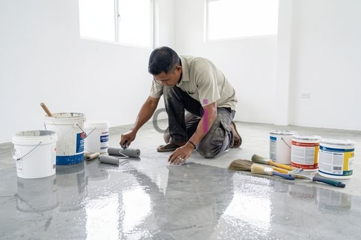

**Cara Memilih Epoxy Upox Dana Paint Terbaik 2026** - Mitra CDI yang kami hormati, banyak pemilik properti yang menghadapi kesulitan dalam memilih jenis epoxy yang tepat untuk kebutuhan lantai mereka. Seringkali, kesalahan dalam memilih formula atau aplikasi menyebabkan hasil akhir kurang memuaskan, seperti cepat mengelupas, mudah tergores, atau bahkan menimbulkan bau yang mengganggu. Pemahaman mengenai perbedaan antara produk epoxy upox, dana paint, dan jenis lainnya sangat krusial untuk mendapatkan hasil yang tahan lama dan estetis.

### Memahami Perbedaan Epoxy Upox, Dana Paint, dan Jenis Lainnya

Sebagai langkah awal, Mitra perlu memahami bahwa istilah "epoxy" mencakup berbagai formulasi dengan karakteristik yang berbeda-beda. Secara umum, epoxy adalah resin termoset yang dikenal karena kekuatannya, daya rekat yang tinggi, dan ketahanannya terhadap bahan kimia. Namun, tidak semua epoxy sama. Produk seperti Upox dan Dana Paint merupakan merek dagang yang menawarkan solusi epoxy dengan spesifikasi unik.

Epoxy Upox umumnya dikenal sebagai sistem epoxy dua komponen yang sangat kuat dan tahan lama. Sistem ini ideal untuk aplikasi yang membutuhkan ketahanan tinggi terhadap abrasi, benturan, dan bahan kimia, seperti lantai gudang, pabrik, atau garasi. Sementara itu, Dana Paint menawarkan berbagai pilihan epoxy dengan fokus pada estetika dan kemudahan aplikasi. Produk Dana Paint seringkali dirancang untuk aplikasi DIY (Do It Yourself) dan tersedia dalam berbagai pilihan warna dan efek finishing.

Selain Upox dan Dana Paint, terdapat pula berbagai merek epoxy lainnya yang tersedia di pasaran. Pemilihan merek dan jenis epoxy yang tepat harus didasarkan pada kebutuhan spesifik proyek Mitra CDI. Pertimbangkan faktor-faktor seperti jenis lantai, tingkat lalu lintas, paparan bahan kimia, dan anggaran yang tersedia.

### Faktor-Faktor Penting dalam Memilih Epoxy Upox Dana Paint

Mitra perlu mempertimbangkan beberapa faktor penting sebelum memutuskan untuk membeli epoxy Upox Dana Paint. Pertama, tentukan jenis lantai yang akan diaplikasikan epoxy. Apakah itu lantai beton, keramik, atau kayu? Setiap jenis lantai memiliki persyaratan persiapan permukaan yang berbeda-beda. Lantai beton, misalnya, memerlukan pengamplasan atau penggrindaan untuk menghilangkan lapisan kotoran dan membuka pori-pori beton agar epoxy dapat merekat dengan baik.

Kedua, pertimbangkan tingkat lalu lintas dan beban yang akan diterima oleh lantai. Untuk area dengan lalu lintas tinggi dan beban berat, seperti pabrik atau gudang, epoxy dengan ketebalan yang lebih tinggi dan kandungan padatan yang lebih tinggi akan lebih cocok. Sementara itu, untuk area dengan lalu lintas rendah dan beban ringan, seperti garasi atau ruang tamu, epoxy dengan ketebalan yang lebih tipis mungkin sudah cukup.

Ketiga, perhatikan paparan bahan kimia yang mungkin terjadi. Jika lantai akan terpapar bahan kimia korosif, seperti oli, pelarut, atau asam, pilihlah epoxy yang secara khusus diformulasikan untuk tahan terhadap bahan kimia tersebut. Keempat, pertimbangkan anggaran yang tersedia. Harga epoxy bervariasi tergantung pada merek, jenis, dan ketebalan. Kami di Creative Design Interior siap membantu Mitra CDI menemukan solusi epoxy yang sesuai dengan anggaran dan kebutuhan.

### Estimasi Biaya dan Jasa Aplikasi Epoxy Upox Dana Paint

Harga epoxy Upox Dana Paint bervariasi tergantung pada beberapa faktor, termasuk jenis produk, ketebalan aplikasi, dan luas area yang akan dicat. Secara umum, harga epoxy per meter persegi berkisar antara Rp 300.000 hingga Rp 800.000. Harga ini bersifat estimasi dan dapat berubah sewaktu-waktu — hubungi Kami untuk penawaran terbaru dan paling akurat sesuai kebutuhan proyek Mitra CDI.

Sebagai gambaran, berikut adalah contoh perhitungan biaya aplikasi epoxy untuk lantai garasi seluas 30 meter persegi dengan ketebalan 200 micron:

*   Biaya epoxy per meter persegi: Rp 400.000
*   Biaya persiapan permukaan (pengamplasan, penggrindaan, dan pembersihan): Rp 50.000 per meter persegi
*   Biaya aplikasi (tenaga kerja): Rp 75.000 per meter persegi
*   Total biaya: (30 m² x Rp 400.000) + (30 m² x Rp 50.000) + (30 m² x Rp 75.000) = Rp 15.750.000

Creative Design Interior menawarkan layanan jasa cat epoxy profesional dengan harga yang kompetitif. Kami menyediakan berbagai pilihan epoxy Upox Dana Paint dengan kualitas terjamin. Tim kami yang berpengalaman akan memastikan bahwa aplikasi epoxy dilakukan dengan benar dan sesuai dengan standar kualitas tertinggi. Kami juga menyediakan layanan konsultasi gratis untuk membantu Mitra CDI memilih jenis epoxy yang tepat untuk kebutuhan proyek.

Sebagai perusahaan yang telah berpengalaman lebih dari 10 tahun di bidang desain interior, furniture custom, dan pengadaan material bangunan, Kami memahami betul pentingnya kualitas dan ketepatan waktu. Kami menggunakan sistem kerja terjadwal untuk memastikan bahwa setiap proyek diselesaikan tepat waktu dan dengan kualitas yang terjaga. Produk dapat ditukar jika tidak sesuai spesifikasi, selama belum dipakai atau dibongkar dan maksimal 1 hari. [Daftar harga](/daftar-harga/) tersedia untuk informasi lebih lanjut.

Apabila terdapat pertanyaan lain seputar topik ini, tombol **Telepon** dan **WhatsApp** di bawah halaman ini siap Kami jawab.
