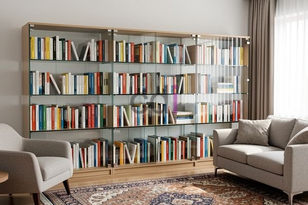

**Tersedia Etalase Buku dari Kaca: Desain Modern untuk Ruang Anda** - Mitra CDI yang kami hormati, tahukah Mitra bahwa 78% orang lebih memilih membaca buku fisik daripada digital untuk relaksasi dan hiburan? Hal ini menunjukkan bahwa meskipun era digital berkembang pesat, buku tetap menjadi bagian penting dari kehidupan banyak orang. Oleh karena itu, memiliki tempat penyimpanan buku yang tepat, seperti etalase buku dari kaca, bukan hanya soal fungsi, tetapi juga estetika ruangan.

### Mengapa Memilih Etalase Buku dari Kaca?

Mitra CDI, etalase buku dari kaca menawarkan sejumlah keuntungan dibandingkan material lain. Kaca memberikan kesan lapang dan terbuka pada ruangan, sehingga cocok untuk ruangan dengan luas terbatas. Selain itu, kaca memungkinkan Mitra untuk menampilkan koleksi buku dan benda-benda dekoratif lainnya dengan jelas, sehingga menambah nilai estetika ruangan. Etalase kaca juga mudah dibersihkan dan dirawat, menjadikannya pilihan praktis untuk jangka panjang. 

Kami di Creative Design Interior memahami betul pentingnya keseimbangan antara fungsi dan estetika. Itulah mengapa Kami menawarkan solusi etalase buku dari kaca yang dirancang khusus sesuai dengan gaya dan kebutuhan Mitra. Baik itu desain minimalis, modern, atau klasik, Kami siap mewujudkannya.

### Jenis-Jenis Etalase Buku dari Kaca yang Tersedia

Ada beberapa jenis etalase buku dari kaca yang dapat Mitra pertimbangkan. Yang paling umum adalah etalase dengan pintu swing, pintu geser, atau tanpa pintu. Etalase tanpa pintu ideal untuk menampilkan koleksi buku yang sering diakses, sementara etalase dengan pintu lebih cocok untuk melindungi buku dari debu dan kerusakan.

Selain itu, Mitra juga dapat memilih antara kaca bening, kaca frosted, atau kaca berwarna. Kaca bening memberikan tampilan yang paling jernih, sementara kaca frosted memberikan privasi dan kesan yang lebih lembut. Kaca berwarna dapat digunakan untuk menambahkan sentuhan unik dan personal pada ruangan.

### Jasa Pembuatan Etalase Buku Kaca Custom dari Creative Design Interior

Mitra, Kami di Creative Design Interior menawarkan jasa pembuatan etalase buku dari kaca yang sepenuhnya custom. Kami akan bekerja sama dengan Mitra untuk memahami kebutuhan dan preferensi Mitra, kemudian merancang etalase yang sesuai dengan visi Mitra. Kami menggunakan bahan-bahan berkualitas tinggi dan teknologi terkini untuk memastikan etalase buku dari kaca yang Kokoh dan tahan lama.

Berikut adalah beberapa keunggulan memilih layanan Kami:

*   **Desain Custom:** Mitra bebas menentukan ukuran, bentuk, dan desain etalase sesuai dengan keinginan.
*   **Kualitas Terjamin:** Kami hanya menggunakan kaca dan material berkualitas tinggi untuk memastikan produk tahan lama.
*   **Pemasangan Profesional:** Tim Kami akan memasang etalase dengan rapi dan aman.
*   **Harga Kompetitif:** Kami menawarkan harga yang bersaing dengan kualitas yang tidak perlu diragukan.

Sebagai gambaran perkiraan biaya, pembuatan etalase buku kaca dengan dimensi standar (tinggi 180 cm, lebar 80 cm, kedalaman 30 cm) dengan pintu swing dan kaca bening berkisar antara Rp 3.500.000 hingga Rp 6.000.000. Harga ini bersifat estimasi dan dapat berubah sewaktu-waktu — hubungi Kami untuk penawaran terbaru dan paling akurat sesuai kebutuhan proyek Mitra CDI.

### Kemudahan Pemesanan dan Pembayaran

Memesan etalase buku dari kaca custom dari Creative Design Interior sangatlah mudah. Mitra dapat menghubungi Kami melalui tombol **Telepon** atau **WhatsApp** yang tertera di bawah halaman ini untuk berkonsultasi dengan tim desain Kami. Kami akan membantu Mitra dalam memilih desain, material, dan anggaran yang sesuai. 

Kami juga menawarkan berbagai pilihan pembayaran yang fleksibel, termasuk COD, transfer bank, DP 50%, transfer setelah barang terkirim, bayar bertahap, atau transfer setelah pekerjaan selesai. Kami melayani wilayah Jakarta, Bogor, Depok, Tangerang, Bekasi, Cikarang, Karawang, Bandung, Serang, Purwakarta, Cilegon, Cikampek, Subang, dan Rangkasbitung. Kami telah berpengalaman lebih dari 10 tahun dalam bidang furniture custom, material bangunan, dan jasa pengecoran, sehingga Mitra dapat mempercayakan proyek ini sepenuhnya kepada Kami.

Untuk konsultasi lebih lanjut, tombol **Telepon** dan **WhatsApp** di bawah halaman ini dapat langsung digunakan untuk menghubungi Kami.
