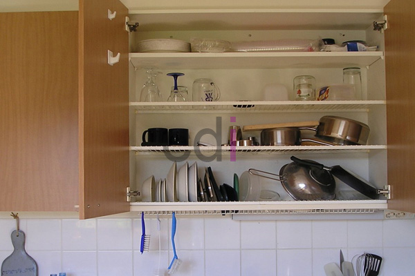

**Etalase Rak Piring Minimalis Jabodetabek: Sentuhan Modern untuk Dapur Idaman** - Hai Mitra CDI! Apakah Anda sedang mencari cara untuk membuat dapur terasa lebih terorganisir dan menawan? Etalase rak piring minimalis bisa jadi jawaban tepat. Lebih dari sekadar tempat penyimpanan, etalase ini menghadirkan estetika modern yang menyegarkan. Di Creative Design Interior (CDI), kami menyediakan solusi custom yang disesuaikan dengan gaya dan kebutuhan dapur Anda di (not detected).

## Mengapa Memilih Etalase Rak Piring Minimalis?

Pertimbangkan sejenak: dapur yang rapi, koleksi piring kesayangan tertata apik, dan tampilan ruangan yang lebih luas. Itulah daya tarik utama etalase rak piring minimalis. Desainnya yang sederhana namun elegan cocok dipadukan dengan berbagai tema interior, mulai dari skandinavia yang hangat hingga industrial yang modern. Nah, kalau dapur Anda punya lahan terbatas, model minimalis ini justru bisa memecahkan masalah tata ruang dengan cerdas.

Bukan cuma soal tampilan, material berkualitas juga memegang peran penting. Kami mengutamakan penggunaan bahan yang awet dan tahan lama, seperti kayu solid, multipleks premium, atau kombinasi keduanya. Penambahan rak kaca bukan hanya memberikan kesan visual yang lebih mewah, tetapi juga memudahkan Anda untuk melihat dan mengambil piring favorit.

## Pilihan Material dan Desain yang Bisa Anda Kustomisasi

Di Creative Design Interior, kami memahami bahwa setiap dapur dan setiap selera itu unik. Itulah kenapa kami menawarkan banyak pilihan material dan desain untuk etalase rak piring minimalis, agar sesuai dengan identitas dapur Anda. Berikut beberapa opsi yang tersedia:

*   **Kayu Solid:** Jati, mahoni, atau meranti memberikan kesan mewah dan kehangatan alami.
*   **Multipleks:** Pilihan ekonomis yang tetap menjamin kekuatan dan estetika, terutama dengan finishing yang tepat.
*   **Kombinasi Kayu dan Kaca:** Menghadirkan kesan elegan dan modern yang seimbang.
*   **Material Melamin:** Solusi praktis yang mudah dibersihkan dan tahan terhadap goresan.

Selain material, Anda juga bisa memilih dari berbagai desain, misalnya:

*   **Etalase Dinding:** Ideal untuk menghemat ruang dan menciptakan kesan lebih lapang.
*   **Etalase Standing:** Cocok untuk dapur yang lebih luas dan membutuhkan ruang penyimpanan ekstra.
*   **Etalase dengan Pintu Kaca:** Melindungi koleksi piring dari debu dan memberikan tampilan yang lebih menarik.
*   **Etalase dengan Pencahayaan LED:** Memberikan sentuhan mewah dan memudahkan Anda melihat koleksi piring di dalamnya.

Kami juga melayani pembuatan etalase custom sepenuhnya sesuai keinginan Anda. Ukuran, warna, detail finishing—semuanya bisa dirancang khusus untuk dapur Anda. Untuk informasi lebih detail mengenai range harga, silakan cek  atau hubungi tim Kami untuk perhitungan biaya yang presisi.

## Pemesanan Mudah, Pemasangan Profesional – Hanya di Creative Design Interior

Kami sadar betul, waktu Anda sangat berharga. Karena itu, Kami berupaya membuat proses pemesanan dan pemasangan etalase rak piring minimalis menjadi semudah mungkin. Cukup hubungi Kami melalui tombol **Telepon** atau **WhatsApp** yang ada di bawah – tim desain Kami siap membantu Anda merencanakan etalase impian.

Setelah desain disetujui, kami akan langsung memulai proses produksi menggunakan material terbaik dan pengerjaan yang teliti. Kami menjamin kualitas produk dan pemasangan yang rapi dan tepat waktu. Kami melayani pengiriman dan pemasangan di seluruh wilayah (not detected), Jabodetabek, Cikarang, Karawang, Bandung, Serang, Purwakarta, Cilegon, Cikampek, Subang, dan Rangkasbitung. 

Kami menawarkan paket harga yang transparan, mencakup material, pengiriman, dan pemasangan. Beberapa wilayah tertentu bahkan berhak mendapatkan gratis ongkir! Selain itu, Anda bisa memilih metode pembayaran yang paling nyaman: COD, transfer bank, DP 50%, transfer setelah barang diterima, bayar bertahap, atau transfer setelah pekerjaan selesai. Apabila terdapat ketidaksesuaian antara produk dengan pesanan Anda, Kami akan dengan senang hati melakukan penggantian, asalkan produk belum digunakan dan belum dibongkar, serta dilaporkan dalam waktu maksimal 1 hari. Untuk informasi lebih lengkap tentang pilihan kami, Anda dapat mengunjungi [Beberapa Model Rak TV Minimalis Modern](/blog/beberapa-model-rak-tv-minimalis-modern/) — ini bisa jadi inspirasi untuk desain dapur Anda!

Jika Anda memiliki pertanyaan lebih lanjut, jangan ragu untuk menghubungi Kami melalui tombol **Telepon** atau **WhatsApp** di halaman ini. Kami siap membantu Anda mewujudkan dapur yang rapi, modern, dan penuh gaya.