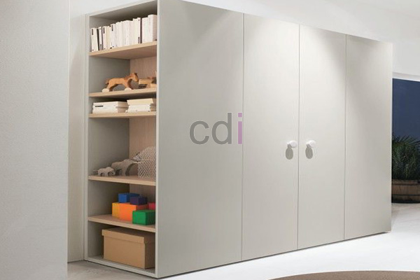

**Furniture Lemari Pakaian Minimalis: Pilih yang Tepat untuk Ruang Anda** - Mitra CDI yang budiman, di tengah tren desain interior modern, furniture lemari pakaian minimalis semakin populer. Lebih dari 70% orang Indonesia dengan ruang penyimpanan terbatas memilih desain minimalis untuk memaksimalkan fungsi ruangan. Artikel ini akan membantu Anda memahami bagaimana memilih furniture lemari pakaian minimalis yang paling sesuai dengan kebutuhan dan gaya Anda, serta bagaimana Kami di Creative Design Interior dapat mewujudkannya.

## Mengapa Memilih Furniture Lemari Pakaian Minimalis?

Tren minimalis bukan hanya soal estetika. Desain minimalis berfokus pada fungsi dan efisiensi ruang. Furniture lemari pakaian minimalis menawarkan sejumlah keunggulan, antara lain tampilan yang bersih dan rapi, penggunaan ruang yang optimal, serta kemudahan perawatan. Selain itu, desain minimalis mudah dipadukan dengan berbagai gaya interior, mulai dari modern, Skandinavia, hingga industrial.

Dengan memilih lemari pakaian minimalis, Anda tidak hanya mendapatkan solusi penyimpanan yang efisien, tetapi juga menciptakan suasana ruangan yang lebih tenang dan terorganisir. Desain yang sederhana dan fungsional juga cenderung lebih tahan lama karena minim ornamen yang rentan rusak.

## Material dan Ukuran Furniture Lemari Pakaian Minimalis

Pemilihan material sangat penting dalam menentukan kualitas dan daya tahan furniture lemari pakaian minimalis Anda. Beberapa material yang umum digunakan antara lain:

*   **Multipleks:** Kuat dan stabil, cocok untuk struktur utama lemari.
*   **MDF (Medium-Density Fiberboard):** Permukaan halus dan mudah dicat, ideal untuk tampilan yang lebih modern.
*   **Kayu Solid:** Memberikan kesan mewah dan tahan lama, namun biasanya lebih mahal.
*   **HPL (High-Pressure Laminate):** Lapisan pelindung yang tahan gores dan mudah dibersihkan.

Ukuran lemari pakaian minimalis harus disesuaikan dengan luas ruangan dan kebutuhan penyimpanan Anda. Berikut adalah beberapa ukuran umum:

| Ukuran (Lebar x Tinggi x Kedalaman) | Cocok Untuk |
|---|---|
| 120 cm x 180 cm x 60 cm | Kamar tidur single atau anak-anak |
| 180 cm x 200 cm x 60 cm | Kamar tidur double |
| 240 cm x 240 cm x 65 cm | Kamar tidur utama dengan kebutuhan penyimpanan besar |

Perhatikan juga tinggi langit-langit ruangan Anda. Jika langit-langit tinggi, Anda dapat memilih lemari yang lebih tinggi untuk memaksimalkan ruang vertikal. Kami di Creative Design Interior menyediakan layanan custom, memungkinkan Anda mendapatkan lemari dengan ukuran yang sesuai dengan kebutuhan spesifik Anda.

## Tips Memilih Furniture Lemari Pakaian Minimalis yang Tepat

Sebelum membeli furniture lemari pakaian minimalis, pertimbangkan beberapa hal berikut:

1.  **Kebutuhan Penyimpanan:** Tentukan jenis pakaian dan barang apa saja yang akan Anda simpan di lemari. Apakah Anda membutuhkan ruang gantung yang luas, rak untuk melipat pakaian, atau laci untuk menyimpan aksesoris?
2.  **Gaya Interior:** Pastikan lemari yang Anda pilih sesuai dengan gaya interior ruangan Anda. Warna dan desain lemari harus selaras dengan tema ruangan.
3.  **Kualitas Material:** Pilih lemari yang terbuat dari material berkualitas tinggi agar tahan lama dan awet. Periksa juga kualitas finishing dan sambungan lemari.
4.  **Fitur Tambahan:** Pertimbangkan fitur tambahan seperti cermin, lampu LED interior, atau sistem ventilasi. Fitur-fitur ini dapat meningkatkan kenyamanan dan fungsionalitas lemari Anda.

Kami di Creative Design Interior siap membantu Anda memilih furniture lemari pakaian minimalis yang paling tepat untuk kebutuhan Anda. Dengan pengalaman lebih dari 10 tahun di bidang desain interior dan pembuatan furniture custom, Kami dapat memberikan solusi terbaik untuk memaksimalkan ruang dan menciptakan tampilan yang sesuai dengan gaya Anda. Harga ini bersifat estimasi dan dapat berubah sewaktu-waktu — hubungi Kami untuk penawaran terbaru dan paling akurat sesuai kebutuhan proyek Anda.

## Creative Design Interior: Solusi Furniture Minimalis Custom Anda

Kami menawarkan layanan pembuatan furniture lemari pakaian minimalis custom sesuai dengan desain dan ukuran yang Anda inginkan. Kami menggunakan material berkualitas tinggi dan dikerjakan oleh tim yang berpengalaman untuk memastikan kualitas dan ketahanan produk. Selain itu, Kami juga menyediakan layanan pengiriman dan pemasangan gratis untuk wilayah Jabodetabek dan sekitarnya.

Kami memahami bahwa setiap ruangan memiliki karakteristik yang unik. Oleh karena itu, Kami menawarkan konsultasi gratis dengan desainer interior Kami untuk membantu Anda merencanakan desain lemari yang paling sesuai dengan kebutuhan Anda. Kami juga menyediakan pilihan pembayaran yang fleksibel, termasuk COD, transfer bank, DP 50%, transfer setelah barang terkirim, bayar bertahap, atau transfer setelah pekerjaan selesai.

Tim Kami siap membantu mewujudkan proyek Anda — silakan hubungi melalui tombol **Telepon** atau **WhatsApp** yang tersedia di bawah.
