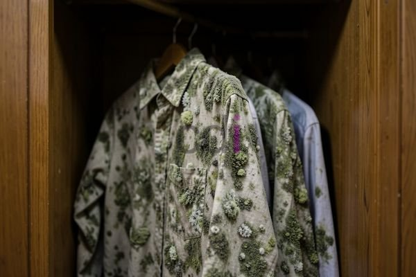

**Gantungan Baju Lemari Tarik: Solusi Ruang Efisien untuk Pakaian Anda** - Mitra CDI, apakah Mitra sedang mencari cara untuk mengoptimalkan ruang di lemari pakaian? Dengan keterbatasan ruang yang sering dihadapi di perkotaan, memanfaatkan setiap inci ruang penyimpanan menjadi sangat penting. Salah satu solusi cerdas yang dapat Mitra pertimbangkan adalah penggunaan gantungan baju lemari tarik.

### Mengapa Memilih Gantungan Baju Lemari Tarik?

Gantungan baju lemari tarik menawarkan beberapa keunggulan dibandingkan gantungan baju konvensional. Pertama, desainnya yang dapat ditarik keluar memungkinkan akses yang lebih mudah ke seluruh pakaian yang digantung. Mitra tidak perlu lagi meraba-raba atau memindahkan pakaian lain hanya untuk mengambil satu item. Kedua, gantungan ini sangat ideal untuk lemari dengan ruang terbatas karena memaksimalkan penggunaan ruang vertikal. Ketiga, gantungan baju lemari tarik memberikan tampilan yang lebih rapi dan terorganisir di dalam lemari, memudahkan Mitra dalam memilih pakaian setiap hari.

### Material dan Jenis Gantungan Baju Lemari Tarik

Mitra CDI, terdapat berbagai material yang dapat digunakan untuk membuat gantungan baju lemari tarik. Pilihan material akan memengaruhi tampilan, daya tahan, dan tentu saja, harga produk. Beberapa material yang umum digunakan antara lain:

*   **Besi:** Gantungan besi dikenal karena kekuatannya dan kemampuannya menahan beban berat. Gantungan besi biasanya dilapisi dengan cat atau powder coating untuk mencegah karat.
*   **Aluminium:** Aluminium adalah material yang ringan namun kuat, serta tahan terhadap korosi. Gantungan aluminium cocok untuk digunakan di area yang lembab.
*   **Kayu:** Gantungan kayu memberikan kesan elegan dan alami pada lemari pakaian. Kayu yang umum digunakan adalah kayu solid atau multipleks dengan finishing yang menarik.
*   **Plastik:** Gantungan plastik adalah pilihan yang paling ekonomis, namun kurang tahan lama dibandingkan material lainnya.

Selain material, gantungan baju lemari tarik juga tersedia dalam berbagai jenis, seperti:

*   **Gantungan Tunggal:** Dirancang untuk menggantung satu potong pakaian.
*   **Gantungan Ganda:** Memiliki dua batang yang memungkinkan Mitra menggantung dua potong pakaian secara vertikal.
*   **Gantungan Celana:** Dirancang khusus untuk menggantung celana panjang atau rok.

<table class="table">
  <caption>Perbandingan Material Gantungan Baju Lemari Tarik</caption>
  <thead>
    <tr><th>Material</th><th>Kelebihan</th><th>Kekurangan</th><th>Estimasi Harga (per buah)</th></tr>
  </thead>
  <tbody>
    <tr><td>Besi</td><td>Kuat, tahan beban berat</td><td>Rentan karat jika tidak dilapisi</td><td>Rp 25.000 - Rp 50.000</td></tr>
    <tr><td>Aluminium</td><td>Ringan, tahan korosi</td><td>Kurang kuat dibandingkan besi</td><td>Rp 30.000 - Rp 60.000</td></tr>
    <tr><td>Kayu</td><td>Elegan, alami</td><td>Membutuhkan perawatan, rentan terhadap kelembaban</td><td>Rp 40.000 - Rp 80.000</td></tr>
    <tr><td>Plastik</td><td>Ekonomis</td><td>Kurang tahan lama</td><td>Rp 10.000 - Rp 20.000</td></tr>
  </tbody>
</table>

### Pemasangan dan Perawatan Gantungan Baju Lemari Tarik

Pemasangan gantungan baju lemari tarik relatif mudah. Mitra dapat memasangnya sendiri dengan menggunakan obeng dan sekrup. Namun, jika Mitra tidak yakin dengan kemampuan sendiri, Kami sarankan untuk menggunakan jasa profesional. Creative Design Interior menawarkan layanan pemasangan furniture, termasuk gantungan baju lemari tarik.

Untuk perawatan, gantungan baju lemari tarik berbahan besi atau aluminium sebaiknya dibersihkan secara berkala dengan lap kering untuk mencegah karat. Gantungan kayu perlu dilapisi dengan pelindung kayu secara berkala untuk menjaga kelembaban dan mencegah kerusakan.

### Dapatkan Solusi Gantungan Baju Lemari Tarik Custom dari Creative Design Interior

Mitra CDI, apakah Mitra ingin memiliki gantungan baju lemari tarik yang sesuai dengan desain dan kebutuhan spesifik? Kami di Creative Design Interior siap membantu. Dengan pengalaman lebih dari 10 tahun di bidang furniture custom, Kami dapat menciptakan gantungan baju lemari tarik yang sempurna untuk lemari Mitra. Kami menyediakan berbagai pilihan material, ukuran, dan finishing. Harga ini bersifat estimasi dan dapat berubah sewaktu-waktu — hubungi Kami untuk penawaran terbaru dan paling akurat sesuai kebutuhan proyek Mitra CDI.

Kami juga menawarkan layanan lainnya, seperti pembuatan kitchen set, lemari custom, dan pengadaan material bangunan. Kami melayani wilayah Jakarta, Bogor, Depok, Tangerang, Bekasi, Cikarang, Karawang, Bandung, Serang, Purwakarta, Cilegon, Cikampek, Subang, dan Rangkasbitung. Dengan skema harga *all in one* (termasuk material, pengiriman, dan bongkar muat), Mitra tidak perlu khawatir dengan biaya tambahan yang tak terduga. Tersedia gratis ongkir (berlaku ketentuan wilayah). Pilihan pembayaran fleksibel: COD, transfer bank, DP 50%, transfer setelah barang terkirim, bayar bertahap, atau transfer setelah pekerjaan selesai.

Jangan ragu untuk menghubungi Kami untuk konsultasi gratis dan penawaran harga terbaik. Tim kerja berpengalaman Kami akan membantu Mitra menemukan solusi terbaik untuk kebutuhan penyimpanan pakaian. Produk dapat ditukar jika tidak sesuai spesifikasi, selama belum dipakai atau dibongkar dan maksimal 1 hari. Lihat daftar harga lengkap di [Daftar Harga](/daftar-harga/).

Apabila terdapat pertanyaan lain seputar topik ini, tombol **Telepon** dan **WhatsApp** di bawah halaman ini siap Kami jawab.
