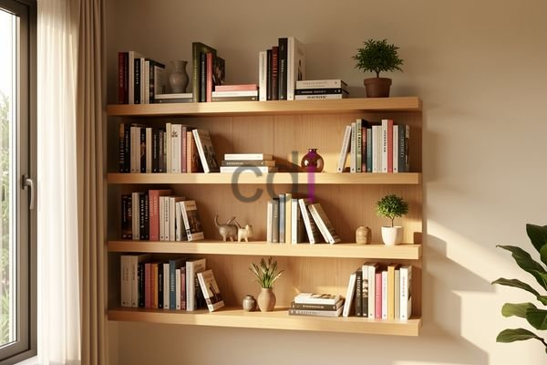

**Gantungan Buku di Dinding** - Mitra CDI di mana pun berada, banyak pemilik rumah yang menghadapi tantangan dalam menata koleksi buku mereka. Ruangan terasa sempit, rak buku konvensional memakan banyak tempat, dan seringkali buku-buku berakhir tertumpuk tidak teratur. Kondisi ini tidak hanya mengganggu estetika ruangan, tetapi juga mempersulit aksesibilitas terhadap buku-buku yang dibutuhkan. 

**Gantungan Buku Dinding: Solusi Cerdas untuk Ruang Terbatas**

Gantungan buku di dinding menawarkan solusi praktis dan estetis untuk mengatasi permasalahan ruang. Dengan memanfaatkan ruang vertikal yang seringkali terabaikan, Anda dapat menyimpan koleksi buku tanpa memakan banyak tempat di lantai. Pilihan ini sangat ideal untuk apartemen, rumah dengan ruang terbatas, atau bagi Anda yang menginginkan tampilan interior yang lebih minimalis. Selain itu, gantungan buku dinding juga dapat menjadi elemen dekoratif yang menarik, menambahkan karakter unik pada ruangan Anda.

**Memilih Material yang Tepat untuk Gantungan Buku Dinding**

Material yang digunakan dalam pembuatan gantungan buku dinding sangat memengaruhi kekuatan, daya tahan, dan estetika produk. Beberapa material umum yang sering digunakan antara lain kayu solid, kayu lapis, metal, dan akrilik. Kayu solid seperti jati atau mahoni menawarkan kekuatan dan keindahan alami, tetapi biasanya memiliki harga yang lebih tinggi. Kayu lapis adalah alternatif yang lebih ekonomis, tetapi perlu dilapisi dengan finishing yang baik untuk melindungi dari kelembaban dan kerusakan. Metal, seperti besi atau baja, memberikan kesan modern dan industrial, serta memiliki daya tahan yang sangat baik. Sementara itu, akrilik menawarkan tampilan yang transparan dan futuristik, cocok untuk gaya interior yang minimalis.

Jika Anda mempertimbangkan material kayu, perhatikan jenis kayu yang digunakan. Kayu dengan kepadatan tinggi seperti kayu keras (hardwood) akan lebih kuat menahan beban buku yang berat. Untuk kayu lapis, pilihlah yang memiliki ketebalan minimal 18mm untuk memastikan kekokohan. Berikut tabel perbandingan material umum untuk gantungan buku dinding:

<table class="table">
  <caption>Perbandingan Material Gantungan Buku Dinding</caption>
  <thead>
    <tr><th>Material</th><th>Kekuatan</th><th>Daya Tahan</th><th>Estetika</th><th>Harga (Estimasi/Meter)</th></tr>
  </thead>
  <tbody>
    <tr><td>Kayu Solid (Jati)</td><td>Sangat Kuat</td><td>Tinggi</td><td>Klasik, Elegan</td><td>Rp 500.000 - Rp 1.500.000</td></tr>
    <tr><td>Kayu Solid (Mahoni)</td><td>Kuat</td><td>Tinggi</td><td>Hangat, Alami</td><td>Rp 300.000 - Rp 800.000</td></tr>
    <tr><td>Kayu Lapis</td><td>Sedang</td><td>Sedang (dengan finishing)</td><td>Fleksibel, Modern</td><td>Rp 150.000 - Rp 300.000</td></tr>
    <tr><td>Metal (Besi)</td><td>Sangat Kuat</td><td>Sangat Tinggi</td><td>Industrial, Minimalis</td><td>Rp 200.000 - Rp 500.000</td></tr>
    <tr><td>Akrilik</td><td>Sedang</td><td>Sedang</td><td>Modern, Futuristik</td><td>Rp 250.000 - Rp 600.000</td></tr>
  </tbody>
</table>

Harga ini bersifat estimasi dan dapat berubah sewaktu-waktu — hubungi Kami untuk penawaran terbaru dan paling akurat sesuai kebutuhan proyek Anda.

**Creative Design Interior: Solusi Gantungan Buku Dinding Custom**

Kami di Creative Design Interior menyediakan layanan pembuatan gantungan buku dinding *custom* sesuai dengan kebutuhan dan preferensi Anda. Anda dapat memilih material, ukuran, warna, dan desain yang sesuai dengan gaya interior rumah Anda. Tim Kami akan membantu Anda merancang dan membuat gantungan buku dinding yang tidak hanya fungsional, tetapi juga menjadi bagian dari dekorasi ruangan yang menarik. Dengan pengalaman lebih dari 10 tahun dalam pembuatan furniture interior, Kami menjamin kualitas produk yang superior dan pengerjaan yang tepat waktu.

Selain layanan pembuatan *custom*, Kami juga menyediakan berbagai pilihan gantungan buku dinding siap pakai dengan desain yang beragam. Kami menggunakan material berkualitas tinggi dan finishing yang tahan lama, sehingga Anda dapat menikmati produk Kami selama bertahun-tahun. [Lihat daftar harga terbaru Kami](/daftar-harga/) untuk mengetahui lebih lanjut mengenai pilihan produk dan harga yang tersedia.

**Kemudahan Pemesanan dan Pembayaran di Creative Design Interior**

Kami memahami bahwa kemudahan proses pemesanan dan pembayaran adalah hal yang penting bagi pelanggan. Oleh karena itu, Kami menyediakan berbagai pilihan pembayaran yang fleksibel, termasuk COD, transfer bank, DP 50%, transfer setelah barang terkirim, bayar bertahap, atau transfer setelah pekerjaan selesai. Kami juga melayani pengiriman ke seluruh wilayah Jabodetabek, Bandung, Serang, Purwakarta, Cilegon, Cikampek, Subang, dan Rangkasbitung, dengan opsi gratis ongkir untuk wilayah tertentu.

Kami melayani area Jakarta, Bogor, Depok, Tangerang, dan Bekasi. Jam operasional Kami adalah Senin sampai Sabtu pukul 08.00 sampai 17.00. Tim Kami siap membantu Anda dalam memilih desain, material, dan ukuran gantungan buku dinding yang tepat untuk kebutuhan Anda. Produk dapat ditukar jika tidak sesuai spesifikasi, selama belum dipakai atau dibongkar dan maksimal 1 hari.

Tim Kami siap membantu mewujudkan proyek Anda — silakan hubungi melalui tombol **Telepon** atau **WhatsApp** yang tersedia di bawah.
