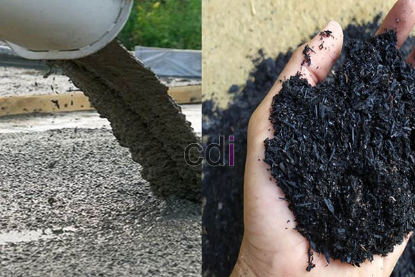

**Garukan Cor Beton: Fungsi, Jenis, dan Tips Penggunaannya untuk Hasil Maksimal** - Hai Mitra CDI! Tahukah Anda, kualitas pengecoran beton adalah kunci penting dalam membangun struktur yang tahan lama dan aman? Nah, salah satu 'pemain' utama yang seringkali terlupakan adalah garukan cor beton. Alat sederhana ini punya peran vital untuk menghasilkan beton yang kuat, rata, dan bebas rongga. Yuk, simak lebih lanjut!

## Mengapa Garukan Cor Beton Begitu Penting dalam Pengecoran?

Membuat campuran beton yang pas saja tidak cukup. Teknik pengecoran yang tepat juga menentukan hasil akhir. Salah satu tahapan krusial yang seringkali terlewat adalah pemadatan beton. Disinilah garukan cor beton berperan. Garukan menciptakan getaran yang memampatkan campuran, membuat partikel-partikel semen dan agregat menyatu dengan sempurna. 

Bayangkan jika gelembung udara tetap terperangkap dalam adonan. Hasilnya? Kekuatan dan daya tahan beton berkurang signifikan. Selain itu, permukaan coran jadi tidak rata dan kasar. Dengan menggunakan garukan cor beton dengan benar, Anda dapat menghindari masalah tersebut dan mendapatkan coran yang lebih padat, homogen, dan memenuhi standar kualitas yang diharapkan. Jangan lupa, mempelajari [Cara Membuat Cor Beton yang Benar: Panduan Lengkap untuk Hasil Kuat dan Awet](/blog/cara-membuat-cor-beton-yang-benar/) akan melengkapi pemahaman Anda, lho!

## Menjelajahi Berbagai Jenis Garukan Cor Beton

Secara garis besar, ada dua tipe garukan cor beton yang umum kita temui: yang manual dan yang elektrik. Keduanya punya kelebihan dan kekurangan masing-masing. Pemilihan yang tepat tergantung pada skala proyek dan kebutuhan spesifik Anda.

### Garukan Cor Beton Manual: Simpel dan Ekonomis

Garukan manual bekerja dengan getaran yang dihasilkan oleh tenaga manusia. Alat ini terdiri dari gagang dan kepala vibrator dengan jarum vibrator yang ditancapkan ke beton. Anda perlu menggerakkan gagang berulang-ulang untuk menghasilkan getaran yang cukup.

**Keunggulan:**
*   Harga terjangkau.
*   Tidak memerlukan sumber listrik.
*   Ideal untuk area kecil atau sulit dijangkau.

**Kelemahan:**
*   Membutuhkan lebih banyak tenaga fisik.
*   Efisiensi pemadatan kurang optimal dibandingkan jenis elektrik.
*   Prosesnya lebih lama untuk area yang luas.

### Garukan Cor Beton Elektrik: Efisien dan Bertenaga

Garukan elektrik memanfaatkan motor listrik untuk menghasilkan getaran. Dilengkapi gagang, kepala vibrator, dan kabel listrik. Getaran yang dihasilkan lebih kuat dan lebih konsisten.

**Keunggulan:**
*   Pemadatan lebih efektif dan efisien.
*   Mengurangi kelelahan operator.
*   Sangat cocok untuk area pengecoran yang luas.
*   Menghasilkan permukaan cor yang lebih rata dan padat.

**Kelemahan:**
*   Harga lebih mahal.
*   Membutuhkan akses ke sumber listrik.
*   Memerlukan perawatan rutin agar tetap berfungsi optimal.

## Tips Ampuh Menggunakan Garukan Cor Beton dengan Benar

Mau hasil cor yang prima? Berikut beberapa tips yang perlu Anda perhatikan saat menggunakan garukan cor beton:

1.  **Kondisi beton ideal:** Pastikan beton berada dalam kondisi yang tepat – konsisten dan belum mengeras.
2.  **Posisi penancapan vertikal:** Masukkan jarum vibrator secara tegak lurus ke dalam campuran. Hindari kemiringan yang bisa menyebabkan material terpisah.
3.  **Gerakan yang halus dan merata:** Gerakkan garukan perlahan dan merata di seluruh permukaan cor. Jangan terburu-buru agar gelembung udara tidak kembali terperangkap.
4.  **Jarak ideal antar titik:** Atur jarak antar titik penancapan sekitar 30-50 cm untuk memastikan pemadatan menyeluruh.
5.  **Waktu yang tepat:** Lakukan pemadatan segera setelah beton dituang dan diratakan. Semakin cepat, semakin baik hasilnya.
6.  **Standar mutu beton:** Pastikan mutu beton sesuai dengan kebutuhan proyek Anda. Pelajari juga [Cara Menghitung Kebutuhan Cor Kolom dengan Tepat untuk Hasil Maksimal](/blog/cara-menghitung-kebutuhan-cor-kolom/) untuk mendapatkan perhitungan yang presisi.

## Pertimbangan Biaya dan Faktor Tambahan di (not detected)

Harga garukan cor beton bervariasi tergantung merek, jenis, dan fitur spesifik. Model manual biasanya tersedia mulai dari Rp 200.000 hingga Rp 500.000, sementara garukan elektrik bisa mencapai Rp 1.500.000 hingga Rp 5.000.000 atau lebih. Ingat, harga ini bersifat perkiraan dan dapat berubah sewaktu-waktu — Kami sarankan untuk menghubungi Kami untuk mendapatkan penawaran harga paling akurat sesuai dengan kebutuhan proyek Anda di (not detected). Selain harga alat, pertimbangkan juga biaya operasional dan perawatan, terutama untuk model elektrik. Jangan lupa, memahami Alas Cor Beton: Panduan Lengkap Jenis, Fungsi, dan Pemasangannya juga akan membantu Anda memaksimalkan kualitas coran.

Butuh informasi lebih lanjut? Jangan sungkan untuk menghubungi Kami! Tombol **Telepon** dan **WhatsApp** di bawah ini siap melayani Anda. Kami hadir untuk mendukung kelancaran proyek konstruksi Anda di (not detected) dan sekitarnya.