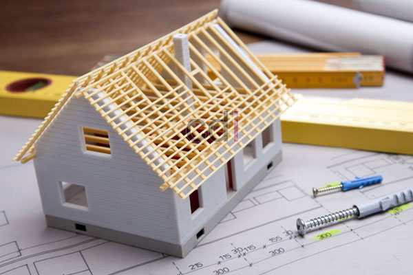

**3 Hal Penting Dalam Merencanakan Pembangunan Rumah** - Hai Mitra CDI! Punya impian membangun rumah idaman di (not detected)? Tentu saja! Rumah bukan hanya sekadar atap di atas kepala, tapi juga tempat kita menciptakan kenangan, berbagi cerita, dan merasakan kedamaian. Pertanyaan yang sering muncul adalah: dari mana sebaiknya memulai perencanaan pembangunan rumah? Apa saja hal-hal penting yang wajib diperhatikan? Yuk, simak pembahasan kami sampai akhir untuk jawabannya!

*Merencanakan Pembangunan Rumah*

## Memahami Kondisi dan Karakteristik Lokasi

Sebelum membayangkan desain dan struktur rumah impian, langkah pertama yang krusial adalah memahami betul kondisi dan karakteristik lokasi di (not detected). Ini mencakup aspek alami maupun aspek formal seperti peraturan dan persyaratan bangunan yang berlaku.

Perencanaan pembangunan rumah yang mengabaikan situasi dan ketentuan lokasi berpotensi menimbulkan masalah di kemudian hari. Sebuah rumah ideal seharusnya menjadi tempat yang nyaman, santai, indah, sehat, dan aman—sesuatu yang justru terhambat jika fondasinya tidak tepat.

## Konsep, Fungsi, dan Tata Ruang

Dalam merencanakan pembangunan rumah, terutama dengan konsep minimalis, prioritas utama adalah kepraktisan, fungsionalitas, efisiensi, dan ekonomis. Dari sinilah, berbagai konsep arsitektur yang sesuai dengan selera masing-masing dapat terwujud—misalnya gaya minimalis, klasik, mediterania, atau natural. 

Mulai dengan mensurvei lahan, mengukur dimensi, dan menyesuaikan denah/peta bangunan. Kemudian, rancang tata ruang dengan mempertimbangkan fungsi dan sifat dasar setiap area. Secara umum, area hunian dapat dibagi menjadi tiga kelompok utama:

- 1. #### Ruang Publik

- 2. #### Area Pribadi

- 3. #### Ruang Pelayanan

Ketiga kelompok ini kemudian bisa dipecah lagi menjadi fungsi-fungsi yang lebih spesifik:

- #### Ruang Publik

    \- Ruang Tamu - Ruang Makan - Ruang Keluarga - Ruang Belajar/Kerja

- #### Area Pribadi

    \- Kamar Tidur - Kamar Mandi 
Area pribadi adalah tempat beristirahat yang terdiri dari kamar tidur dan fasilitas pendukungnya, seperti kamar mandi dan ruang penyimpanan barang pribadi.

- #### Ruang Pelayanan

    \- Dapur - Area Penyimpanan (Gudang) - Garasi

Setelah konsep-konsep ini terdefinisi dengan baik, Mitra akan semakin mudah mewujudkan desain rumah impian. Kami biasanya memanfaatkan software seperti Autocad untuk mempermudah proses desain. Software ini praktis dan relatif mudah dipelajari. Jika Mitra kurang familiar dengan teknologi, banyak tutorial online yang bisa membantu. Jangan ragu juga untuk mencari inspirasi desain di website khusus perencanaan rumah atau buku-buku terkait. Semakin banyak referensi, semakin kaya ide yang bisa Mitra terapkan.

## Kesimpulan: Tips Merencanakan Pembangunan Rumah

Sebelum memulai pembangunan rumah minimalis atau model yang lain, perhatikan beberapa saran dan tips berikut:

- 1\. Pastikan sirkulasi udara dalam rumah baik untuk mengurangi panas dan kelembaban. Manfaatkan pencahayaan alami minimal satu jam sehari untuk kesehatan, dan pertimbangkan penggunaan atap yang efektif melindungi bangunan dari panas dan hujan.
- 2\. Tambahkan area hijau di depan rumah untuk menciptakan kesan hidup, segar, indah, dan harmonis.
- 3\. Perhatikan kondisi tanah untuk memastikan keamanan bangunan dari risiko banjir. Tentukan tinggi lantai bangunan yang sesuai.
- 4\. Sesuaikan jumlah dan ukuran ruangan dengan jumlah anggota keluarga, rutinitas, hobi, ukuran lahan, dan anggaran yang tersedia.
- 5\. Rancang ruang yang memberikan nilai tambah bagi Anda. Jika Mitra gemar membaca, sediakan ruang perpustakaan khusus.

Dengan pengaturan tata ruang dan desain yang tepat, Mitra bisa menciptakan rumah yang dapat mengakomodasi beragam kebutuhan dan mewujudkan impian, bahkan dengan lahan terbatas. Demikian tips dari kami tentang Hal Wajib Dalam Merencanakan Pembangunan Rumah. Semoga artikel ini dapat membantu Mitra dalam mewujudkan rumah impian di (not detected)! Jangan ragu untuk menghubungi kami untuk konsultasi lebih lanjut terkait jasa desain interior dan kebutuhan material bangunan Anda. 