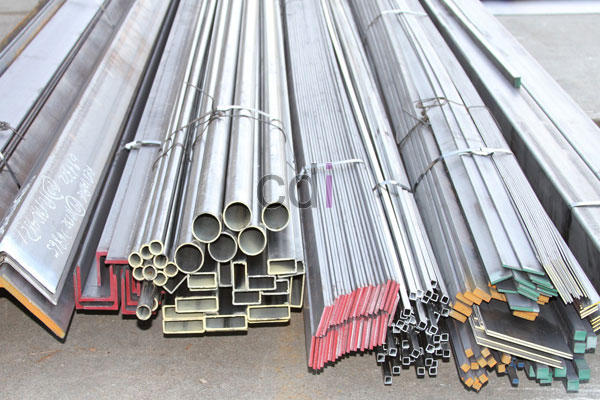

**Harga Besi Cor Beton Terbaru** – Hai Mitra CDI! Sedang mencari informasi harga besi cor beton terkini? Anda berada di tempat yang tepat! Kami dari Creative Design Interior (CDI) hadir sebagai solusi kebutuhan material konstruksi Anda di (not detected) dan sekitarnya. Besi beton, sebagai tulang punggung bangunan kokoh, adalah salah satu produk unggulan kami. Kami menyediakan berbagai jenis besi beton untuk berbagai aplikasi, mulai dari fondasi rumah, dak, hingga proyek infrastruktur skala besar seperti jembatan dan pagar. Yuk, simak daftar harga terbaru kami!

Daftar harga besi cor beton yang kami sajikan ini mencakup berbagai tipe dan ukuran besi, memastikan Anda menemukan yang paling sesuai dengan kebutuhan proyek Anda. Kami melayani wilayah (not detected), termasuk Jakarta, Bogor, Depok, Tangerang, Bekasi, Cikarang, Karawang, Cikampek, dan Purwakarta, dengan pengiriman cepat dan pelayanan terbaik.

## Update Harga Besi Cor Beton Semua Tipe

Berikut adalah daftar harga besi cor beton terbaru yang telah kami susun, dengan detail lengkap untuk memudahkan perencanaan anggaran Anda:

Daftar Harga Besi Cor Beton Terbaru
<table style="text-align: center; height: 141px;" border="1" width="100%" cellspacing="0" cellpadding="3"><tbody><tr><td>
No
</td><td>
Tipe Besi Beton SNI
</td><td>Diameter</td><td>
Harga
</td></tr><tr><td>1</td><td>
Besi Beton 16 TJ ( Polos )
</td><td>15,5 mm</td><td>Rp 16.100,-</td></tr><tr><td>2</td><td>
Besi Beton D 19 IBD ( Ulir )
</td><td>18,8 mm</td><td>Rp 18.000,-</td></tr><tr><td>3</td><td>
Besi Beton D 16 IBD ( Ulir )
</td><td>15,8 mm</td><td>Rp 19.000,-</td></tr><tr><td>4</td><td>Besi Beton&nbsp;D 13 IBD ( Ulir )</td><td>12,8 mm</td><td>Rp 24.200,-</td></tr><tr><td>5</td><td>Besi Beton 12 IBD</td><td>11,8 mm</td><td>Rp 26.300,-</td></tr><tr><td>6</td><td>Besi Beton 10 IBD</td><td>9,8 mm</td><td>Rp 28.900,-</td></tr><tr><td>7</td><td>Besi Cor Beton 8 IBD</td><td>7,8 mm</td><td>Rp 39.700,-</td></tr><tr><td>8</td><td>Besi Beton&nbsp;D 19 TJ</td><td>18,5 mm</td><td>Rp 59.600,-</td></tr><tr><td>9</td><td>&nbsp;Besi Beton D 16 TJ</td><td>15,5 mm</td><td>Rp 82.600,-</td></tr><tr><td>10</td><td>&nbsp;Besi Beton D 13 TJ</td><td>12,5 mm</td><td>Rp 103.125,-</td></tr><tr><td>11</td><td>&nbsp;Besi Beton D 10 TJ</td><td>9,5 mm</td><td>Rp 153.200,-</td></tr><tr><td>12</td><td>&nbsp;Besi Beton 12 TJ</td><td>&nbsp;11,5 mm</td><td>Rp 36.800,-</td></tr><tr><td>13</td><td>&nbsp;Besi Beton 10 TJ</td><td>&nbsp;9,5 mm</td><td>Rp 53.800,-</td></tr><tr><td>14</td><td>&nbsp;Besi Cor Beton 8 TJ</td><td>7,5 mm</td><td>Rp 75.200,-</td></tr><tr><td>15</td><td>&nbsp;Besi Beton 12 MSS BJKU</td><td>&nbsp;9,5 mm</td><td>Rp 33.200,-</td></tr><tr><td>16</td><td>&nbsp;Besi Beton 10 MSS BJKU</td><td>&nbsp;8 mm</td><td>Rp 47.000,-</td></tr><tr><td>17</td><td>&nbsp;Besi Beton 8 MSS BJKU</td><td>&nbsp;6,2 mm</td><td>Rp 63.200,-</td></tr><tr><td>18</td><td>&nbsp;Besi Beton 12 SPI BJKU</td><td>10,5 mm</td><td>Rp 43.000,-</td></tr><tr><td>19</td><td>&nbsp;Besi Beton 10 SPI BJKU</td><td>&nbsp;8,7 mm</td><td>Rp 63.000,-</td></tr><tr><td>20</td><td>&nbsp;Besi Beton Cor 8 SPI BJKU</td><td>&nbsp;7 mm</td><td>Rp 88.000,-</td></tr><tr><td>21</td><td>&nbsp;Besi Beton D 16 SRB</td><td>&nbsp;15,2 mm</td><td>Rp 63.500,-</td></tr><tr><td>22</td><td>Besi Beton D 163SRB</td><td>&nbsp;12,2 mm</td><td>Rp 105.800,-</td></tr><tr><td>23</td><td>&nbsp;Besi Beton 12 SRB</td><td>11,2 mm</td><td>Rp 157.000,-</td></tr><tr><td>24</td><td>&nbsp;Besi Beton 10 SRB</td><td>9,1 mm</td><td>Rp 219.000,-</td></tr><tr><td>25</td><td>&nbsp;Besi Beton Cor 8 SRB</td><td>7,1 mm</td><td>Rp 44.000,-</td></tr><tr><td>26</td><td>&nbsp;Besi Beton TARIK 6 mm</td><td>5,8 mm</td><td>Rp 65.900,-</td></tr><tr><td>27</td><td>&nbsp;Besi Beton TARIK 6 mm</td><td>&nbsp;5,6 mm</td><td>Rp 91.300,-</td></tr><tr><td>28</td><td>&nbsp;Besi Beton TARIK 6 mm</td><td>&nbsp;5,2 mm</td><td>Rp 108.300,-</td></tr><tr><td>29</td><td>&nbsp;Besi Beton TARIK 5 mm</td><td>&nbsp;4,2 mm</td><td>Rp 161.000,-</td></tr><tr><td>30</td><td>&nbsp;Besi Beton TARIK 4 mm</td><td>4 mm</td><td>Rp 223.700,-</td></tr><tr><td>31</td><td>&nbsp;Besi Beton TARIK 4 mm</td><td>&nbsp;3,8 mm</td><td>Rp 153.400,-</td></tr></tbody></table>

Perlu diingat, harga besi cor beton ini bisa berubah sewaktu-waktu mengikuti dinamika pasar. Namun, daftar ini dapat menjadi acuan dasar yang akurat untuk perencanaan biaya proyek Anda. Untuk detail harga terkini, silakan lihat tabel di atas atau hubungi kami.

## Bagaimana Cara Pemesanan Besi Cor Beton di (not detected)?

Tertarik dengan produk kami? Proses pemesanan di CDI sangat mudah! Kami siap melayani kebutuhan besi cor beton Anda di (not detected) dan sekitarnya. Jangan sungkan untuk menghubungi tim kami untuk mendapatkan penawaran terbaik dan informasi lebih lanjut.

Untuk pemesanan dan negosiasi harga, silakan klik tombol Telepon/WhatsApp atau kunjungi showroom kami. Kami siap memberikan pelayanan terbaik dan memastikan ketersediaan stok yang Anda butuhkan. Pastikan Anda mendapatkan besi beton berkualitas SNI dengan harga yang bersahabat. Berapapun skala proyek Anda, kami siap mendukung kesuksesan konstruksi Anda! [Analisa Cor Beton K 225: Panduan Lengkap untuk Fondasi Kuat dan Tahan Lama](/blog/analisa-cor-beton-k-225/) — Pelajari juga tentang jenis-jenis campuran beton terbaik untuk kekuatan yang optimal. Jangan lupa bandingkan harga kami dengan pemasok lainnya untuk mendapatkan penawaran terbaik. Terima kasih telah mempercayakan kebutuhan material konstruksi Anda kepada CDI! Kami tunggu pesanan Anda!