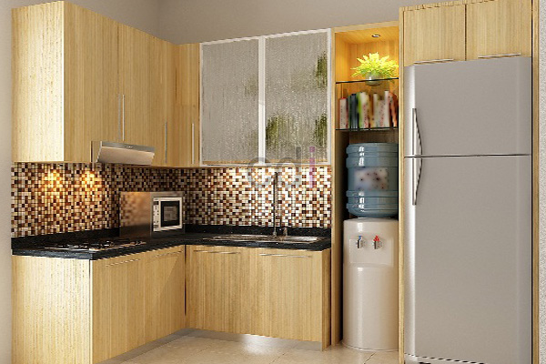

**Harga Borong Kitchen Set Jabodetabek: Estimasi & Pilihan Terbaik 2026** - Halo Mitra CDI! Mencari kitchen set impian di Jabodetabek? Nah, seringkali hal pertama yang bikin bingung adalah soal biaya. Estimasi yang tidak jelas atau biaya tambahan yang muncul di tengah jalan bisa jadi masalah, kan? Tenang, Kami dari Creative Design Interior hadir untuk memberikan solusi.

### Apa Itu Borongan Kitchen Set & Kenapa Memilihnya?

Sistem borongan untuk pembuatan kitchen set itu praktis banget, lho. Anda cukup membayar satu harga yang sudah mencakup semuanya – mulai dari desain, material (kayu, multiplek, HPL, granit, stainless steel, dan lain-lain), ongkos tukang, pengiriman, sampai pemasangan. Jadi, Anda bisa fokus memikirkan desainnya saja, tanpa perlu repot urus detail teknis. Ini hemat waktu dan tenaga banget!

Di Creative Design Interior, Kami mengerti betul pentingnya transparansi. Karena itu, Kami menawarkan layanan borongan *all-in-one* dengan rincian harga yang jelas. Anda akan tahu persis kemana anggaran Anda dialokasikan, tanpa ada biaya tersembunyi yang bikin kaget.

### Estimasi Biaya Borongan Kitchen Set Berdasarkan Jenis Material

Biaya borongan kitchen set itu sangat bervariasi, tergantung bahan apa yang Anda pilih. Setiap material punya harga, kelebihan, dan kekurangan masing-masing. Ini dia perkiraan harganya per meter persegi di tahun 2026:

<table class="table">
  <caption>Estimasi Harga Borong Kitchen Set Per Meter Persegi (2026)</caption>
  <thead>
    <tr><th>Material</th><th>Harga (Rp/m²)</th></tr>
  </thead>
  <tbody>
    <tr><td>Multiplek Melamin</td><td>300.000 – 500.000</td></tr>
    <tr><td>Multiplek HPL</td><td>500.000 – 800.000</td></tr>
    <tr><td>Kayu Solid (Meranti/Jati)</td><td>800.000 – 1.500.000</td></tr>
    <tr><td>Kitchen Set Minimalis (Bahan Kombinasi)</td><td>600.000 – 1.000.000</td></tr>
  </tbody>
</table>

Perlu diingat, harga ini cuma estimasi, ya. Untuk mendapatkan penawaran yang paling akurat sesuai proyek Anda, hubungi Kami sekarang juga! Selain jenis material, biaya total juga dipengaruhi oleh kompleksitas desain, ukuran kitchen set, dan fitur tambahan seperti *kitchen sink*, kompor tanam, atau *cooker hood*.

### Faktor Lain yang Mempengaruhi Harga Borongan

Selain material, ada beberapa hal lain yang perlu Anda perhatikan saat memperkirakan biaya borongan kitchen set. Semakin rumit desainnya – misalnya banyak laci, sudut yang unik, atau detail ukiran – maka akan membutuhkan keahlian dan waktu lebih banyak, yang tentunya berpengaruh pada harga. Ukuran kitchen set juga penting. Area yang lebih luas membutuhkan lebih banyak material dan tenaga kerja, jadi biayanya juga akan lebih tinggi.

Tim desain Kami di Creative Design Interior siap membantu Anda merancang kitchen set impian, sesuai dengan anggaran yang Anda miliki. Kami akan memberikan saran terbaik mengenai material dan desain yang optimal, sehingga Anda mendapatkan kitchen set yang berkualitas tanpa harus khawatir soal biaya. [Harga Dining Table Set: Cek Estimasi & Pilihan Terbaik 2026](/blog/harga-dining-table-set/) untuk referensi desain.

### Proses Pemesanan & Pembayaran yang Mudah Bersama Kami

Kami ingin proses pemesanan dan pembayaran kitchen set Anda jadi lancar dan tanpa ribet. Karena itu, Kami menyediakan beberapa pilihan pembayaran yang fleksibel: COD, transfer bank, DP 50%, transfer setelah barang terkirim, bayar bertahap, atau transfer setelah pekerjaan selesai. Pilih yang paling nyaman buat Anda, ya!

Kami juga menawarkan layanan pengiriman dan pemasangan GRATIS untuk wilayah Jakarta, Bogor, Depok, Tangerang, Bekasi, Cikarang, Karawang, Bandung, Serang, Purwakarta, Cilegon, Cikampek, Subang, dan Rangkasbitung. Tim pemasangan Kami yang berpengalaman akan memastikan kitchen set terpasang dengan rapi dan sesuai dengan desain yang telah disepakati. Kalau ada ketidaksesuaian, produk bisa ditukar (selama belum dipakai atau dibongkar dan maksimal 1 hari).

Yuk, konsultasikan kebutuhan kitchen set Anda sekarang! Gunakan tombol **Telepon** atau **WhatsApp** di bawah ini untuk menghubungi Kami. Jangan ragu untuk bertanya, ya! [Biaya Bikin Kitchen Set: Estimasi, Material, dan Tips Hemat di Jabodetabek](/blog/biaya-bikin-kitchen-set/) bisa jadi panduan tambahan sebelum berkonsultasi.