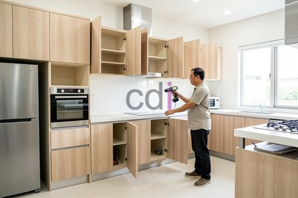

**Berapa Harga Buat Kitchen Cabinet? Estimasi Biaya & Tips 2026** - Hai Mitra CDI! Apakah Anda sedang merencanakan renovasi dapur dan bertanya-tanya soal biaya kitchen cabinet? Dapur yang tertata apik dengan kitchen cabinet yang pas tentu jadi impian setiap pemilik rumah. Memilih yang tepat memang perlu pertimbangan matang. Artikel ini akan mengulas tuntas mengenai estimasi biaya, faktor-faktor penentu harga, serta tips memilih kitchen cabinet ideal untuk Anda.

Investasi pada kitchen cabinet bukan cuma soal estetika. Fungsionalitas dan kualitas material adalah kunci utama. Nah, kami akan bantu Anda memahami seluk-beluk harga kitchen cabinet agar sesuai dengan anggaran dan kebutuhan di (not detected).

## Estimasi Harga Kitchen Cabinet Berdasarkan Material

Harga kitchen cabinet bervariasi signifikan tergantung material yang dipilih. Ada beberapa pilihan populer, masing-masing dengan kelebihan dan kekurangannya. Material multipleks (plywood) dengan finishing HPL (High Pressure Laminate) adalah opsi yang paling ekonomis, dengan kisaran harga Rp 800.000 hingga Rp 1.500.000 per meter lari. Material ini mudah dibersihkan dan cukup awet, namun kurang ideal jika sering terpapar kelembapan.

Untuk kualitas yang lebih baik, material MDF (Medium Density Fiberboard) dengan finishing HPL atau *melamin* bisa menjadi pilihan. Harga kitchen cabinet dari MDF berkisar antara Rp 1.200.000 hingga Rp 2.000.000 per meter lari. MDF lebih halus permukaannya dan cocok untuk desain rumit. Sama seperti multipleks, hindari kontak langsung dengan air ya, Mitra!

Bagi Anda yang menginginkan kitchen cabinet tahan lama dan berkelas, kayu solid seperti kayu jati atau merbau adalah jawabannya. Tentu saja, harganya lebih tinggi, mulai dari Rp 2.500.000 hingga Rp 5.000.000 atau lebih per meter lari, tergantung jenis kayu dan kerumitan desain. Kayu solid menawarkan kekuatan, keawetan, serta keindahan serat alami yang tak tertandingi.

## Faktor Penting yang Mempengaruhi Biaya Kitchen Cabinet

Selain material utama, ada beberapa faktor lain yang juga memengaruhi harga kitchen cabinet, di antaranya:

*   **Ukuran dan Kompleksitas Desain:** Semakin luas dapur dan semakin rumit desain cabinet (misalnya, banyak laci, rak terbuka, atau sudut khusus), biayanya akan lebih tinggi.
*   **Jenis Finishing:** Finishing HPL atau *melamin* umumnya lebih terjangkau dibandingkan finishing cat duco yang lebih mewah atau *varnish* yang tahan lama.
*   **Aksesori Tambahan:** Penggunaan engsel *soft close*, rel laci *telescopic*, lampu LED, atau aksesori lainnya tentu akan menambah biaya produksi.
*   **Lokasi dan Biaya Operasional:** Harga kitchen cabinet juga bisa sedikit berbeda tergantung lokasi Anda di (not detected) karena perbedaan biaya transportasi dan tenaga kerja.

Berikut tabel estimasi biaya berdasarkan luas dapur untuk memudahkan Anda memperkirakan anggaran:

<table class="table">
  <caption>Estimasi Biaya Kitchen Cabinet (Estimasi 2026)</caption>
  <thead>
    <tr><th>Luas Dapur</th><th>Material HPL/Melamin (Rp)</th><th>Material Kayu Solid (Rp)</th></tr>
  </thead>
  <tbody>
    <tr><td>2x3 meter</td><td>4.800.000 - 9.000.000</td><td>12.000.000 - 24.000.000</td></tr>
    <tr><td>3x4 meter</td><td>7.200.000 - 14.400.000</td><td>18.000.000 - 36.000.000</td></tr>
    <tr><td>4x5 meter</td><td>9.600.000 - 20.000.000</td><td>24.000.000 - 48.000.000</td></tr>
  </tbody>
</table>

Perlu diingat, harga di atas hanyalah estimasi. Untuk mendapatkan penawaran yang lebih akurat sesuai kebutuhan proyek Anda di (not detected), yuk hubungi Kami! Daftar Harga juga tersedia untuk referensi Anda.

## Creative Design Interior: Solusi Kitchen Cabinet Lengkap

Kami di Creative Design Interior hadir untuk mewujudkan dapur impian Anda dengan solusi kitchen cabinet *all-in-one*. Dengan pengalaman lebih dari 10 tahun di bidang desain interior dan pembuatan furniture custom, kami siap membantu Anda dari tahap perencanaan hingga pemasangan.

Kami menawarkan beragam pilihan material, desain, dan finishing yang bisa disesuaikan dengan anggaran dan selera Anda. Layanan kami meliputi desain 3D, pembuatan, pengiriman, dan pemasangan yang profesional. Kami juga menyediakan berbagai pilihan metode pembayaran yang fleksibel, seperti COD, transfer bank, DP 50%, transfer setelah barang terkirim, bayar bertahap, atau transfer setelah pekerjaan selesai. Kami siap melayani proyek di Jakarta, Bogor, Depok, Tangerang, Bekasi, Cikarang, Karawang, Bandung, Serang, Purwakarta, Cilegon, Cikampek, Subang, dan Rangkasbitung.

## Kemudahan Pemesanan dan Kualitas Terjamin dari CDI

Memilih kitchen cabinet dari Creative Design Interior sangat mudah. Anda bisa melihat Daftar Harga untuk mengetahui perkiraan biaya. Tim desain kami juga siap membantu Anda dalam memilih material dan desain yang ideal. Kami mengutamakan kualitas dan ketepatan waktu dalam pengerjaan, dengan sistem kerja yang terjadwal dan tim yang berpengalaman. Produk dapat ditukar jika tidak sesuai spesifikasi (selama belum digunakan atau dibongkar) dalam waktu maksimal 1 hari.

Jadi, tunggu apa lagi? Percayakan kebutuhan kitchen cabinet Anda kepada Creative Design Interior dan nikmati dapur impian yang fungsional dan cantik. Untuk konsultasi lebih lanjut, silakan gunakan tombol **Telepon** atau **WhatsApp** di bawah ini. Kami siap melayani Anda! [Berapa Biaya Ngecor Rumah? Estimasi Lengkap 2026](/blog/berapa-biaya-ngecor-rumah/) bisa menjadi referensi lainnya untuk proyek konstruksi Anda.