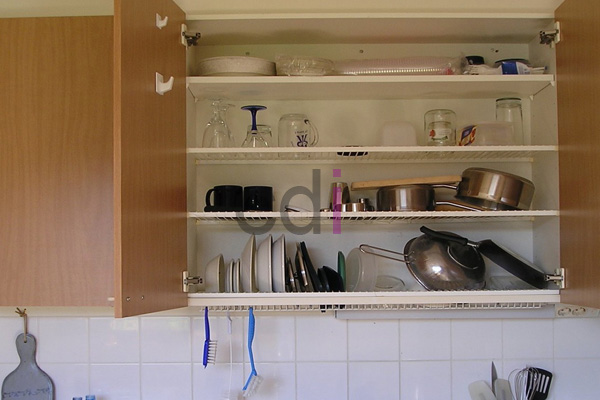

**Harga Bufet Rak Piring: Cek Estimasi & Pesan Custom di Jabodetabek** - Mitra CDI yang berbahagia, menentukan harga bufet rak piring memerlukan pertimbangan berbagai faktor, mulai dari material hingga desain. Kami di Creative Design Interior siap membantu Anda menemukan solusi yang sesuai dengan anggaran dan kebutuhan ruangan Anda. Bufet rak piring adalah investasi penting untuk dapur yang tertata rapi dan fungsional.

## Memahami Faktor Penentu Harga Bufet Rak Piring

Harga bufet rak piring sangat dipengaruhi oleh bahan baku yang digunakan. Material seperti kayu solid (jati, mahoni) tentu akan lebih mahal dibandingkan material olahan seperti MDF atau multipleks. Selain itu, desain yang rumit dengan banyak detail ukiran atau finishing khusus juga akan meningkatkan biaya produksi. Ukuran bufet juga berperan penting; bufet yang lebih besar membutuhkan lebih banyak material dan tenaga kerja. 

Sebagai gambaran, harga bufet rak piring dengan material MDF dan finishing HPL biasanya mulai dari Rp 1.500.000 hingga Rp 3.000.000. Sementara itu, bufet rak piring berbahan kayu solid dengan finishing melamin atau vernis dapat mencapai Rp 5.000.000 hingga Rp 15.000.000 atau lebih, tergantung ukuran dan tingkat kesulitan desain. Harga ini bersifat estimasi dan dapat berubah sewaktu-waktu — hubungi Kami untuk penawaran terbaru dan paling akurat sesuai kebutuhan proyek Mitra CDI.

## Pilihan Material Bufet Rak Piring dan Estimasi Biaya

Berikut adalah tabel perbandingan beberapa material umum yang digunakan dalam pembuatan bufet rak piring beserta estimasi biayanya per meter persegi:

<table class="table">
  <caption>Perbandingan Material Bufet Rak Piring</caption>
  <thead>
    <tr><th>Material</th><th>Kelebihan</th><th>Kekurangan</th><th>Estimasi Harga/m²</th></tr>
  </thead>
  <tbody>
    <tr><td>MDF</td><td>Harga terjangkau, mudah dibentuk</td><td>Kurang tahan lama, rentan terhadap kelembapan</td><td>Rp 300.000 - Rp 600.000</td></tr>
    <tr><td>Multipleks</td><td>Lebih kuat dari MDF, harga sedang</td><td>Permukaan kurang halus, perlu finishing tambahan</td><td>Rp 500.000 - Rp 800.000</td></tr>
    <tr><td>Kayu Solid (Jati)</td><td>Kuat, tahan lama, tampilan mewah</td><td>Harga mahal, memerlukan perawatan rutin</td><td>Rp 1.500.000 - Rp 3.000.000</td></tr>
    <tr><td>Kayu Solid (Mahoni)</td><td>Lebih terjangkau dari jati, tampilan menarik</td><td>Kurang tahan terhadap hama</td><td>Rp 1.000.000 - Rp 2.000.000</td></tr>
  </tbody>
</table>

Perlu diingat bahwa estimasi harga di atas hanya mencakup biaya material dan belum termasuk biaya desain, finishing, pengiriman, dan pemasangan. Kami di Creative Design Interior menyediakan skema harga *all in one* yang mencakup seluruh biaya tersebut, sehingga Anda tidak perlu khawatir akan biaya tersembunyi.

## Bufet Rak Piring Custom: Solusi Terbaik untuk Ruang Dapur Anda

Selain bufet rak piring standar, Kami juga menawarkan layanan pembuatan bufet custom sesuai dengan desain dan ukuran yang Anda inginkan. Dengan bufet custom, Anda dapat memaksimalkan ruang dapur Anda dan menciptakan tampilan yang unik dan personal. Kami memiliki tim desain yang berpengalaman yang siap membantu Anda mewujudkan ide-ide kreatif Anda.

Kami berpengalaman lebih dari 10 tahun dalam pembuatan furniture custom, termasuk kitchen set dan bufet rak piring. Tim kerja Kami terlatih dan bekerja secara terjadwal untuk memastikan pengerjaan tepat waktu dan kualitas terjaga. Produk dapat ditukar jika tidak sesuai spesifikasi, selama belum dipakai atau dibongkar dan maksimal 1 hari. Untuk mengetahui daftar harga lengkap dan pilihan material yang tersedia, Anda dapat mengunjungi [halaman Daftar Harga](/daftar-harga/).

## Kemudahan Pemesanan dan Pembayaran di Creative Design Interior

Kami memahami bahwa proses pemesanan dan pembayaran yang mudah adalah hal penting bagi pelanggan. Oleh karena itu, Kami menyediakan berbagai pilihan pembayaran yang fleksibel, termasuk COD, transfer bank, DP 50%, transfer setelah barang terkirim, bayar bertahap, atau transfer setelah pekerjaan selesai. Kami juga melayani pengiriman ke seluruh wilayah Jabodetabek, Bandung, Serang, Purwakarta, Cilegon, Cikampek, Subang, dan Rangkasbitung. Bahkan, tersedia gratis ongkir untuk beberapa wilayah layanan Kami.

Apabila masih terdapat hal yang ingin ditanyakan, jangan ragu menghubungi Kami melalui tombol **WhatsApp** atau **Telepon** pada halaman ini.
