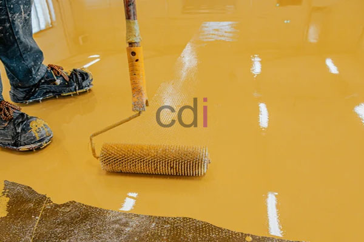

**Harga Cat Coating Lantai: Berapa Biaya & Apa Saja Pilihan Terbaik?** - Mitra CDI yang terhormat, biaya untuk melapisi lantai dengan *coating* sangat bervariasi, umumnya berkisar antara Rp 150.000 hingga Rp 800.000 per meter persegi. Perbedaan harga ini dipengaruhi oleh jenis *coating* yang dipilih, luas area yang akan dilapisi, serta kompleksitas persiapan permukaan. Artikel ini akan membahas secara rinci faktor-faktor yang memengaruhi harga, jenis-jenis *coating* lantai yang populer, dan estimasi biayanya.

## Mengapa Lantai Perlu Dilapisi *Coating*?

*Coating* lantai adalah lapisan pelindung yang diterapkan pada permukaan lantai untuk meningkatkan daya tahan, estetika, dan fungsionalitasnya. Ada beberapa alasan utama mengapa Anda perlu mempertimbangkan penggunaan *coating*:

*   **Perlindungan Terhadap Abrasi:** *Coating* melindungi lantai dari goresan, lecet, dan keausan akibat aktivitas sehari-hari. Ini sangat penting untuk area dengan lalu lintas tinggi seperti garasi, gudang, atau pabrik.
*   **Ketahanan Kimia:** *Coating* tertentu tahan terhadap bahan kimia, minyak, dan pelarut, sehingga ideal untuk area seperti bengkel, laboratorium, atau dapur industri.
*   **Mudah Dibersihkan:** Permukaan yang dilapisi *coating* umumnya lebih mudah dibersihkan dan dirawat dibandingkan lantai tanpa lapisan pelindung.
*   **Estetika:** *Coating* tersedia dalam berbagai warna dan tekstur, sehingga dapat meningkatkan tampilan visual lantai.

## Jenis-Jenis Cat *Coating* Lantai dan Estimasi Harganya

Ada beberapa jenis *coating* lantai yang umum digunakan di Indonesia. Berikut adalah beberapa di antaranya:

*   **Epoxy *Coating*:** Epoxy adalah pilihan yang sangat populer karena daya tahannya yang tinggi, ketahanan terhadap bahan kimia, dan kemampuannya untuk menahan beban berat. Epoxy *coating* sering digunakan di garasi, pabrik, gudang, dan area komersial. Harga epoxy *coating* berkisar antara Rp 250.000 – Rp 600.000 per meter persegi, tergantung pada jenis epoxy dan ketebalan lapisan.
*   **Polyurethane *Coating*:** Polyurethane *coating* menawarkan fleksibilitas yang lebih baik daripada epoxy, sehingga lebih tahan terhadap retak dan pergeseran. Jenis ini juga memiliki ketahanan yang baik terhadap sinar UV, sehingga cocok untuk area outdoor. Biaya polyurethane *coating* umumnya berada di kisaran Rp 200.000 – Rp 500.000 per meter persegi.
*   **Acrylic *Coating*:** Acrylic *coating* adalah pilihan yang lebih terjangkau dan mudah diaplikasikan. Namun, daya tahannya tidak sekuat epoxy atau polyurethane. Acrylic *coating* sering digunakan untuk lantai beton interior yang tidak memerlukan perlindungan intensif. Harga acrylic *coating* berkisar antara Rp 150.000 – Rp 350.000 per meter persegi.

## Faktor-Faktor yang Mempengaruhi Harga *Coating* Lantai

Selain jenis *coating*, ada beberapa faktor lain yang dapat memengaruhi harga:

*   **Luas Area:** Semakin luas area yang akan dilapisi, semakin tinggi biaya totalnya. Namun, biasanya ada diskon untuk proyek dengan luas area yang besar.
*   **Kondisi Permukaan:** Jika permukaan lantai memerlukan perbaikan sebelum *coating* diaplikasikan (misalnya, perbaikan retakan atau pengamplasan), biaya tambahan akan dikenakan.
*   **Persiapan Permukaan:** Proses persiapan permukaan seperti pembersihan, pengamplasan, dan priming juga menambah biaya.
*   **Metode Aplikasi:** Metode aplikasi yang berbeda (misalnya, *spray*, kuas, atau roller) dapat memengaruhi biaya tenaga kerja.
*   **Penyedia Jasa:** Setiap penyedia jasa memiliki struktur harga yang berbeda.

Kami di Creative Design Interior menawarkan skema harga *all in one* untuk jasa *coating* lantai, yang sudah termasuk material, tenaga kerja, dan pengiriman. Untuk mendapatkan penawaran harga yang paling akurat sesuai kebutuhan proyek Anda, [silakan kunjungi halaman Daftar Harga](/daftar-harga/) kami.

Kami juga menyediakan layanan konsultasi gratis untuk membantu Anda memilih jenis *coating* yang paling sesuai dengan anggaran dan kebutuhan Anda. Jangan ragu untuk menghubungi Kami melalui tombol **WhatsApp** atau **Telepon** pada halaman ini.
