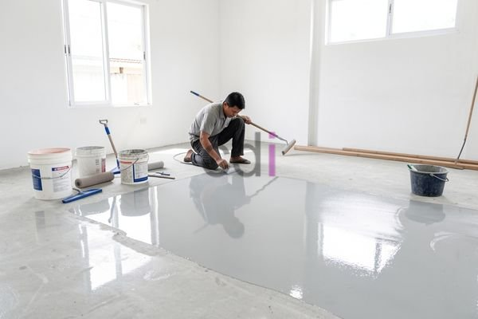

**Harga Cat Epoxy 1kg: Panduan Cerdas untuk Hasil Optimal** - Mitra CDI di mana pun berada, pernahkah Mitra mempertimbangkan penggunaan cat epoxy untuk lantai atau permukaan lainnya? Permintaan akan cat epoxy meningkat pesat dalam beberapa tahun terakhir, dengan pertumbuhan pasar global mencapai 8,5% pada tahun 2023. Hal ini menunjukkan bahwa semakin banyak orang menyadari keunggulan epoxy sebagai lapisan pelindung yang tahan lama dan estetis. Artikel ini akan memberikan panduan komprehensif mengenai harga cat epoxy 1kg, jenis-jenis yang tersedia, serta bagaimana Kami di Creative Design Interior dapat membantu Mitra mewujudkan proyek impian.

## Memahami Rentang Harga Cat Epoxy 1kg

Mitra CDI, harga cat epoxy 1kg sangat bervariasi, dipengaruhi oleh beberapa faktor utama. Secara umum, harga bisa berkisar antara Rp 150.000 hingga Rp 800.000 per kilogram, tergantung pada merek, jenis, dan kualitasnya. Cat epoxy dengan kualitas standar mungkin tersedia di rentang harga terendah, sementara produk dengan performa tinggi, seperti epoxy resin khusus untuk industri atau aplikasi kelautan, akan lebih mahal.

Faktor-faktor yang mempengaruhi harga antara lain:

*   **Jenis Resin:** Epoxy resin yang digunakan sebagai dasar cat sangat memengaruhi harga. Resin dengan kualitas lebih tinggi menawarkan ketahanan yang lebih baik terhadap abrasi, bahan kimia, dan suhu ekstrem.
*   **Kandungan Padatan:** Semakin tinggi kandungan padatan dalam cat epoxy, semakin tebal lapisan yang dihasilkan dan semakin baik daya tahannya. Namun, cat dengan kandungan padatan tinggi biasanya lebih mahal.
*   **Aditif:** Penambahan aditif tertentu, seperti pigmen khusus, anti-UV, atau bahan anti-slip, dapat meningkatkan harga cat epoxy.
*   **Merek:** Merek-merek terkenal dengan reputasi baik cenderung menawarkan harga yang lebih tinggi dibandingkan merek yang kurang dikenal.

Harga ini bersifat estimasi dan dapat berubah sewaktu-waktu — hubungi Kami untuk penawaran terbaru dan paling akurat sesuai kebutuhan proyek Mitra CDI.

## Perbandingan Jenis Cat Epoxy dan Harganya

Untuk membantu Mitra CDI memahami lebih lanjut, berikut adalah perbandingan beberapa jenis cat epoxy yang umum digunakan beserta perkiraan harganya per kilogram:

<table class="table">
  <caption>Perbandingan Jenis Cat Epoxy</caption>
  <thead>
    <tr><th>Jenis Epoxy</th><th>Kelebihan</th><th>Kekurangan</th><th>Estimasi Harga/kg</th></tr>
  </thead>
  <tbody>
    <tr><td>Epoxy Standar</td><td>Harga terjangkau, mudah diaplikasikan</td><td>Kurang tahan terhadap bahan kimia kuat, tidak cocok untuk lalu lintas tinggi</td><td>Rp 150.000 - Rp 300.000</td></tr>
    <tr><td>Epoxy Self-Leveling</td><td>Permukaan sangat halus dan rata, tampilan estetis</td><td>Memerlukan persiapan permukaan yang sangat baik, waktu pengeringan lebih lama</td><td>Rp 300.000 - Rp 500.000</td></tr>
    <tr><td>Epoxy Novolac</td><td>Tahan terhadap bahan kimia ekstrem, suhu tinggi, dan abrasi</td><td>Harga lebih mahal, memerlukan keahlian khusus untuk aplikasi</td><td>Rp 500.000 - Rp 800.000</td></tr>
  </tbody>
</table>

Selain jenis-jenis di atas, terdapat juga cat epoxy khusus yang dirancang untuk aplikasi tertentu, seperti epoxy lantai gudang, epoxy lantai garasi, atau epoxy lantai kamar mandi. Pemilihan jenis epoxy yang tepat sangat penting untuk memastikan hasil akhir yang optimal dan tahan lama. Kami di Creative Design Interior siap membantu Mitra CDI memilih jenis epoxy yang paling sesuai dengan kebutuhan proyek.

## Mengapa Memilih Creative Design Interior untuk Kebutuhan Epoxy Mitra?

Mitra CDI, Kami di Creative Design Interior tidak hanya menyediakan material berkualitas tinggi, tetapi juga menawarkan solusi *all-in-one* untuk proyek pengecatan epoxy Mitra. Dengan pengalaman lebih dari 10 tahun di bidang furniture interior, material bangunan, dan jasa pengecoran, Kami memahami betul pentingnya kualitas dan ketepatan waktu. Kami menawarkan skema harga *all-in-one* yang sudah termasuk material, pengiriman, dan bongkar muat, sehingga Mitra tidak perlu khawatir tentang biaya tersembunyi.

Kami hadir di wilayah Jakarta, Bogor, Depok, Tangerang, Bekasi, Cikarang, Karawang, Bandung, Serang, Purwakarta, Cilegon, Cikampek, Subang, dan Rangkasbitung. Tim Kami yang berpengalaman bekerja dengan sistem terjadwal untuk memastikan pengerjaan tepat waktu dan kualitas terjaga. Produk yang Kami sediakan dapat ditukar jika tidak sesuai spesifikasi, selama belum dipakai atau dibongkar dan maksimal 1 hari. Untuk mengetahui daftar harga lengkap dan penawaran khusus, silakan kunjungi [halaman Daftar Harga](/daftar-harga/).

Selain itu, Kami juga menyediakan jasa pengecatan epoxy profesional. [Tersedia Jasa Cat Epoxy: Cara Buat Cat Epoxy Profesional](/blog/cara-buat-cat-epoxy/) akan memberikan informasi lebih mendalam mengenai layanan ini. Kami menjamin hasil pengecatan yang rapi, tahan lama, dan sesuai dengan harapan Mitra. Jika Mitra membutuhkan bantuan lebih lanjut dalam memilih jenis cat epoxy yang tepat atau ingin mendapatkan penawaran harga khusus, jangan ragu untuk menghubungi Kami.

Membutuhkan bantuan langsung untuk kebutuhan proyek Mitra CDI? Silakan klik tombol **WhatsApp** atau **Telepon** di bawah untuk berkonsultasi dengan tim Kami.
