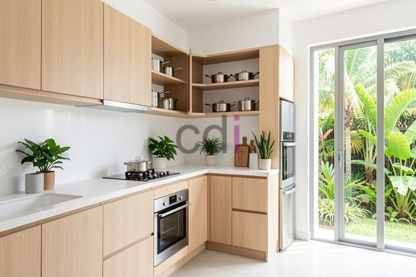

**Harga Chicken Set Dapur: Sebelum Memesan, Cek Estimasi Biaya 2026** - Mitra CDI di mana pun berada, pernahkah Anda membayangkan dapur yang tertata rapi, fungsional, dan sesuai dengan gaya Anda? Chicken set dapur, atau yang lebih dikenal dengan kitchen set, adalah solusi tepat untuk mewujudkan impian tersebut. Namun, sebelum memutuskan untuk membeli atau memesan, penting untuk memahami perkiraan biayanya agar sesuai dengan anggaran Anda.

### Memahami Komponen Harga Chicken Set Dapur

Harga chicken set dapur tidak bisa ditentukan secara pasti tanpa mengetahui beberapa faktor penting. Material yang digunakan adalah penentu utama biaya. Pilihan material yang paling umum meliputi multiplek (MDF), particle board, kayu solid, dan stainless steel. Masing-masing material menawarkan kelebihan dan kekurangan tersendiri, baik dari segi harga, durabilitas, maupun estetika. 

Sebagai gambaran, chicken set dengan material multiplek berlapis *HPL* (High Pressure Laminate) biasanya menjadi pilihan paling ekonomis. Sementara itu, penggunaan kayu solid seperti jati atau mahoni akan menghasilkan kitchen set yang lebih mewah dan tahan lama, tetapi dengan harga yang lebih tinggi. Stainless steel seringkali menjadi pilihan untuk kitchen set modern dan minimalis, dengan keunggulan dalam hal kebersihan dan perawatan.

Selain material, dimensi dan kompleksitas desain juga memengaruhi harga. Kitchen set dengan bentuk yang rumit, banyak laci dan rak, serta fitur tambahan seperti *pull-out system* atau pencahayaan LED tentu akan lebih mahal dibandingkan dengan desain yang sederhana.

### Estimasi Biaya Chicken Set Dapur Berdasarkan Material

Untuk memberikan gambaran yang lebih jelas, berikut ini estimasi biaya chicken set dapur berdasarkan material (harga ini bersifat estimasi dan dapat berubah sewaktu-waktu — hubungi Kami untuk penawaran terbaru dan paling akurat sesuai kebutuhan proyek Mitra CDI):

<table class="table">
  <caption>Estimasi Harga Chicken Set Dapur Berdasarkan Material (per meter lari)</caption>
  <thead>
    <tr><th>Material</th><th>Estimasi Harga (Rp)</th><th>Kelebihan</th><th>Kekurangan</th></tr>
  </thead>
  <tbody>
    <tr><td>Multiplek (MDF) HPL</td><td>Rp 800.000 – Rp 1.500.000</td><td>Harga terjangkau, banyak pilihan warna dan motif</td><td>Kurang tahan terhadap kelembaban dan benturan</td></tr>
    <tr><td>Particle Board Melamin</td><td>Rp 600.000 – Rp 1.200.000</td><td>Pilihan termurah, mudah dibersihkan</td><td>Kurang kuat dan tahan lama, mudah mengembang jika terkena air</td></tr>
    <tr><td>Kayu Solid (Jati/Mahoni)</td><td>Rp 2.500.000 – Rp 5.000.000+</td><td>Tahan lama, tampilan mewah, bisa diperbaiki</td><td>Harga mahal, perawatan khusus</td></tr>
    <tr><td>Stainless Steel</td><td>Rp 1.800.000 – Rp 3.500.000</td><td>Higienis, mudah dibersihkan, tahan karat</td><td>Tampak dingin, harga relatif tinggi</td></tr>
  </tbody>
</table>

Perlu diingat bahwa estimasi harga di atas adalah per meter lari. Jadi, untuk menghitung total biaya, Anda perlu mengetahui panjang kitchen set yang Anda inginkan. Selain itu, harga tersebut belum termasuk biaya tambahan seperti pemasangan, pengiriman, dan desain.

### Creative Design Interior: Solusi Chicken Set Dapur All-in-One

Kami di Creative Design Interior memahami bahwa setiap kebutuhan dapur berbeda-beda. Itulah mengapa Kami menawarkan layanan pembuatan chicken set dapur *custom* yang dapat disesuaikan dengan anggaran, selera, dan kebutuhan Anda. Kami berpengalaman lebih dari 10 tahun dalam memproduksi furniture interior berkualitas tinggi, termasuk kitchen set, lemari, meja, dan dipan.

Kami menyediakan skema harga *all-in-one* yang sudah termasuk material, pengiriman, dan bongkar muat. Kami juga menawarkan gratis ongkir untuk wilayah tertentu. Untuk pembayaran, Anda dapat memilih berbagai opsi, termasuk COD, transfer bank, DP 50%, transfer setelah barang terkirim, bayar bertahap, atau transfer setelah pekerjaan selesai.

Kami melayani wilayah Jakarta, Bogor, Depok, Tangerang, Bekasi, Cikarang, Karawang, Bandung, Serang, Purwakarta, Cilegon, Cikampek, Subang, dan Rangkasbitung. Tim Kami yang berpengalaman akan memastikan pengerjaan tepat waktu dan kualitas terjaga, dengan sistem kerja terjadwal. Produk dapat ditukar jika tidak sesuai spesifikasi, selama belum dipakai atau dibongkar dan maksimal 1 hari.

Membutuhkan bantuan langsung untuk kebutuhan proyek Anda? Silakan klik tombol **WhatsApp** atau **Telepon** di bawah untuk berkonsultasi dengan tim Kami.
