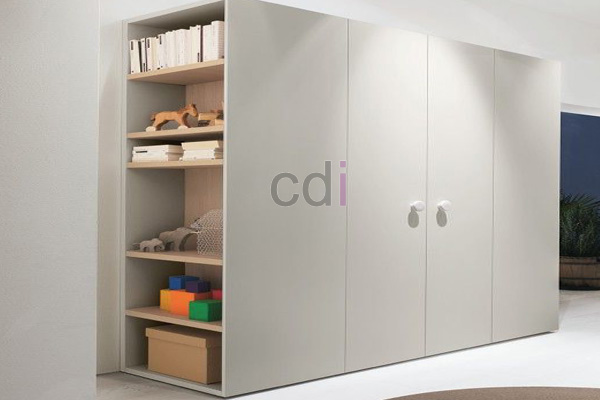

**Harga Custom Lemari Pakaian: Atasi Ruang Sempit dengan Desain Impian** - Mitra CDI di mana pun berada, memiliki ruang penyimpanan yang efisien adalah kunci kenyamanan rumah. Lemari pakaian custom hadir sebagai solusi cerdas untuk memaksimalkan area yang tersedia.

Memilih lemari pakaian yang tepat seringkali menjadi tantangan, terutama jika Anda memiliki ruang terbatas atau preferensi desain yang unik. Lemari pakaian custom menawarkan fleksibilitas tak tertandingi, memungkinkan Anda menyesuaikan ukuran, bentuk, material, dan fitur internal sesuai kebutuhan spesifik Anda. Dengan demikian, Anda tidak perlu lagi berkompromi antara fungsi dan estetika.

## Estimasi Harga Custom Lemari Pakaian: Faktor Penentu Biaya

Harga custom lemari pakaian dipengaruhi oleh beberapa faktor utama. Material yang digunakan adalah salah satu penentu biaya paling signifikan. Pilihan material yang populer meliputi kayu solid (seperti jati, mahoni, atau pinus), multipleks dengan finishing HPL atau melamin, dan material alternatif seperti MDF. Kayu solid umumnya memiliki harga yang lebih tinggi dibandingkan multipleks atau MDF, namun menawarkan durabilitas dan estetika yang tak tertandingi. Ketebalan material juga berpengaruh; semakin tebal material, semakin kuat dan tahan lama lemari, tetapi juga semakin tinggi biayanya.

Selain material, ukuran dan kompleksitas desain juga memengaruhi harga. Lemari pakaian dengan ukuran besar atau desain rumit dengan banyak laci, rak, dan fitur tambahan tentu akan lebih mahal dibandingkan lemari pakaian dengan desain sederhana. Jasa desain dan pemasangan juga merupakan komponen biaya yang perlu dipertimbangkan. Kami di Creative Design Interior menawarkan layanan *all-in-one* yang mencakup desain, pembuatan, pengiriman, dan pemasangan, sehingga Anda tidak perlu repot mencari penyedia jasa yang berbeda.

Sebagai gambaran, harga custom lemari pakaian berkisar antara Rp 2.500.000 hingga Rp 15.000.000 per meter persegi, tergantung pada material, desain, dan kompleksitasnya. Harga ini bersifat estimasi dan dapat berubah sewaktu-waktu — hubungi Kami untuk penawaran terbaru dan paling akurat sesuai kebutuhan proyek Anda.

## Pilihan Material untuk Lemari Pakaian Custom: Keunggulan dan Perbandingan

Memilih material yang tepat untuk lemari pakaian custom Anda adalah keputusan penting. Berikut adalah perbandingan beberapa material yang umum digunakan:

<table class="table">
  <caption>Perbandingan Material Lemari Pakaian</caption>
  <thead>
    <tr><th>Material</th><th>Keunggulan</th><th>Kekurangan</th><th>Estimasi Harga (per meter persegi)</th></tr>
  </thead>
  <tbody>
    <tr><td>Kayu Solid (Jati)</td><td>Tahan lama, estetika tinggi, kuat</td><td>Mahal, rentan terhadap perubahan cuaca</td><td>Rp 8.000.000 - Rp 15.000.000</td></tr>
    <tr><td>Multipleks (HPL/Melamin)</td><td>Lebih terjangkau, pilihan warna dan motif beragam, mudah dibersihkan</td><td>Kurang tahan lama dibandingkan kayu solid, kualitas tergantung pada kualitas multipleks</td><td>Rp 3.000.000 - Rp 7.000.000</td></tr>
    <tr><td>MDF</td><td>Permukaan halus, mudah dipotong dan dibentuk, harga paling terjangkau</td><td>Kurang tahan air, mudah rusak jika terkena benturan keras</td><td>Rp 2.500.000 - Rp 5.000.000</td></tr>
  </tbody>
</table>

Perlu diingat bahwa harga di atas hanyalah estimasi. Harga sebenarnya dapat bervariasi tergantung pada kualitas material, pemasok, dan lokasi Anda. Kami siap membantu Anda memilih material yang paling sesuai dengan anggaran dan kebutuhan Anda.

## Mendesain Lemari Pakaian Custom: Maksimalkan Fungsionalitas dan Estetika

Desain lemari pakaian custom harus mempertimbangkan kebutuhan penyimpanan Anda dan gaya interior rumah Anda. Pertimbangkan jenis pakaian yang akan disimpan (pakaian gantung, lipat, sepatu, aksesori), jumlah anggota keluarga, dan ketersediaan ruang.

Untuk ruang yang terbatas, lemari pakaian dengan desain *built-in* atau lemari pakaian *walk-in* dapat menjadi solusi cerdas. Lemari pakaian dengan cermin dapat membantu menciptakan ilusi ruang yang lebih luas. Anda juga dapat menambahkan fitur-fitur seperti rak tarik, laci dengan pembagi, gantungan khusus untuk dasi dan ikat pinggang, serta pencahayaan internal untuk memudahkan Anda menemukan barang yang Anda cari.

Kami menyediakan layanan desain gratis untuk membantu Anda menciptakan lemari pakaian custom yang sesuai dengan impian Anda. Tim desain kami akan bekerja sama dengan Anda untuk memahami kebutuhan Anda dan menciptakan desain yang fungsional, estetis, dan sesuai dengan anggaran Anda. [Temukan inspirasi desain di halaman portfolio Kami](/daftar-harga/).

## Kemudahan Pemesanan dan Pembayaran Lemari Pakaian Custom di Creative Design Interior

Kami memahami bahwa proses pemesanan dan pembayaran dapat menjadi hal yang merepotkan. Oleh karena itu, Kami menawarkan kemudahan pemesanan dan pembayaran untuk memberikan pengalaman yang nyaman bagi pelanggan Kami. Anda dapat memesan lemari pakaian custom melalui tombol **WhatsApp** atau **Telepon** pada halaman ini. Setelah desain disetujui, Kami akan memberikan penawaran harga yang rinci dan jelas.

Kami menerima berbagai pilihan pembayaran, termasuk COD, transfer bank, DP 50%, transfer setelah barang terkirim, bayar bertahap, atau transfer setelah pekerjaan selesai. Kami juga menawarkan gratis ongkir untuk wilayah layanan Jabodetabek, Bandung, Serang, Purwakarta, Cilegon, Cikampek, Subang, dan Rangkasbitung. Dengan tim kerja berpengalaman dan sistem kerja terjadwal, Kami memastikan pengerjaan tepat waktu dan kualitas terjaga. Produk dapat ditukar jika tidak sesuai spesifikasi, selama belum dipakai atau dibongkar dan maksimal 1 hari.

Apabila masih terdapat hal yang ingin ditanyakan, jangan ragu menghubungi Kami melalui tombol **WhatsApp** atau **Telepon** pada halaman ini.
