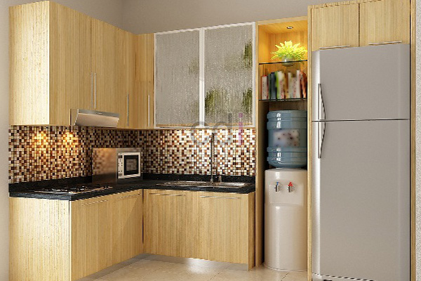

**Tersedia Harga Dapur Kitchen Set Custom Jabodetabek** – Hai Mitra CDI! Punya rencana mempercantik dapur? Kami tahu, menentukan anggaran untuk kitchen set custom seringkali bikin bingung. Banyak yang kesulitan membayangkan berapa biaya yang dibutuhkan untuk dapur impian, apalagi dengan banyaknya pilihan material dan desain. Nah, di sinilah kami hadir untuk membantu! Perencanaan anggaran yang cermat, lho, kunci utama keberhasilan renovasi dapur Anda.

### Apa Saja yang Mempengaruhi Harga Kitchen Set?

Mitra perlu tahu, harga kitchen set itu nggak cuma soal material, tapi banyak faktor yang bermain di dalamnya. Material jelas jadi penentu utama – mulai dari kayu solid yang mewah, multiplek yang praktis, sampai stainless steel yang higienis. Setiap material punya karakteristik dan harga yang berbeda. Ukuran dapur dan tingkat kerumitan desain juga berpengaruh. Bayangkan, dapur luas dengan banyak laci dan sudut unik tentu butuh biaya lebih dibandingkan dapur minimalis yang sederhana.

Selain itu, kualitas *hardware* (engsel, rel laci, handle) juga penting. Hardware berkualitas artinya dapur Anda awet dan nyaman dipakai. Kami di Creative Design Interior selalu menyarankan hardware terpercaya untuk investasi jangka panjang. Pikirkan ini sebagai fondasi kekuatan dapur Anda!

### Kisaran Harga Kitchen Set Berdasarkan Material

Sebagai gambaran, ini dia perkiraan harga kitchen set per meter persegi berdasarkan material yang populer. Penting diingat, ini hanya estimasi ya, harga bisa berubah tergantung detail proyek Anda. Untuk penawaran paling akurat, jangan ragu hubungi Kami!

<table class="table">
  <caption>Estimasi Harga Kitchen Set Per Meter Persegi (Estimasi 2026)</caption>
  <thead>
    <tr><th>Material</th><th>Harga (Per Meter Persegi)</th><th>Keterangan</th></tr>
  </thead>
  <tbody>
    <tr><td>Multiplek Finishing HPL</td><td>Rp 800.000 – Rp 1.200.000</td><td>Pilihan ekonomis, tahan lama, banyak pilihan warna dan motif</td></tr>
    <tr><td>Multiplek Finishing Melamin</td><td>Rp 600.000 – Rp 900.000</td><td>Pilihan lebih ekonomis, cocok untuk budget terbatas</td></tr>
    <tr><td>Kayu Solid (Meranti/Jati)</td><td>Rp 1.500.000 – Rp 3.000.000</td><td>Tampilan premium, tahan lama, membutuhkan perawatan khusus</td></tr>
    <tr><td>Stainless Steel</td><td>Rp 1.200.000 – Rp 2.500.000</td><td>Higienis, mudah dibersihkan, cocok untuk dapur modern</td></tr>
    <tr><td>Aluminium Composite Panel (ACP)</td><td>Rp 700.000 – Rp 1.100.000</td><td>Ringan, tahan air, pilihan warna beragam</td></tr>
  </tbody>
</table>

### Kenapa Pilih Creative Design Interior untuk Kitchen Set Anda?

Di Creative Design Interior, kami menawarkan solusi kitchen set *all-in-one* yang bikin Anda praktis.  Nggak perlu pusing cari tukang kayu, tukang listrik, atau pasang kitchen set sendiri. Semua kami urus! Mulai dari desain hingga pemasangan, kami sediakan layanan lengkap. Harga kami sudah termasuk material berkualitas, tenaga kerja berpengalaman, pengiriman ke seluruh wilayah Jabodetabek, plus bongkar muat.

Dengan pengalaman lebih dari 10 tahun di bidang desain interior, pembuatan furniture, dan pengadaan material bangunan, kami berkomitmen memberikan yang terbaik. Tim kami bekerja sesuai jadwal, memastikan pengerjaan tepat waktu dan kualitas terjaga.  Bagaimana kalau ada yang kurang sesuai? Tenang saja, produk bisa ditukar jika tidak sesuai dengan spesifikasi, selama belum dipakai atau dibongkar, dan maksimal 1 hari setelah penerimaan. Kami juga menyediakan beragam pilihan pembayaran: COD, transfer bank, DP 50%, transfer setelah barang terkirim, bayar bertahap, atau transfer setelah pekerjaan selesai. Fleksibel banget, kan?

### Yuk, Konsultasi Gratis Sekarang!

Pesan kitchen set custom di Creative Design Interior itu gampang banget! Cukup hubungi Kami melalui tombol **Telepon** atau **WhatsApp** yang ada di bawah halaman ini untuk konsultasi gratis. Tim desain kami siap membantu Anda menentukan desain, material, dan anggaran yang pas dengan kebutuhan dan selera Anda. Jangan lupa cek Daftar Harga untuk referensi. Jangan sungkan tanya-tanya kalau ada yang ingin diketahui! Di (not detected) dan sekitarnya, Kami siap melayani Anda. [Harga Custom Kitchen Set Di Abadijaya Depok](/kitchen/harga-custom-kitchen-set-di-abadijaya-depok/) mungkin bisa jadi inspirasi awal untuk desain dapur impian Anda. [Harga Custom Kitchen Set Di Babakan Pasar Bogor](/kitchen/harga-custom-kitchen-set-di-babakan-pasar-bogor/) juga bisa Anda jadikan referensi. Untuk konsultasi lebih lanjut, tombol **Telepon** dan **WhatsApp** di bawah halaman ini bisa langsung Anda klik.